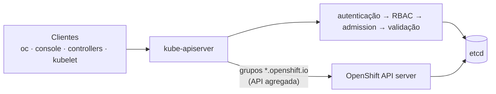

# API Server (kube-apiserver)

> **ID:** 00-fundamentos-e-linguagem/api-server | **Termo original:** API server, kube-apiserver | **Tradução:** servidor de API | **Classe ontológica:** componente | **Plataforma:** Kubernetes; no OpenShift há também o OpenShift API server | **Escopo:** não aplicável (roda no plano de controle) | **Disponibilidade:** nativo | **Versões validadas:** Kubernetes 1.35 / OCP 4.22 | **Nível:** básico → intermediário | **Atualizado em:** 2026-11-04

## Definição em uma frase

O API server é o componente do control plane que **expõe a [API](kubernetes-api.md) do Kubernetes**: recebe todas as requisições, autentica, autoriza, valida e grava o estado no etcd. É a "porta de entrada" do cluster.

## Explicação didática

Se a API é o contrato, o API server é o **atendente** que cumpre esse contrato. Toda conversa passa por ele: a do `oc`, a do console, a dos controllers e a do kubelet. Os outros componentes **não falam entre si** nem tocam no etcd diretamente; leem e escrevem pelo API server.

A implementação principal se chama **kube-apiserver**. Ela foi projetada para **escalar na horizontal**: dá para rodar várias instâncias e balancear o tráfego entre elas.

## Para que existe e qual problema resolve

- **Ponto único de controle:** autenticação, autorização (RBAC), *admission* e validação acontecem num lugar só.
- **Proteção do armazenamento:** só o API server conversa com o etcd. Assim o formato, a consistência e a segurança dos dados ficam centralizados.
- **Notificação de mudanças:** o verbo **watch** permite que controllers recebam alterações em tempo real, sem consultar o tempo todo.

## Funcionamento técnico e ciclo de vida

Caminho de uma requisição de escrita (simplificado):

1. **Autenticação:** quem é você? (certificado, token...)
2. **Autorização:** você pode fazer este verbo neste recurso? (RBAC)
3. **Admission:** controladores de admissão podem **alterar** (*mutating*) ou **rejeitar** (*validating*) o pedido.
4. **Validação do esquema** e aplicação de valores padrão (*defaults*).
5. **Persistência** no etcd, com nova `resourceVersion`.
6. **Notificação** dos clientes que estão em *watch*.

Leituras passam pelos passos 1 e 2 e são atendidas a partir dos dados do etcd (ou de cache).

## Relações e dependências

- Serve a [API](kubernetes-api.md), organizada em [grupos](api-group.md) e [versões](api-version.md).
- Único cliente direto do etcd.
- Clientes: [controllers](controller.md), scheduler, kubelet, `oc`/`kubectl`, console.

## Exemplo de situação real

O `oc` fica lento e alguns comandos dão *timeout*, mas os Pods das aplicações continuam respondendo. O control plane (API server) está com problema, mas os nós continuam rodando o que já estava atribuído. Aplicações em execução não dependem do API server a cada requisição; mudanças e novos agendamentos, sim.

## Como visualizar e inspecionar (somente leitura)

```bash
# Endereço do API server usado pelo contexto atual
oc whoami --show-server

# OpenShift: saúde dos Operators que gerenciam os dois API servers
oc get clusteroperator kube-apiserver openshift-apiserver

# Pods dos API servers (namespaces de plataforma; apenas observar)
oc get pods -n openshift-kube-apiserver
oc get pods -n openshift-apiserver

# Prontidão do API server, com detalhes por verificação (pode exigir permissão)
oc get --raw '/readyz?verbose' | tail -5

# OpenShift: quais grupos de API são atendidos por um serviço agregado
oc get apiservices | grep openshift.io
```

## Como interpretar a saída

- `oc get clusteroperator`: o normal é `AVAILABLE=True`, `PROGRESSING=False`, `DEGRADED=False`. Um `PROGRESSING=True` passageiro é esperado durante a rotação de certificados ou de configuração.
- `/readyz?verbose`: cada linha `[+]nome ok` é uma verificação aprovada; a última linha `readyz check passed` resume. Linhas `[-]` indicam a verificação que falhou.
- `oc get apiservices`: a coluna `SERVICE` mostra quem atende o grupo. `Local` = o próprio kube-apiserver; `<namespace>/<serviço>` = API **agregada**, atendida por outro servidor. A coluna `AVAILABLE` deve estar `True`.

## Diferenças e confusões frequentes

- **API server ≠ API:** um é o componente; a outra, a interface.
- **kube-apiserver ≠ OpenShift API server:** no OCP, o **Kubernetes API server** valida e configura dados como Pods e Services. O **OpenShift API server** valida e configura recursos do OpenShift, como **projects, routes e templates**. O OpenShift API server é gerenciado pelo *OpenShift API Server Operator*. Do lado do cliente, tudo aparece numa **única API**.
- **API server fora do ar ≠ aplicações fora do ar** (ver exemplo).

## No OpenShift 4.22 versus Kubernetes

A documentação do OCP lista no control plane os serviços Kubernetes (API server, etcd, controller manager, scheduler) e os serviços OpenShift (OpenShift API server, OpenShift controller manager, OpenShift OAuth API server, OpenShift OAuth server). Parte deles roda como **static pods**; o CRI-O e o kubelet rodam como serviços **systemd** no host.

## No HomeLab SNO

Há uma só instância de cada API server, porque há um só nó de control plane. Uma reinicialização do API server (por exemplo, ao rotacionar certificados) deixa a API indisponível por alguns instantes. Observe; não reinicie Pods de `openshift-kube-apiserver`.

## Diagrama Mermaid



*Legenda: o OpenShift API server atende os grupos do OpenShift; o cliente enxerga uma única API. O caminho pela agregação está marcado "a verificar" na revisão.*

## Termos relacionados

[API](kubernetes-api.md) · [API Group](api-group.md) · [API Version](api-version.md) · [Controller](controller.md) · [Cluster](cluster.md) · [ClusterOperator](../../09-operators-e-extensoes/verbetes/clusteroperator.md)

## Fontes oficiais

- Kubernetes Glossary — kube-apiserver: <https://kubernetes.io/docs/reference/glossary/?all=true#term-kube-apiserver> (fonte: `kubernetes/website` `release-1.35`, `reference/glossary/kube-apiserver.md`)
- Kubernetes — Components: <https://kubernetes.io/docs/concepts/overview/components/>
- OCP 4.22 — Control plane architecture, "Machine roles" (serviços Kubernetes e OpenShift no control plane; static pods e systemd): <https://docs.redhat.com/en/documentation/openshift_container_platform/4.22/html/architecture/control-plane> (fonte: `architecture/control-plane.adoc` → `modules/architecture-machine-roles.adoc`)

<details>
<summary>Notas de revisão</summary>

- **Estado:** desenvolvido. Fontes conferidas em 2026-11-04.
- **Pendências:** confirmar no SNO que os grupos `*.openshift.io` aparecem em `oc get apiservices` com `SERVICE` = `openshift-apiserver/api` (é o modelo de agregação esperado, mas **não foi verificado** nesta rodada); confirmar a permissão necessária para `/readyz?verbose`; confirmar a URL publicada de "Control plane architecture".

</details>
