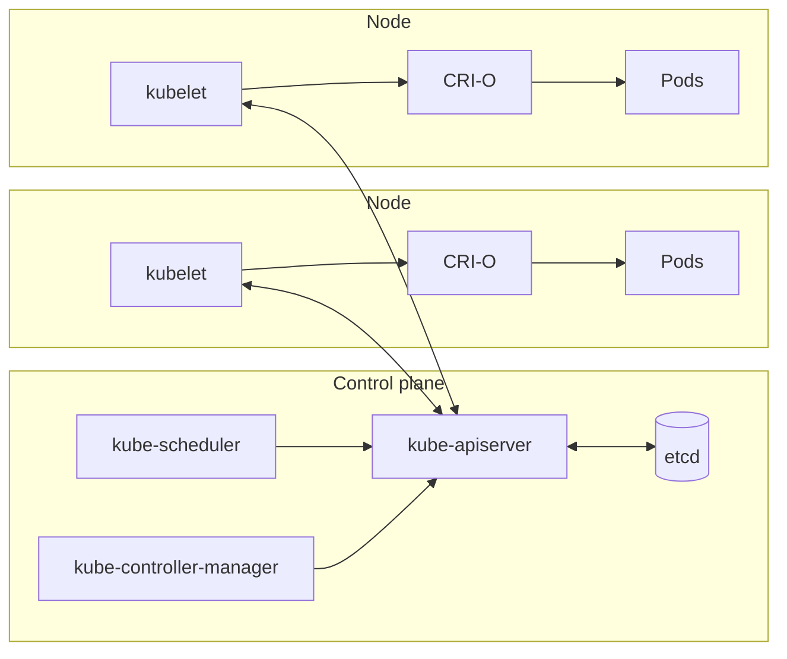

# Cluster

## Definição em uma frase

Um cluster Kubernetes é o conjunto formado por um **control plane** (*control plane*), que expõe a API e toma as decisões, e por **nós** (*nodes*), as máquinas que executam os contêineres das aplicações.

## Explicação didática

Do lado de fora, o cluster parece um único computador grande: você pede "rode isto", e ele resolve onde e como. Por dentro há uma divisão de tarefas:

- o **control plane** guarda o estado (etcd), atende os pedidos (API server), decide em que nó cada Pod roda (scheduler) e corrige desvios (controllers);
- os **nós** executam os Pods, por meio do kubelet e do runtime de contêineres.

**Não existe um `kind: Cluster`** no Kubernetes padrão. "Cluster" é o nome do sistema inteiro, e não um objeto que você cria com YAML. No OpenShift há objetos que **descrevem** o cluster, como `ClusterVersion` e `Infrastructure` (grupo `config.openshift.io`), mas eles não são "o cluster".

## Para que existe e qual problema resolve

Juntar máquinas num cluster permite tratar a capacidade como um *pool*: as falhas de uma máquina são absorvidas pelas outras, e a carga pode crescer acrescentando nós. Em produção, o control plane costuma estar distribuído em vários computadores, o que dá tolerância a falhas e alta disponibilidade.

## Funcionamento técnico e ciclo de vida



*Legenda: todos os componentes conversam com o API server; nenhum fala direto com o etcd, a não ser o próprio API server.*

1. **Formação:** o cluster é criado pela instalação, no OpenShift com o instalador e Ignition.
2. **Operação:** os nós se registram como objetos [Node](../../02-compute-e-nodes/verbetes/node.md) e relatam sua saúde. O control plane distribui o trabalho.
3. **Evolução:** nós entram e saem; o control plane é atualizado. No OpenShift, a topologia escolhida na instalação, por exemplo SNO, é fixa para todo o ciclo de vida.

## Relações e dependências

- Contém [Nodes](../../02-compute-e-nodes/verbetes/node.md) e os [Namespaces](namespace.md), que dividem o cluster logicamente.
- Define as fronteiras dos escopos: recursos são **namespaced** ou **cluster-scoped**. Ver [Resource](resource.md).
- É gerenciado por meio da [API](kubernetes-api.md).

## Exemplo de situação real

Uma empresa mantém um cluster de produção com três nós de control plane e dez de compute, e um cluster de desenvolvimento menor. As equipes compartilham cada cluster separadas por namespaces. Quem administra pensa em "capacidade do cluster", e não em "servidor X".

## Como visualizar e inspecionar (somente leitura)

Não há objeto "Cluster". Observa-se o cluster pelas suas partes:

```bash
# Endpoint da API do cluster ao qual o contexto atual está ligado
oc whoami --show-server

# Nós e seus papéis (exige permissão de leitura de nós)
oc get nodes -o wide

# Recursos cluster-scoped e namespaced que este cluster serve
oc api-resources --namespaced=false
oc api-resources --namespaced=true

# OpenShift: identidade e versão do cluster
oc get clusterversion
oc get infrastructure cluster -o yaml   # topologia e plataforma
```

## Como interpretar a saída

Saída **ilustrativa** de `oc get nodes` num SNO:

```text
NAME       STATUS   ROLES                         AGE   VERSION
<nó-sno>   Ready    control-plane,master,worker   30d   v1.35.x
```

- `ROLES` com `control-plane,master,worker` no mesmo nó é típico do SNO. Num cluster HA aparecem nós distintos para cada papel.
- `VERSION` é a versão do kubelet (Kubernetes).
- No objeto `Infrastructure`, os campos `status.controlPlaneTopology` e `status.infrastructureTopology` indicam a topologia (por exemplo `SingleReplica` ou `HighlyAvailable`). **Confirme com `oc explain infrastructure.status`** antes de tirar conclusões.

## Diferenças e confusões frequentes

- **Cluster ≠ Node:** o nó é uma máquina; o cluster é o conjunto.
- **Cluster ≠ Namespace:** o namespace divide o cluster, mas não cria outro cluster, nem isolamento físico.
- **"Cluster-scoped" ≠ "global no sentido de rede":** é só uma questão de escopo de nome e de permissão na API.
- O nome "master" é histórico; a documentação atual usa *control plane*.

## No OpenShift 4.22 versus Kubernetes

O OpenShift acrescenta objetos que descrevem o cluster (`ClusterVersion`, `Infrastructure`, `ClusterOperator`) e um processo de atualização do cluster inteiro. O Kubernetes upstream não define nada disso.

## No HomeLab SNO

Um único nó acumula os papéis de controle e de compute: o cluster existe, mas **sem alta disponibilidade**. Desligar ou drenar esse nó derruba o cluster inteiro, por isso a observação é sempre só de leitura.

## Termos relacionados

[Kubernetes](kubernetes.md) · [OpenShift Container Platform](openshift-container-platform.md) · [Node](../../02-compute-e-nodes/verbetes/node.md) · [Namespace](namespace.md) · [Resource](resource.md) · [API](kubernetes-api.md)

## Fontes oficiais

- Kubernetes Glossary — Cluster e Control Plane: <https://kubernetes.io/docs/reference/glossary/?all=true#term-cluster> (fontes: `kubernetes/website` `release-1.35`, `content/en/docs/reference/glossary/cluster.md` e `control-plane.md`)
- Kubernetes — Cluster Architecture: <https://kubernetes.io/docs/concepts/architecture/>
- OCP 4.22 — Single-node OpenShift: <https://docs.redhat.com/en/documentation/openshift_container_platform/4.22/html/installing_on_a_single_node/index> (fonte: `modules/install-sno-about-installing-on-a-single-node.adoc`)

<details>
<summary>Ficha técnica e notas de revisão</summary>

**Ficha técnica**

- **ID:** 00-fundamentos-e-linguagem/cluster
- **Termo original:** cluster
- **Tradução:** cluster (agrupamento)
- **Classe ontológica:** conceito
- **Plataforma:** Kubernetes / OpenShift
- **Escopo:** não aplicável (o cluster é a fronteira dos escopos)
- **Disponibilidade:** nativo
- **Versões validadas:** Kubernetes 1.35 / OCP 4.22
- **Nível:** básico
- **Atualizado em:** 2026-11-04

**Notas de revisão**

- **Estado:** desenvolvido. Fontes conferidas em 2026-11-04.
- **Pendências:** validar no SNO a coluna `ROLES` e os campos de topologia do `Infrastructure`, que **não foram executados**; confirmar a URL publicada do guia de SNO (o slug `installing_on_a_single_node` é a verificar).

</details>
