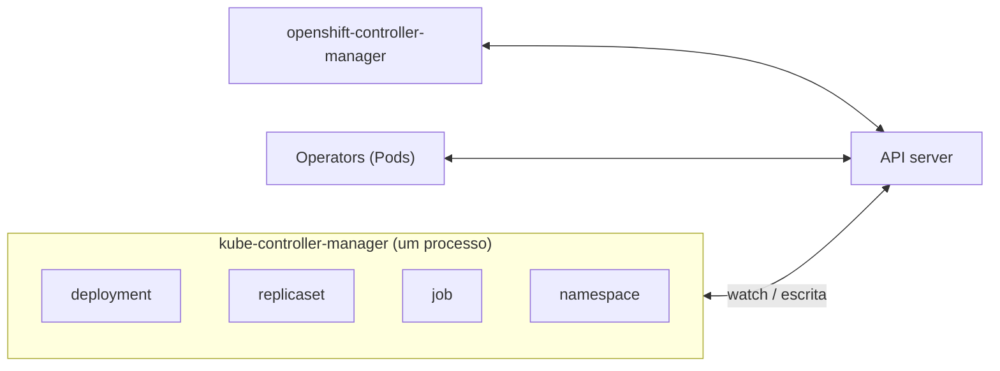

# Controller

## Definição em uma frase

Um controller é um **control loop** (*control loop*) que observa o estado do cluster pela API e faz, ou pede, mudanças para aproximar o estado atual do desired state.

## Explicação didática

O [verbete Reconciliation](reconciliation.md) explica **o que** acontece a cada volta do laço. Este verbete trata de **quem** faz: os controllers são os programas que executam a reconciliation.

- **Control loop** é o mecanismo genérico (o termostato é o exemplo clássico): um laço que **não termina** e regula um sistema.
- **Controller** é um control loop aplicado a um ou mais tipos de recurso do Kubernetes.

Exemplos nativos: o controller de **Deployment**, o de **Job**, o de **Namespace**, o de **ServiceAccount**.

## Para que existe e qual problema resolve

Em vez de um "cérebro" monolítico, o Kubernetes usa **muitos controllers simples**, cada um responsável por um aspecto. Controllers podem falhar, e o sistema foi desenhado para isso: outro assume ou o laço recomeça e compara o estado de novo.

## Funcionamento técnico e ciclo de vida

- **Observação:** via *watch* no [API server](api-server.md), nunca direto no etcd.
- **Ação:** normalmente pela API, criando ou alterando outros objetos (o controller de Job cria Pods; ele não roda contêineres). Às vezes age direto num sistema externo e relata o resultado.
- **Escopo próprio:** vários controllers podem criar o mesmo tipo de objeto (Deployments e Jobs criam Pods), mas cada um só cuida dos que lhe pertencem, identificados por labels e referências de dono.
- **Onde rodam:**
  - os nativos ficam no **kube-controller-manager**: logicamente cada controller é um processo separado, mas todos são compilados num binário só e rodam num único processo;
  - controllers de extensão (Operators) rodam como Pods, ou até fora do cluster.
- **Alta disponibilidade:** com várias réplicas do controller manager, só **uma é líder ativa** por vez; as demais esperam.

## Relações e dependências

- Executa a [reconciliation](reconciliation.md) entre o [desired state](desired-state.md) e o [current state](current-state.md).
- Um [Operator](../../09-operators-e-extensoes/verbetes/operator.md) é um controller (ou um conjunto deles) com conhecimento operacional de uma aplicação, geralmente com CRDs.
- Os Operators de plataforma do OpenShift relatam seu estado em [ClusterOperator](../../09-operators-e-extensoes/verbetes/clusteroperator.md).

## Exemplo de situação real

Pods de um Deployment não são recriados depois de apagados. A suspeita recai sobre o controller manager: se ele está fora do ar ou sem liderança, ninguém reconcilia. No OpenShift, o primeiro olhar vai para `oc get clusteroperator kube-controller-manager`.

## Como visualizar e inspecionar (somente leitura)

```bash
# OpenShift: saúde dos controller managers (Kubernetes e OpenShift)
oc get clusteroperator kube-controller-manager openshift-controller-manager

# Pods dos controller managers (apenas observar)
oc get pods -n openshift-kube-controller-manager
oc get pods -n openshift-controller-manager

# Quem é o dono (controller) de um objeto
oc get replicaset <nome> -n <namespace> \
  -o jsonpath='{range .metadata.ownerReferences[*]}{.kind}/{.name} controller={.controller}{"\n"}{end}'

# Eventos emitidos por controllers no namespace
oc get events -n <namespace> --sort-by=.lastTimestamp

# Leases usados na eleição de líder (a localização exata varia; a verificar)
oc get leases -n kube-system
```

## Como interpretar a saída

- `ownerReferences` com `controller=true` aponta **o** controller responsável. Pode haver outros donos com `controller=false`.
- Nos Events, a coluna `SOURCE` (ou o campo `reportingComponent`) mostra qual controller emitiu o evento, por exemplo `deployment-controller` ou `replicaset-controller`.
- `ClusterOperator` `kube-controller-manager` em `Degraded=True` afeta **todos** os workloads nativos. Investigue com `oc describe clusteroperator kube-controller-manager`.

## Diferenças e confusões frequentes

- **Controller ≠ Operator:** todo Operator usa controllers, mas a maioria dos controllers nativos não é Operator.
- **Controller ≠ "controlador de workload":** muita gente chama Deployment, StatefulSet etc. de "controllers", mas esses são **objetos**. O controller é o código que os reconcilia.
- **Controller manager ≠ scheduler:** o scheduler escolhe o nó de um Pod; não é um controller de reconciliation de objetos.
- **IngressController (OpenShift)** é um **objeto** de configuração do Operator de ingress, apesar do nome. Ver [IngressController](../../04-networking/verbetes/ingresscontroller.md).

## No OpenShift 4.22 versus Kubernetes

O OCP roda o **Kubernetes controller manager** e também o **OpenShift controller manager**, que observa objetos do OpenShift (projects, routes, templates...) e usa a API para impor o estado especificado. Cada um é gerenciado por um Operator próprio.

## No HomeLab SNO

Há uma réplica de cada controller manager. Observe os ClusterOperators e os Events; **não** apague Pods de `openshift-kube-controller-manager` para "reiniciar" controllers.

## Diagrama



## Termos relacionados

[Reconciliation](reconciliation.md) · [Desired State](desired-state.md) · [API Server](api-server.md) · [Operator](../../09-operators-e-extensoes/verbetes/operator.md) · [ClusterOperator](../../09-operators-e-extensoes/verbetes/clusteroperator.md) · [ReplicaSet](../../03-workloads/verbetes/replicaset.md)

## Fontes oficiais

- Kubernetes — Controllers: <https://kubernetes.io/docs/concepts/architecture/controller/> (fonte: `kubernetes/website` `release-1.35`)
- Kubernetes Glossary — Controller e kube-controller-manager: <https://kubernetes.io/docs/reference/glossary/?all=true#term-kube-controller-manager>
- OCP 4.22 — Control plane architecture, "Machine roles" (Kubernetes controller manager com um líder ativo; OpenShift controller manager): <https://docs.redhat.com/en/documentation/openshift_container_platform/4.22/html/architecture/control-plane> (fonte: `modules/architecture-machine-roles.adoc`)

<details>
<summary>Ficha técnica e notas de revisão</summary>

**Ficha técnica**

- **ID:** 00-fundamentos-e-linguagem/controller
- **Termo original:** controller
- **Remissões:** control loop (laço de controle), kube-controller-manager
- **Tradução:** controlador
- **Classe ontológica:** componente / padrão
- **Plataforma:** Kubernetes / OpenShift
- **Escopo:** não aplicável
- **Disponibilidade:** nativo (controllers embutidos) e por extensão (Operators)
- **Versões validadas:** Kubernetes 1.35 / OCP 4.22
- **Nível:** básico → intermediário
- **Atualizado em:** 2026-11-04

**Notas de revisão**

- **Estado:** desenvolvido. Fontes conferidas em 2026-11-04.
- **Remissão:** "Control Loop" (inventário da categoria 00) aponta para este verbete e para [Reconciliation](reconciliation.md); não há página separada.
- **Pendências:** confirmar o namespace dos Leases de eleição de líder no OCP 4.22 e os nomes dos campos de origem dos Events no SNO, que **não foram executados**.

</details>
