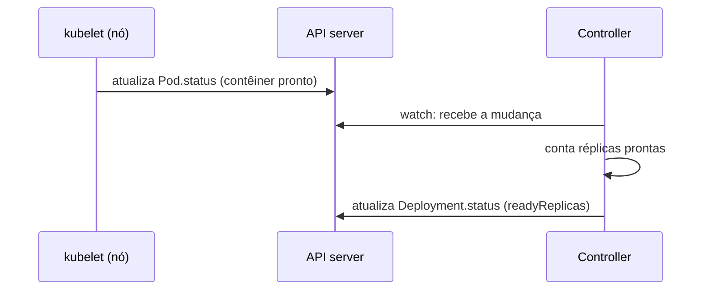

# Estado observado (current state / actual state)

> **ID:** 00-fundamentos-e-linguagem/current-state | **Termo original:** current state, actual state, observed state | **Tradução:** estado observado, estado atual, estado real | **Classe ontológica:** conceito / padrão (modelo declarativo) | **Plataforma:** Kubernetes / OpenShift | **Escopo:** não aplicável | **Disponibilidade:** nativo | **Versões validadas:** Kubernetes 1.35 / OCP 4.22 | **Nível:** básico | **Atualizado em:** 2026-11-04

## Definição em uma frase

Estado observado é **como o sistema realmente está** num dado momento: o que os componentes do cluster constatam e relatam, em geral no [`status`](status.md) dos [objetos](object.md).

## Explicação didática

Na analogia do termostato, é a **temperatura real da sala**. Ela pode estar longe dos 22 °C desejados, e é justamente essa diferença que faz o sistema agir.

**Nota de nomenclatura:** a documentação do Kubernetes usa sobretudo *current state* e *actual state*. "Observed" aparece em nomes de campos como `observedGeneration` e nas convenções ("observations of actual state"). Este glossário adota **"estado observado"** como termo principal em português, porque ressalta um ponto essencial: o que está no `status` é **o que foi observado**, e pode estar levemente atrasado em relação à realidade.

## Para que existe e qual problema resolve

Sem um registro do estado real, nenhum controller saberia se precisa agir, e nenhuma pessoa saberia se o pedido foi atendido. O estado observado é o **lado "realidade"** da comparação que move o Kubernetes. Ver [Reconciliação](reconciliation.md).

## Funcionamento técnico e ciclo de vida

1. **Observação:** componentes constatam fatos. O kubelet vê os contêineres rodando; um controller conta os Pods prontos; o Operator de ingress verifica os roteadores.
2. **Relato:** os fatos são gravados no `status` pelo subrecurso `/status`, ou expressos como Events.
3. **Uso:** controllers leem esse estado (o seu e o de outros objetos) e comparam com o [estado desejado](desired-state.md).
4. **Instabilidade natural:** a documentação deixa claro que o cluster pode estar mudando a todo momento, e que **talvez nunca atinja um estado estável**. Enquanto os controllers puderem agir, isso não é um problema.

Observe que **parte do estado observado nem sempre está na API.** O estado real de um disco num storage externo, por exemplo, só é conhecido por um controller que consulta esse sistema (controle direto) e relata o resultado.

## Relações e dependências

- Contraparte do [estado desejado](desired-state.md); registrado em [`status`](status.md).
- Sinais complementares: [Conditions](conditions.md) e [ObservedGeneration](observed-generation.md) (no `status`) e [Events](events.md).

## Exemplo de situação real

Um Pod aparece como `Running`, mas a aplicação não responde. O estado observado diz que o contêiner está em execução; a condição `Ready` está `False`, porque a *readiness probe* falha. O "estado observado" tem várias camadas, e ler só a coluna `STATUS` engana.

## Como visualizar e inspecionar (somente leitura)

```bash
# Estado observado de um Pod: fase, condições e estado de cada contêiner
oc get pod <nome> -n <namespace> -o jsonpath='{.status.phase}{"\n"}'
oc get pod <nome> -n <namespace> \
  -o jsonpath='{range .status.conditions[*]}{.type}={.status}{"\n"}{end}'

# Visão humana com eventos recentes
oc describe pod <nome> -n <namespace>

# Eventos do namespace, do mais antigo ao mais recente
oc get events -n <namespace> --sort-by=.lastTimestamp

# O controller já processou o último spec?
oc get deployment <nome> -n <namespace> \
  -o jsonpath='generation={.metadata.generation} observed={.status.observedGeneration}{"\n"}'
```

## Como interpretar a saída

- `phase=Running` + `Ready=False`: o contêiner roda, mas não está pronto para receber tráfego. Investigue as *probes* e os logs.
- `generation` maior que `observed`: o `status` ainda não reflete a última mudança de `spec`. Espere ou verifique se o controller está saudável.
- Events `Warning` recentes costumam explicar **por que** o estado observado não convergiu (ex.: `FailedScheduling`, `BackOff`).
- Um Event é transitório e sai do cluster depois de algum tempo; ausência de eventos antigos não significa que nada aconteceu.

## Diferenças e confusões frequentes

- **Estado observado ≠ verdade absoluta:** é a última observação registrada; pode haver atraso.
- **`status` ≠ Events:** o `status` é a foto atual (sobrescrita); os Events são registros de ocorrências.
- **Coluna `STATUS` do `oc get pods` ≠ `status.phase`:** a coluna é um resumo que pode mostrar razões de espera de contêiner (`CrashLoopBackOff`, `ImagePullBackOff`), que não são fases.

## No OpenShift 4.22 versus Kubernetes

O OpenShift expõe o estado observado **da plataforma** em `ClusterOperator` e `ClusterVersion` (condições `Available`, `Progressing`, `Degraded`), e o console web agrega esses sinais. O conceito é o mesmo do Kubernetes.

## No HomeLab SNO

Leitura segura: `get`, `describe` e `events`. Num nó único, uma pressão de recursos no nó (memória, disco) aparece rápido no estado observado de muitos objetos ao mesmo tempo. Observe o Node antes de culpar a aplicação.

## Diagrama Mermaid



## Termos relacionados

[Estado desejado](desired-state.md) · [Status](status.md) · [Reconciliação](reconciliation.md) · [Spec](spec.md) · [Pod](../../03-workloads/verbetes/pod.md) · [ClusterOperator](../../09-operators-e-extensoes/verbetes/clusteroperator.md)

## Fontes oficiais

- Kubernetes — Controllers, "Desired versus current state" e "Direct control": <https://kubernetes.io/docs/concepts/architecture/controller/> (fonte: `kubernetes/website` `release-1.35`)
- Kubernetes — Objects In Kubernetes ("The status describes the current state"): <https://kubernetes.io/docs/concepts/overview/working-with-objects/>
- Kubernetes API Conventions — "Spec and Status" ("most recent observations of actual state"): <https://github.com/kubernetes/community/blob/master/contributors/devel/sig-architecture/api-conventions.md>

## Revisão editorial

- **Estado:** 🟡 desenvolvido. Fontes conferidas em 2026-11-04.
- **Decisão de nomenclatura:** slug `current-state` (termo oficial em inglês) e título em português "Estado observado", com remissões para *actual state* e *observed state*.
- **Pendências:** validar no SNO os exemplos de `jsonpath`, que **não foram executados**; aprofundar Events e Conditions nos verbetes próprios.
