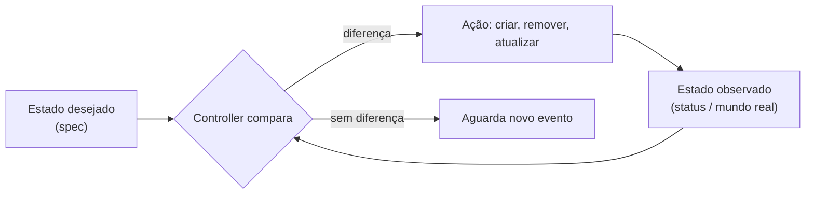

# Estado desejado (desired state)

> **ID:** 00-fundamentos-e-linguagem/desired-state | **Termo original:** desired state | **Tradução:** estado desejado | **Classe ontológica:** conceito / padrão (modelo declarativo) | **Plataforma:** Kubernetes / OpenShift | **Escopo:** não aplicável | **Disponibilidade:** nativo | **Versões validadas:** Kubernetes 1.35 / OCP 4.22 | **Nível:** básico | **Atualizado em:** 2026-11-04

## Definição em uma frase

Estado desejado é a **descrição de como algo deve estar**, registrada num [objeto](object.md), normalmente no seu [`spec`](spec.md), e que o sistema trabalha continuamente para tornar realidade.

## Explicação didática

A analogia oficial é o **termostato**. Você ajusta 22 °C: esse é o estado desejado. A temperatura real da sala é o [estado observado](current-state.md). O termostato liga e desliga o equipamento para aproximar um do outro. Você não diz "ligue o aquecedor por 10 minutos"; diz "quero 22 °C".

No Kubernetes é igual: "quero 3 réplicas desta imagem, expostas na porta 8080". Como chegar lá é problema dos controllers.

**Não existe objeto chamado "DesiredState".** É um conceito, materializado no `spec` (ou em campos equivalentes, como `data` ou `rules`) de cada objeto.

## Para que existe e qual problema resolve

O modelo **declarativo** resolve problemas do modelo **imperativo** (sequências de comandos):

| Imperativo ("faça X") | Declarativo ("quero X") |
|---|---|
| Se um passo falha, o estado fica pela metade | O sistema continua tentando até convergir |
| Repetir o comando pode duplicar o efeito | Reaplicar o mesmo estado não muda nada (**idempotente**) |
| Desvios posteriores passam despercebidos | Desvios são detectados e corrigidos |
| Difícil auditar "como deveria estar" | O próprio objeto **é** a documentação da intenção |

## Funcionamento técnico e ciclo de vida

1. O estado desejado é **declarado**: um manifesto aplicado, um comando do CLI ou outro controller (um Deployment declara o estado desejado de um ReplicaSet, que declara o de Pods).
2. Fica **persistido** na API, e não na memória de um processo.
3. **Controllers** comparam esse estado com o observado e agem. Ver [Reconciliação](reconciliation.md).
4. Quando o `spec` muda, o novo estado desejado substitui o anterior. O sistema persegue sempre o **mais recente**, sem precisar passar por estados intermediários.
5. Pode haver **cascata**: o estado observado de um nível (Pods criados) vira o estado desejado de outro. Após o scheduling, por exemplo, o Pod passa a fazer parte do estado desejado do kubelet do nó.

## Relações e dependências

- Materializado em [`spec`](spec.md); comparado com o [estado observado](current-state.md) relatado em [`status`](status.md).
- Imposto pela [reconciliação](reconciliation.md).
- Hierarquia: Deployment → ReplicaSet → Pod. Ver [Deployment](../../03-workloads/verbetes/deployment.md) e [ReplicaSet](../../03-workloads/verbetes/replicaset.md).

## Exemplo de situação real

Um administrador apaga um Pod para "reiniciá-lo". O Pod volta com outro nome. Não é falha: o estado desejado (3 réplicas, no ReplicaSet) continua igual, e o controller recriou o que faltava. Para mudar de verdade, é preciso alterar o estado desejado, por exemplo `spec.replicas` no Deployment.

## Como visualizar e inspecionar (somente leitura)

O estado desejado se lê no `spec` dos objetos:

```bash
# Estado desejado de réplicas de um Deployment
oc get deployment <nome> -n <namespace> -o jsonpath='{.spec.replicas}{"\n"}'

# Comparação lado a lado: desejado × pronto
oc get deployment <nome> -n <namespace> \
  -o custom-columns=NOME:.metadata.name,DESEJADO:.spec.replicas,PRONTO:.status.readyReplicas

# Quanto o seu manifesto local difere do estado desejado guardado no cluster
# (somente leitura: oc diff não aplica nada)
oc diff -f <arquivo>.yaml
```

## Como interpretar a saída

- Em `custom-columns`, `DESEJADO` diferente de `PRONTO` significa que a reconciliação está em curso ou bloqueada; investigue `status.conditions` e os Events.
- O `oc diff` mostra no formato *diff* o que **mudaria** no estado desejado se o arquivo fosse aplicado. Saída vazia indica que o manifesto local já coincide com o armazenado.
- Um valor `<none>` em `PRONTO` costuma significar que o campo ainda não foi preenchido pelo controller.

## Diferenças e confusões frequentes

- **Estado desejado ≠ manifesto local:** o que vale é o que está **na API**. Um YAML no seu disco ou no Git só vira estado desejado quando é aplicado (base do GitOps, categoria 15).
- **Estado desejado ≠ resultado garantido:** declarar 3 réplicas não garante 3 Pods prontos (pode faltar CPU, a imagem pode não existir...).
- **Declarativo × imperativo no CLI:** `oc apply -f` trabalha com o estado desejado completo; `oc scale`, `oc set image` são atalhos imperativos que **também** alteram o estado desejado. O efeito final está sempre no objeto.

## No OpenShift 4.22 versus Kubernetes

O OpenShift aplica o mesmo modelo **à própria plataforma**: a versão desejada do cluster é declarada em `ClusterVersion` e a configuração em objetos de `config.openshift.io`. Os Operators reconciliam os componentes até esse estado. Em clusters gerenciados por Operators, alterar recursos internos à mão pode ser desfeito pela reconciliação.

## No HomeLab SNO

Observe o estado desejado à vontade com `get`, `-o jsonpath` e `oc diff`. **Não** altere o estado desejado de objetos em `openshift-*`: o Operator correspondente pode reverter a mudança, ou pior, a configuração passa a divergir do suportado.

## Diagrama Mermaid



## Termos relacionados

[Estado observado](current-state.md) · [Reconciliação](reconciliation.md) · [Spec](spec.md) · [Status](status.md) · [Objeto](object.md) · [Deployment](../../03-workloads/verbetes/deployment.md)

## Fontes oficiais

- Kubernetes — Controllers (control loop, termostato, "Desired versus current state"): <https://kubernetes.io/docs/concepts/architecture/controller/> (fonte: `kubernetes/website` `release-1.35`, `content/en/docs/concepts/architecture/controller.md`)
- Kubernetes — Objects In Kubernetes ("record of intent"): <https://kubernetes.io/docs/concepts/overview/working-with-objects/>
- Kubernetes API Conventions — "Spec and Status" (*level-based*): <https://github.com/kubernetes/community/blob/master/contributors/devel/sig-architecture/api-conventions.md>
- OCP 4.22 — "Kubernetes overview", seção "Kubernetes resources" (modelo declarativo e Operators como control loop). Fonte conferida: `openshift-docs` `enterprise-4.22`, `welcome/kubernetes-overview.adoc` → `modules/kubernetes-resources.adoc`. URL publicada **a verificar**: <https://docs.redhat.com/en/documentation/openshift_container_platform/4.22>

## Revisão editorial

- **Estado:** 🟡 desenvolvido. Fontes conferidas em 2026-11-04.
- **Pendências:** confirmar com `oc diff --help` no cliente 4.22 que o comportamento é somente leitura (assim está documentado no `kubectl diff`). Exemplos **não executados**.
