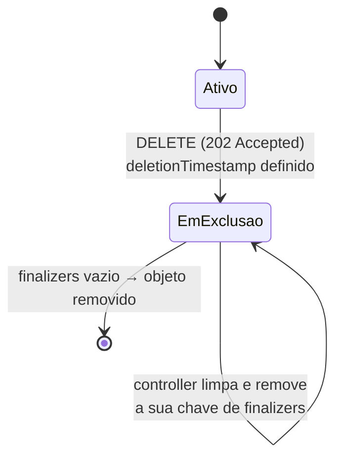

# Finalizer

> **ID:** 00-fundamentos-e-linguagem/finalizer | **Termo original:** finalizer (`metadata.finalizers`) | **Tradução:** finalizador | **Classe ontológica:** conceito (campo de metadata e mecanismo de exclusão) | **Plataforma:** Kubernetes / OpenShift | **Escopo:** não aplicável | **Disponibilidade:** nativo | **Versões validadas:** Kubernetes 1.35 / OCP 4.22 | **Nível:** intermediário | **Atualizado em:** 2026-11-04

## Definição em uma frase

Um finalizer é uma **chave na lista `metadata.finalizers`** que impede a remoção definitiva de um objeto até que o controller responsável conclua uma tarefa de limpeza e retire a chave.

## Explicação didática

É como um "aguarde, falta assinar" na saída de um processo. O pedido de exclusão é aceito, mas o objeto fica **em exclusão** (visível, com `deletionTimestamp`) até que cada pendência seja resolvida. O finalizer **não contém código**: é só uma chave, como uma annotation. Quem faz o trabalho é o controller que conhece aquela chave.

## Para que existe e qual problema resolve

Evita apagar algo que ainda está em uso ou que deixaria lixo fora do cluster. Exemplo oficial: o finalizer `kubernetes.io/pv-protection` impede que um PersistentVolume em uso por um Pod seja removido; o PV fica `Terminating` até deixar de estar em uso.

## Funcionamento técnico e ciclo de vida

Quando chega um `DELETE` para um objeto com finalizers, o API server:

1. preenche `metadata.deletionTimestamp` com o horário do pedido;
2. **impede a remoção** enquanto houver itens em `metadata.finalizers`;
3. responde **`202 Accepted`**.

Depois:

4. O controller dono da chave vê o `deletionTimestamp`, faz a limpeza e **remove a sua chave**.
5. Quando a lista fica vazia, o objeto é apagado de fato.

Regras após o pedido de exclusão:
- É possível **remover** finalizers, mas **não acrescentar** novos.
- O `deletionTimestamp` não pode ser alterado.
- Não há como "desfazer" a exclusão; só criando um objeto novo.
- Finalizers personalizados precisam ter nome qualificado (ex.: `example.com/finalizer-name`), e o API server rejeita os que não têm.

Finalizers da exclusão em cascata: na exclusão *foreground*, o dono recebe o finalizer `foregroundDeletion`; na política *orphan*, recebe `orphan`. Ver [Garbage Collection](garbage-collection.md).

## Relações e dependências

- Campo de [metadata](metadata.md); age junto com `deletionTimestamp`.
- Usado pela [Garbage Collection](garbage-collection.md) e por controllers e Operators que precisam limpar recursos externos.
- Aparece em [Namespaces](namespace.md) presos em `Terminating`.

## Exemplo de situação real

Um Operator é desinstalado antes de seus recursos personalizados serem apagados. Os CRs ficam com o finalizer do Operator e, como não há mais ninguém para retirá-lo, **nunca somem**. O namespace que os contém fica em `Terminating`. A documentação recomenda **evitar** remover finalizers à mão, a não ser que se entenda o propósito do finalizer e que ele tenha sido cumprido de outro modo.

## Como visualizar e inspecionar (somente leitura)

```bash
# Finalizers e marca de exclusão de um objeto
oc get <tipo> <nome> -n <namespace> \
  -o jsonpath='finalizers={.metadata.finalizers} deletion={.metadata.deletionTimestamp}{"\n"}'

# Objetos de um tipo em exclusão pendente (têm deletionTimestamp)
oc get pods -n <namespace> \
  -o jsonpath='{range .items[?(@.metadata.deletionTimestamp)]}{.metadata.name}{"\t"}{.metadata.finalizers}{"\n"}{end}'

# Namespace em Terminating: condições explicam o que falta
oc get namespace <nome> \
  -o jsonpath='{range .status.conditions[*]}{.type}={.status}: {.message}{"\n"}{end}'
```

## Como interpretar a saída

- `deletionTimestamp` preenchido + `finalizers` não vazio: exclusão **pendente**, à espera do controller dono de cada chave.
- Num namespace, condições como `NamespaceContentRemaining` ou `NamespaceFinalizersRemaining` dizem quais recursos ou finalizers ainda seguram a exclusão. Confira o texto exato no seu cluster.
- O finalizer `kubernetes` em `spec.finalizers` de um **Namespace** é do próprio Kubernetes; é ele que garante a limpeza do conteúdo.

## Diferenças e confusões frequentes

- **Finalizer ≠ hook de contêiner** (`preStop`): o hook atua no processo; o finalizer, no objeto da API.
- **Finalizer ≠ owner reference:** ambos influenciam exclusões, mas o finalizer é uma pendência **no próprio objeto**, e a owner reference, um vínculo **com outro**.
- **Remover finalizer à força ≠ "consertar":** pode deixar recursos externos órfãos (discos, balanceadores, registros).

## No OpenShift 4.22 versus Kubernetes

Igual. Operators do OpenShift e do OperatorHub usam finalizers próprios em seus CRs; desinstale primeiro os CRs e depois o Operator, conforme a documentação de cada produto.

## No HomeLab SNO

Observe finalizers à vontade. Remover finalizers é uma **alteração arriscada**: não faça isso em recursos de plataforma e, nos seus, só com a causa entendida.

## Diagrama Mermaid



## Termos relacionados

[Garbage Collection](garbage-collection.md) · [OwnerReference](owner-reference.md) · [Metadata](metadata.md) · [Namespace](namespace.md) · [Controller](controller.md) · [PersistentVolume](../../05-storage/verbetes/persistentvolume.md)

## Fontes oficiais

- Kubernetes — Finalizers: <https://kubernetes.io/docs/concepts/overview/working-with-objects/finalizers/> (fonte: `kubernetes/website` `release-1.35`, `concepts/overview/working-with-objects/finalizers.md`)
- Kubernetes — Owners and Dependents, "Ownership and finalizers": <https://kubernetes.io/docs/concepts/overview/working-with-objects/owners-dependents/>
- Kubernetes — Garbage Collection, "Cascading deletion": <https://kubernetes.io/docs/concepts/architecture/garbage-collection/>

## Revisão editorial

- **Estado:** 🟡 desenvolvido. Fontes conferidas em 2026-11-04.
- **Pendências:** os nomes das condições de Namespace (`NamespaceContentRemaining` e `NamespaceFinalizersRemaining`) e o finalizer `kubernetes` em `spec.finalizers` são conhecidos da referência da API, mas **não foram conferidos** nesta rodada; validar com `oc explain namespace.status.conditions` e `oc explain namespace.spec`. O diagrama usa `stateDiagram-v2`.
