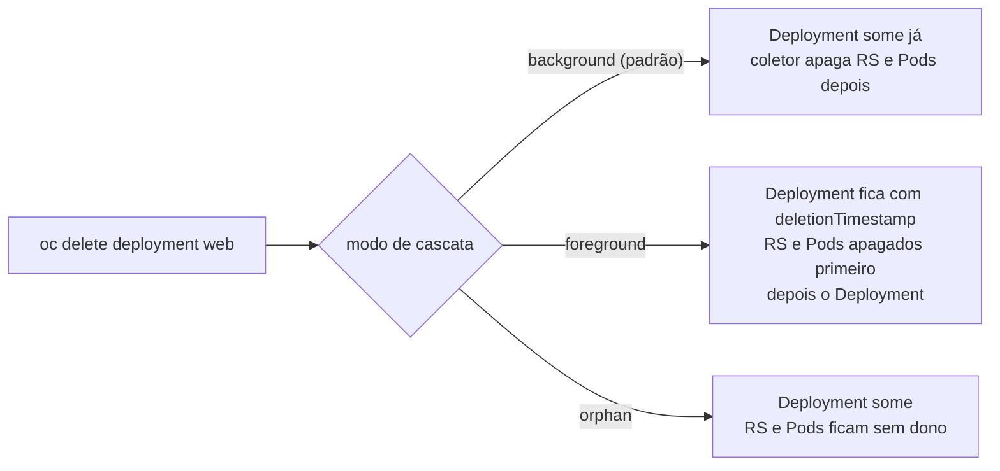

# Garbage Collection

> **ID:** 00-fundamentos-e-linguagem/garbage-collection | **Termo original:** garbage collection (GC), cascading deletion | **Remissões:** exclusão em cascata, orphan, foreground, background | **Tradução:** coleta de lixo | **Classe ontológica:** conceito / mecanismo (executado por controllers e pelo kubelet) | **Plataforma:** Kubernetes / OpenShift | **Escopo:** não aplicável | **Disponibilidade:** nativo | **Versões validadas:** Kubernetes 1.35 / OCP 4.22 | **Nível:** intermediário | **Atualizado em:** 2026-11-04

## Definição em uma frase

Garbage collection é o conjunto de mecanismos com que o Kubernetes **limpa recursos que não são mais necessários**, principalmente objetos dependentes cujo dono foi apagado.

## Explicação didática

Quando você apaga um Deployment, não precisa apagar ReplicaSets e Pods um por um: o coletor de lixo segue as [owner references](owner-reference.md) e remove os dependentes. O termo abrange também outras limpezas automáticas.

Segundo a documentação, a coleta cuida de, entre outros:
- Pods terminados;
- Jobs concluídos (com TTL configurado);
- objetos sem owner references válidas (dependentes órfãos);
- contêineres e imagens não usados (feito pelo **kubelet** em cada nó);
- PersistentVolumes provisionados dinamicamente com política de recuperação `Delete`;
- CertificateSigningRequests vencidas;
- Leases de nós.

## Para que existe e qual problema resolve

Sem garbage collection, cada exclusão deixaria restos: Pods sem dono, discos esquecidos, imagens ocupando o nó. A coleta mantém o cluster coerente com o desired state também **na hora de remover**.

## Funcionamento técnico e ciclo de vida

**Exclusão em cascata**, em dois modos:

| Modo | O que acontece | Quando |
|---|---|---|
| **Background** (padrão) | O dono é apagado **imediatamente**; o coletor remove os dependentes em seguida, em segundo plano | Comportamento padrão |
| **Foreground** | O dono entra em "exclusão em andamento" (`deletionTimestamp` e finalizer `foregroundDeletion`) e continua visível; os dependentes são apagados primeiro (os que têm `blockOwnerDeletion=true` seguram o dono); só depois o dono some | Pedido explícito |

**Órfãos:** com a política *orphan*, o dono é apagado e os dependentes **ficam**, sem dono (o dono recebe o finalizer `orphan` durante o processo).

No CLI, a escolha é feita com `--cascade=background|foreground|orphan` em `oc delete`. Isso é uma alteração; ver a seção de comandos.

**Contêineres e imagens:** o kubelet coleta imagens não usadas a cada cinco minutos e contêineres não usados a cada minuto, com base em limites de uso de disco. A documentação desaconselha ferramentas externas de coleta, que podem quebrar o kubelet.

## Relações e dependências

- Baseia-se em [OwnerReference](owner-reference.md) e usa [Finalizers](finalizer.md).
- Executada por controllers do control plane (o *garbage collector* fica no kube-controller-manager; ver [Controller](controller.md)) e, para imagens e contêineres, pelo kubelet.

## Exemplo de situação real

Alguém apaga um ReplicaSet com `--cascade=orphan` para "trocar" o controller sem derrubar os Pods. Os Pods continuam rodando sem dono. Se um novo ReplicaSet com o mesmo seletor for criado, ele pode **adotá-los**. Se não, eles ficam órfãos até alguém apagá-los.

## Como visualizar e inspecionar (somente leitura)

```bash
# Quem é dono de quem (base da cascata)
oc get pods -n <namespace> \
  -o custom-columns=POD:.metadata.name,DONO:.metadata.ownerReferences[0].kind,NOME_DONO:.metadata.ownerReferences[0].name

# Objetos em exclusão pendente (foreground ou finalizers)
oc get deployments -n <namespace> \
  -o jsonpath='{range .items[?(@.metadata.deletionTimestamp)]}{.metadata.name} {.metadata.finalizers}{"\n"}{end}'

# Eventos do coletor de lixo
oc get events -A --field-selector=reason=OwnerRefInvalidNamespace
```

**Alteração (apenas para estudo consciente em projeto próprio; NÃO EXECUTAR AUTOMATICAMENTE):**

```bash
# Escolher o modo de cascata ao apagar
oc delete deployment <nome> -n <namespace> --cascade=foreground
oc delete replicaset <nome> -n <namespace> --cascade=orphan
```

## Como interpretar a saída

- `DONO` vazio (`<none>`) num Pod significa que ele não tem dono: não será recriado nem coletado por cascata.
- Um Deployment visível com `deletionTimestamp` e finalizer `foregroundDeletion` está em exclusão *foreground*, esperando os dependentes.
- Uma exclusão "presa" costuma ter um dependente com `blockOwnerDeletion=true` que não consegue ser apagado (por exemplo, porque ele mesmo tem um finalizer pendente).

## Diferenças e confusões frequentes

- **GC de objetos (controller) × GC de imagens (kubelet):** mesmo nome, executores diferentes.
- **Órfão ≠ erro:** às vezes é intencional (`--cascade=orphan`).
- **Coleta por label? Não.** A cascata segue **owner references**, e não seletores.

## No OpenShift 4.22 versus Kubernetes

O mecanismo é o do Kubernetes. A coleta de imagens nos nós é configurada pelo OpenShift através da configuração do kubelet gerenciada pela plataforma (`KubeletConfig`, categoria 02), e não editando o nó diretamente.

## No HomeLab SNO

Num nó único com disco limitado, a coleta de imagens pelo kubelet é importante para não lotar o disco. **Observe** o uso de disco do nó; não ajuste os limites nem apague imagens à mão.

## Diagrama Mermaid



## Termos relacionados

[OwnerReference](owner-reference.md) · [Finalizer](finalizer.md) · [Controller](controller.md) · [UID](uid.md) · [ReplicaSet](../../03-workloads/verbetes/replicaset.md) · [Deployment](../../03-workloads/verbetes/deployment.md)

## Fontes oficiais

- Kubernetes — Garbage Collection: <https://kubernetes.io/docs/concepts/architecture/garbage-collection/> (fonte: `kubernetes/website` `release-1.35`, `concepts/architecture/garbage-collection.md`)
- Kubernetes — Use Cascading Deletion in a Cluster: <https://kubernetes.io/docs/tasks/administer-cluster/use-cascading-deletion/>
- Kubernetes — Owners and Dependents: <https://kubernetes.io/docs/concepts/overview/working-with-objects/owners-dependents/>

## Revisão editorial

- **Estado:** 🟡 desenvolvido. Fontes conferidas em 2026-11-04.
- **Pendências:** as flags `--cascade=background|foreground|orphan` foram conferidas na página de tarefa "Use Cascading Deletion" (`release-1.35`). Conferir a configuração de GC de imagens via `KubeletConfig` no OCP 4.22 (categoria 02) e a localização do garbage collector no kube-controller-manager.
