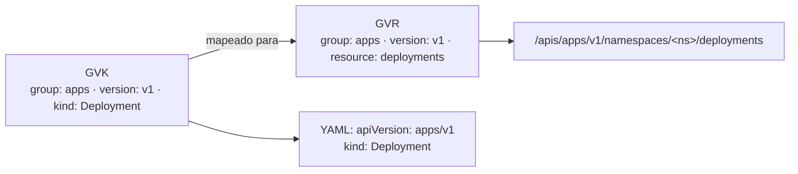

# Kind

## Definição em uma frase

`kind` é o campo, e o conceito, que identifica **qual esquema** um objeto segue (ex.: `Pod`, `Deployment`, `Route`). Junto com `apiVersion`, ele diz à API como interpretar o conteúdo.

## Explicação didática

Se o tipo de [recurso](resource.md) é o "endereço" (`deployments`), o **kind** é o "formulário" que define quais campos existem (`Deployment`). Todo objeto JSON devolvido pela API carrega `kind` e `apiVersion`, porque sem eles não há como decodificar o resto.

```yaml
apiVersion: route.openshift.io/v1   # grupo/versão
kind: Route                          # esquema dentro desse grupo/versão
```

O kind é escrito em **CamelCase e no singular**. O mesmo nome de kind pode existir em grupos diferentes, e é o par `apiVersion` + `kind` que o identifica sem ambiguidade (é o chamado GVK: *Group, Version, Kind*).

## Para que existe e qual problema resolve

Separar o **esquema** (kind) do **endereço** (recurso) e da **versão** permite que a API evolua: um mesmo kind pode ser servido em versões diferentes, e o servidor converte entre elas.

## Funcionamento técnico e ciclo de vida

As convenções da API dividem os kinds em três categorias:

1. **Objetos:** entidades persistentes, com metadados completos (`Pod`, `Service`, `Namespace`, `Node`).
2. **Listas:** coleções; o nome termina em `List` e os itens ficam no campo `items` (`PodList`, `NodeList`).
3. **Simples:** respostas de operações e entidades não persistidas, como `Status` (devolvido nos erros) e `Scale`. Muitos são **subrecursos**.

O termo "kind" é **reservado** a esses tipos de primeiro nível. Para subcategorias dentro de um objeto, a convenção é usar "type" (como no `type` de um Service ou de uma Condition).

## Relações e dependências

- Cada [tipo de recurso](resource.md) tem um kind: `pods` ↔ `Pod`, `deployments` ↔ `Deployment`.
- Kinds novos chegam por [CRDs](../../09-operators-e-extensoes/verbetes/customresourcedefinition.md), que declaram `spec.names.kind` e `spec.names.plural`.
- O kind de um objeto aparece em `ownerReferences`, nos Events e nas mensagens de erro.

## Exemplo de situação real

Um manifesto com `kind: deployment` (minúsculo) é rejeitado: o kind diferencia maiúsculas de minúsculas. No CLI, porém, `oc get deployment` e `oc get Deployment` funcionam, porque ali você informa o **recurso**, que o cliente resolve.

## Como visualizar e inspecionar (somente leitura)

```bash
# Relação recurso ↔ kind ↔ grupo/versão
oc api-resources | head -20

# Documentação do kind (cabeçalho mostra GROUP, KIND, VERSION)
oc explain route
oc explain deployment --api-version=apps/v1

# Kind real de um objeto
oc get deployment <nome> -n <namespace> -o jsonpath='{.apiVersion} {.kind}{"\n"}'
```

## Como interpretar a saída

O cabeçalho do `oc explain` tem esta forma (**ilustrativo**):

```text
GROUP:      apps
KIND:       Deployment
VERSION:    v1
```

- Para kinds do grupo *core* (ex.: `Pod`), o campo `GROUP` fica vazio ou é omitido.
- Se dois grupos servirem um kind de mesmo nome, use `--api-version=<grupo>/<versão>` ou a notação `recurso.grupo` para não ler o esquema errado.
- `kind: List` numa saída com vários tipos é invenção do cliente, e não um kind da API.

## Diferenças e confusões frequentes

| Termo | Forma | Uso |
|---|---|---|
| **Kind** | `Deployment` | Campo `kind` do YAML/JSON; `oc explain` |
| **Recurso** | `deployments` | URL, RBAC, `oc get` |
| **Short name** | `deploy` | Atalho do CLI |
| **`type`** | `ClusterIP`, `Ready` | Subcategoria **dentro** de um objeto |

- **Kind ≠ classe ontológica deste glossário.** Nem todo verbete tem kind: "Cluster", "Desired state" e "Reconciliation" são conceitos sem objeto.

## No OpenShift 4.22 versus Kubernetes

O OpenShift traz kinds próprios (`Route`, `Project`, `BuildConfig`, `ImageStream`, `ClusterVersion`, `ClusterOperator`...). O kind `DeploymentConfig` (grupo `apps.openshift.io`) continua servido, mas está **deprecated desde o OCP 4.14**; a alternativa é o `Deployment` (`apps/v1`).

## No HomeLab SNO

`oc explain` só consulta o esquema publicado e não altera nada: é a forma mais segura de estudar um kind. Os kinds que o seu SNO conhece dependem dos Operators instalados.

## Diagrama



*Legenda: GVK (esquema) e GVR (endereço) são duas faces do mesmo tipo.*

## Termos relacionados

[Resource](resource.md) · [Object](object.md) · [API](kubernetes-api.md) · [Spec](spec.md) · [CustomResourceDefinition](../../09-operators-e-extensoes/verbetes/customresourcedefinition.md)

## Fontes oficiais

- Kubernetes API Conventions — "Types (Kinds)" e "Resources": <https://github.com/kubernetes/community/blob/master/contributors/devel/sig-architecture/api-conventions.md>
- Kubernetes — API Concepts, "Kubernetes API terminology": <https://kubernetes.io/docs/reference/using-api/api-concepts/> (fonte: `kubernetes/website` `release-1.35`)
- Kubernetes — Objects In Kubernetes, "Required fields": <https://kubernetes.io/docs/concepts/overview/working-with-objects/>
- OCP 4.22 — Release notes, tabela de deprecated e removed (`DeploymentConfig`): <https://docs.redhat.com/en/documentation/openshift_container_platform/4.22/html/release_notes/ocp-4-22-release-notes>

<details>
<summary>Ficha técnica e notas de revisão</summary>

**Ficha técnica**

- **ID:** 00-fundamentos-e-linguagem/kind
- **Termo original:** kind
- **Tradução:** tipo (de objeto) — o termo em inglês é o usado na prática
- **Classe ontológica:** conceito (campo e terminologia da API)
- **Plataforma:** Kubernetes / OpenShift
- **Escopo:** não aplicável
- **Disponibilidade:** nativo
- **Versões validadas:** Kubernetes 1.35 / OCP 4.22
- **Nível:** básico
- **Atualizado em:** 2026-11-04

**Notas de revisão**

- **Estado:** desenvolvido. Fontes conferidas em 2026-11-04.
- **Pendências:** o formato do cabeçalho de `oc explain` é ilustrativo e **não foi executado**. A deprecação do `DeploymentConfig` foi confirmada nas release notes do 4.14 (fonte: `openshift-docs` `enterprise-4.14`, seção "DeploymentConfig resources are now deprecated") e na tabela de deprecated do 4.22.

</details>
