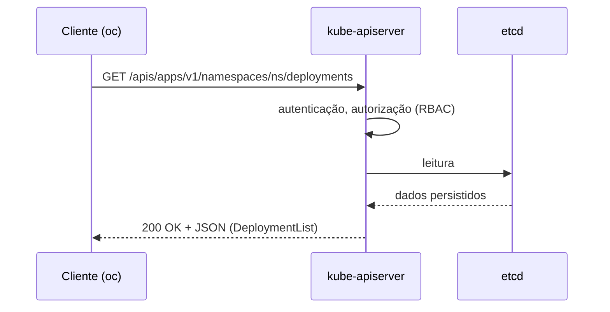

# API (Kubernetes API)

## Definição em uma frase

A API do Kubernetes é a **interface HTTP/REST**, servida pelo API server, pela qual se consultam e alteram todos os [objetos](object.md) que representam o estado do cluster.

## Explicação didática

Tudo passa pela API. O `oc`, o `kubectl`, o console web, os controllers e até o kubelet de cada nó são **clientes** dela. Quando você roda `oc get pods`, o CLI faz uma requisição HTTP `GET` para um caminho como `/api/v1/namespaces/<ns>/pods` e mostra a resposta em formato de tabela.

Por isso, entender a API é entender o Kubernetes: cada tipo de objeto tem um caminho, uma versão e um esquema.

## Para que existe e qual problema resolve

- **Fonte única da verdade:** o estado declarado fica num só lugar (o etcd), acessível apenas pelo API server, que valida, autentica e autoriza cada pedido.
- **Coordenação sem acoplamento:** os componentes não conversam entre si. Cada um observa a API e reage. Ver [Reconciliation](reconciliation.md).
- **Extensibilidade:** novos tipos podem ser acrescentados (CRDs, APIs agregadas) sem mudar os clientes.

## Funcionamento técnico e ciclo de vida

**Caminhos (URIs):**

| Tipo | Caminho |
|---|---|
| Grupo *core* (legado, sem nome) | `/api/v1/...` (ex.: `/api/v1/namespaces`) |
| Grupos nomeados | `/apis/<grupo>/<versão>/...` (ex.: `/apis/apps/v1/deployments`) |
| Recurso namespaced | `/apis/<grupo>/<versão>/namespaces/<ns>/<recurso>/<nome>` |
| Subrecurso | `.../<recurso>/<nome>/<subrecurso>` (ex.: `status`, `scale`) |

**Grupos e versões:** a API é versionada **por grupo**, e não por campo. Isso permite evoluir e descontinuar APIs de forma controlada. Um mesmo dado persistido pode ser servido em mais de uma versão (por exemplo `v1beta1` e `v1`), e o API server converte entre elas.

**Verbos:** além dos verbos HTTP (GET, POST, PUT, PATCH, DELETE), o Kubernetes usa verbos próprios: **get** (um item), **list** (coleção), **watch** (fluxo de mudanças), **create**, **update**, **patch**, **delete**. São esses nomes que aparecem nas regras de RBAC.

**Descoberta (discovery):** o servidor publica quais grupos, versões e recursos oferece. É daí que `oc api-resources` e `oc api-versions` tiram a informação. O esquema dos campos é publicado em OpenAPI, e é o que `oc explain` usa.

**Formatos:** JSON é o padrão; também há YAML, Protobuf e CBOR. O YAML dos manifestos é convertido pelo cliente antes do envio.

## Relações e dependências

- Os objetos são instâncias de [recursos](resource.md) de um [kind](kind.md).
- O API server é o único que lê e grava no etcd.
- O OpenShift serve grupos próprios (`route.openshift.io`, `project.openshift.io`, `config.openshift.io`, etc.) na mesma API.

## Exemplo de situação real

Um pipeline de CI cria um Deployment. A requisição vai à API, que autentica o token da ServiceAccount, verifica o RBAC (`create` em `deployments`), aplica os *admission controllers*, valida o esquema e grava o objeto. O controller do Deployment, que estava fazendo **watch**, recebe o evento e começa a trabalhar.

## Como visualizar e inspecionar (somente leitura)

```bash
# Grupos/versões servidos (discovery)
oc api-versions

# Recursos servidos, com grupo, kind, escopo e verbos
oc api-resources -o wide

# Recursos de um grupo específico
oc api-resources --api-group=apps

# Esquema de um tipo, a partir do OpenAPI publicado pelo servidor
oc explain deployment
oc explain deployment.spec.replicas

# Requisição GET crua à API (somente leitura); a saída é JSON
oc get --raw /apis/apps/v1 | head -c 600

# Ver as requisições HTTP que o oc faz (diagnóstico; não altera nada)
oc get pods -n <namespace> -v=6
```

## Como interpretar a saída

Linha **ilustrativa** de `oc api-resources -o wide`:

```text
NAME          SHORTNAMES   APIVERSION   NAMESPACED   KIND         VERBS
deployments   deploy       apps/v1      true         Deployment   create,delete,deletecollection,get,list,patch,update,watch
```

- `NAME` é o **recurso** (plural, minúsculo, usado na URL). `KIND` é o **tipo** do objeto (CamelCase, usado no YAML).
- `APIVERSION` = `<grupo>/<versão>`. Quando só aparece `v1`, o recurso é do grupo *core*.
- `NAMESPACED` diz se o recurso pertence a um namespace (`true`) ou ao cluster (`false`).
- `VERBS` lista o que **a API** suporta, e não o que **você** tem permissão de fazer. Para isso use `oc auth can-i <verbo> <recurso>`.
- Com `-v=6` aparecem linhas `GET https://.../api/v1/namespaces/<ns>/pods 200 OK`: o caminho REST real e o código HTTP.

## Diferenças e confusões frequentes

- **API ≠ API server.** A API é a interface (contrato). O kube-apiserver é o componente que a serve (ver [API Server](api-server.md)).
- **Recurso aparece em `api-resources` ≠ existem instâncias.** A lista só diz que o tipo é servido.
- **Erro `Forbidden` ≠ API inexistente.** `Forbidden` vem do RBAC; `the server doesn't have a resource type "x"` indica que a API não é servida.
- **`oc get all` ≠ "todos os recursos".** É só um conjunto pré-definido (categoria `all`).

## No OpenShift 4.22 versus Kubernetes

O OCP 4.22 serve a API do Kubernetes 1.35 **mais** os grupos do OpenShift e as CRDs dos Operators instalados. Duas instalações do 4.22 podem expor conjuntos de recursos diferentes, conforme os Operators e as *capabilities* habilitadas.

## No HomeLab SNO

Todos os comandos acima são leituras. O `oc get --raw` deve ficar restrito a caminhos de descoberta ou de leitura (`/api`, `/apis`, `/version`). **Não** use caminhos de Secret.

## Diagrama



## Termos relacionados

[Object](object.md) · [Resource](resource.md) · [Kind](kind.md) · [Kubernetes](kubernetes.md) · [Reconciliation](reconciliation.md) · [CustomResourceDefinition](../../09-operators-e-extensoes/verbetes/customresourcedefinition.md)

## Fontes oficiais

- Kubernetes — The Kubernetes API: <https://kubernetes.io/docs/concepts/overview/kubernetes-api/> (fonte: `kubernetes/website` `release-1.35`, `content/en/docs/concepts/overview/kubernetes-api.md`)
- Kubernetes — API Concepts (terminologia, URIs, verbos, formatos): <https://kubernetes.io/docs/reference/using-api/api-concepts/>
- Kubernetes Glossary — API Group: <https://kubernetes.io/docs/reference/glossary/?all=true#term-api-group>
- OCP 4.22 — CLI `oc`: <https://docs.redhat.com/en/documentation/openshift_container_platform/4.22/html/cli_tools/openshift-cli-oc>

<details>
<summary>Ficha técnica e notas de revisão</summary>

**Ficha técnica**

- **ID:** 00-fundamentos-e-linguagem/kubernetes-api
- **Termo original:** Kubernetes API
- **Remissões:** API, API REST do cluster
- **Tradução:** API do Kubernetes
- **Classe ontológica:** conceito / interface
- **Plataforma:** Kubernetes / OpenShift
- **Escopo:** não aplicável
- **Disponibilidade:** nativo
- **Versões validadas:** Kubernetes 1.35 / OCP 4.22
- **Nível:** básico
- **Atualizado em:** 2026-11-04

**Notas de revisão**

- **Estado:** desenvolvido. Fontes conferidas em 2026-11-04.
- **Pendências:** validar no SNO as colunas de `oc api-resources -o wide`. A linha mostrada é ilustrativa, montada a partir da documentação, e **não foi executada**. Os verbetes [API Server](api-server.md), [API Group](api-group.md) e [API Version](api-version.md) foram criados no lote 2.

</details>
