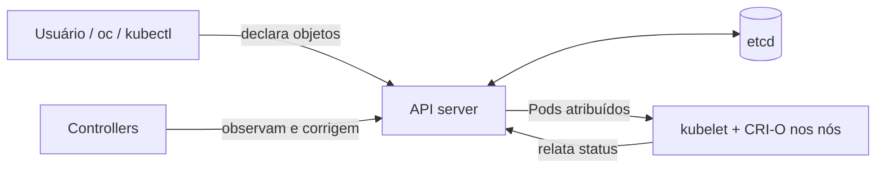

# Kubernetes

> **ID:** 00-fundamentos-e-linguagem/kubernetes | **Termo original:** Kubernetes | **Sigla/remissão:** K8s | **Tradução:** não se traduz (do grego, "timoneiro" ou "piloto") | **Classe ontológica:** tecnologia / plataforma | **Plataforma:** Kubernetes (upstream) | **Escopo:** não aplicável | **Disponibilidade:** nativo (é a base do OpenShift) | **Versões validadas:** Kubernetes 1.35 (a versão usada pelo OCP 4.22) | **Nível:** básico | **Atualizado em:** 2026-11-04

## Definição em uma frase

Kubernetes é uma plataforma de código aberto que **orquestra contêineres**: você declara como as aplicações devem estar, e ela trabalha continuamente para que o cluster fique desse jeito.

## Explicação didática

Executar um contêiner numa máquina é simples. O difícil é manter centenas deles funcionando em várias máquinas: reiniciar o que falhou, distribuir a carga, trocar versões sem parar o serviço, dar endereços estáveis e montar discos. O Kubernetes assume esse trabalho.

O ponto central é o **modelo declarativo**. Você não dá a ordem "inicie três contêineres". Você registra o que quer, por exemplo "quero três réplicas desta aplicação", e o sistema cuida do resto. Se uma réplica morrer, ele cria outra, porque o registro ainda diz "três".

**K8s** é só uma abreviação: o "8" conta as oito letras entre o "K" e o "s".

## Para que existe e qual problema resolve

- **Operação em escala:** substitui scripts e intervenções manuais por um sistema que corrige desvios sozinho (*self-healing*).
- **Portabilidade:** a mesma descrição de aplicação (manifesto) funciona em nuvens e data centers diferentes.
- **Padronização:** expõe tudo por uma única [API](kubernetes-api.md), o que permite ferramentas, automação e extensões.

Capacidades destacadas pela documentação oficial: descoberta de serviços e balanceamento de carga, orquestração de armazenamento, *rollouts* e *rollbacks* automatizados, alocação de contêineres conforme CPU e memória (*bin packing*), autorrecuperação, gestão de Secrets e configuração, e execução em lote.

## Funcionamento técnico e ciclo de vida

1. O usuário (ou uma ferramenta) envia um [objeto](object.md) à [API](kubernetes-api.md), descrevendo o [estado desejado](desired-state.md) no campo [`spec`](spec.md).
2. O API server valida o objeto e o grava no etcd.
3. **Controllers** observam a API, comparam o desejado com o [estado observado](current-state.md) e agem para reduzir a diferença. Esse ciclo é a [reconciliação](reconciliation.md).
4. Componentes nos nós (kubelet e o runtime de contêineres) executam o que foi decidido e relatam o resultado no campo [`status`](status.md).
5. O ciclo não termina: qualquer desvio posterior é detectado e corrigido.

## Relações e dependências

- É a base do [OpenShift Container Platform](openshift-container-platform.md). O OCP 4.22 usa o **Kubernetes 1.35** com o runtime CRI-O.
- Organiza-se em um [cluster](cluster.md): plano de controle mais [nós](../../02-compute-e-nodes/verbetes/node.md).
- Tudo o que ele gerencia é representado como [recursos](resource.md) e [objetos](object.md) de um [kind](kind.md).

## Exemplo de situação real

Uma loja virtual roda em três réplicas. À noite, um nó falha. Ninguém é acionado: o controller do [Deployment](../../03-workloads/verbetes/deployment.md) percebe que há menos réplicas que o declarado e pede novos [Pods](../../03-workloads/verbetes/pod.md). O scheduler os coloca em nós saudáveis. De manhã, o time só encontra o registro do ocorrido nos Events.

## Como visualizar e inspecionar (somente leitura)

O Kubernetes não é um objeto da API. Observa-se a plataforma de forma indireta: pela versão do servidor e pelas APIs que ele publica.

```bash
# Versões do cliente e do servidor (inclui a versão do Kubernetes)
oc version

# Para qual API server o contexto atual aponta
oc whoami --show-server

# Grupos/versões de API servidos pelo cluster
oc api-versions
```

## Como interpretar a saída

Saída **ilustrativa** de `oc version` (os números variam conforme o cluster):

```text
Client Version: 4.22.x
Kustomize Version: v5.x.x
Server Version: 4.22.x
Kubernetes Version: v1.35.x
```

- `Server Version` é a versão do OpenShift. `Kubernetes Version` é a do Kubernetes embutido.
- Se aparecer só o cliente, seguido de um erro de conexão, o `oc` não alcançou a API. Isso não diz nada sobre a saúde do cluster.
- Em `oc api-versions`, linhas como `apps/v1` são grupos do Kubernetes. Linhas terminadas em `.openshift.io` (por exemplo `route.openshift.io/v1`) são APIs acrescentadas pelo OpenShift.

## Diferenças e confusões frequentes

- **Kubernetes ≠ Docker.** O Docker é uma ferramenta de contêineres. O Kubernetes orquestra contêineres por meio de um runtime compatível com a CRI. No OpenShift esse runtime é o CRI-O.
- **Kubernetes ≠ OpenShift.** O OpenShift é uma distribuição empresarial que **contém** o Kubernetes e acrescenta APIs, Operators, console, registry, builds e um SO próprio. Ver [OpenShift Container Platform](openshift-container-platform.md).
- **"Kubernetes faz tudo" — não.** A documentação oficial deixa claro que ele não é um PaaS completo: não faz build de código-fonte nem impõe soluções de logging ou monitoramento. As distribuições é que acrescentam isso.

## No OpenShift 4.22 versus Kubernetes

As release notes do OCP 4.22 informam que a versão usa **Kubernetes 1.35 com CRI-O**. Recursos novos do Kubernetes posteriores à 1.35 **não** devem ser presumidos no OCP 4.22. A página atual de kubernetes.io pode já descrever uma versão mais nova.

## No HomeLab SNO

Presente: o SNO é um cluster OpenShift completo, logo roda Kubernetes 1.35. Para confirmar a versão, basta `oc version`, que não altera nada no cluster.

## Diagrama Mermaid



*Legenda: visão lógica simplificada; não representa o fluxo físico de rede.*

## Termos relacionados

[OpenShift Container Platform](openshift-container-platform.md) · [Cluster](cluster.md) · [API](kubernetes-api.md) · [Objeto](object.md) · [Reconciliação](reconciliation.md) · [Node](../../02-compute-e-nodes/verbetes/node.md)

## Fontes oficiais

- Kubernetes — Overview: <https://kubernetes.io/docs/concepts/overview/> (fonte conferida: `kubernetes/website`, branch `release-1.35`, `content/en/docs/concepts/overview/_index.md`)
- OCP 4.22 — Release notes, "About this release": <https://docs.redhat.com/en/documentation/openshift_container_platform/4.22/html/release_notes/ocp-4-22-release-notes> (fonte conferida: `openshift/openshift-docs`, branch `enterprise-4.22`, `modules/rn-ocp-about-this-release.adoc`)
- OCP 4.22 — CLI `oc`: <https://docs.redhat.com/en/documentation/openshift_container_platform/4.22/html/cli_tools/openshift-cli-oc>

## Revisão editorial

- **Estado:** 🟡 desenvolvido. O conteúdo foi conferido nos fontes oficiais (GitHub) em 2026-11-04.
- **Pendências:** abrir as URLs publicadas (kubernetes.io e docs.redhat.com estavam bloqueados pela rede da sessão); validar a saída de `oc version` no SNO. A saída mostrada é ilustrativa e **não foi executada**.
