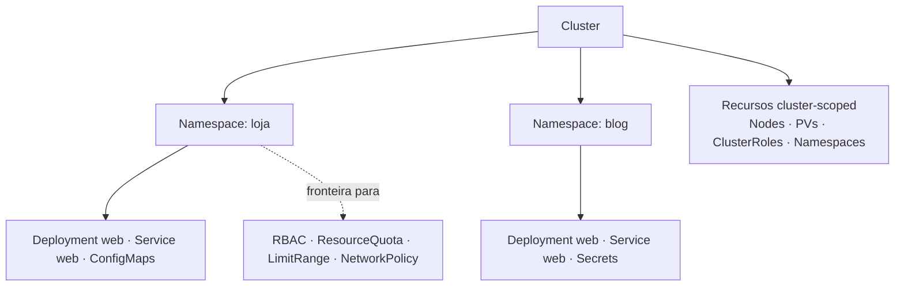

# Namespace

> **ID:** 00-fundamentos-e-linguagem/namespace | **Termo original:** Namespace | **Remissões:** ns, Project (OpenShift) | **Tradução:** espaço de nomes | **Classe ontológica:** objeto da API | **API:** `apiVersion: v1` (grupo *core*), `kind: Namespace` | **Plataforma:** Kubernetes (no OpenShift, apresentado como Project) | **Escopo:** **cluster-scoped** (o namespace em si não pertence a outro namespace) | **Disponibilidade:** nativo | **Versões validadas:** Kubernetes 1.35 / OCP 4.22 | **Nível:** básico | **Atualizado em:** 2026-11-04

## Definição em uma frase

Um Namespace é um objeto que **divide logicamente um cluster**: delimita o escopo dos nomes e serve de fronteira para permissões, quotas e políticas dos recursos *namespaced*.

## Explicação didática

Num cluster compartilhado, duas equipes querem um Deployment chamado `web`. Com namespaces, cada uma tem o seu: `loja/web` e `blog/web`. Os nomes precisam ser únicos **dentro** do namespace, não entre namespaces.

Namespaces **não se aninham** (não existe namespace dentro de namespace), e cada recurso namespaced pertence a **exatamente um** namespace. Recursos cluster-scoped, como Nodes, PersistentVolumes, ClusterRoles e os próprios Namespaces, ficam fora desse recorte.

## Para que existe e qual problema resolve

- **Escopo de nomes:** evita colisões entre equipes e ambientes.
- **Fronteira administrativa:** RBAC por namespace (Role/RoleBinding), quotas (ResourceQuota) e limites (LimitRange).
- **Organização:** agrupa o que pertence a uma aplicação ou equipe.

A documentação faz duas ressalvas: clusters pequenos, com poucos usuários, podem nem precisar de vários namespaces; e versões diferentes do mesmo software não pedem namespaces separados, porque **labels** bastam.

## Funcionamento técnico e ciclo de vida

1. **Criação:** um objeto `Namespace` com um nome válido como **label DNS RFC 1123**, porque o nome entra nos nomes DNS dos Services (`<serviço>.<namespace>.svc.cluster.local`).
2. **Uso:** recursos namespaced são criados com `metadata.namespace`. A URL inclui `/namespaces/<ns>/`.
3. **Exclusão:** apagar um namespace apaga **todos** os recursos namespaced dentro dele. O namespace fica em `status.phase: Terminating` até que o conteúdo seja removido e os *finalizers* sejam atendidos; só então desaparece.

**Namespaces iniciais do Kubernetes:** `default`, `kube-node-lease` (Leases de heartbeat dos nós), `kube-public` (legível por todos, por convenção) e `kube-system` (objetos do sistema). Evite criar namespaces com prefixo `kube-`, reservado ao sistema. Em produção, prefira não usar o `default`.

## Relações e dependências

- Define o escopo do [nome](resource-name.md) e se aplica a [recursos](resource.md) namespaced.
- É gerenciado pelo controller de namespace (ver [Controller](controller.md)).
- Fronteira para RBAC, quotas e [NetworkPolicy](../../04-networking/verbetes/networkpolicy.md).
- No OpenShift, cada namespace de usuário é apresentado como um **Project** (ver [Project](project.md)).

## Exemplo de situação real

Um namespace fica preso em `Terminating` por horas. Em geral, algum recurso lá dentro tem um *finalizer* que depende de um controller ausente (por exemplo, de um Operator já desinstalado), ou uma API agregada está indisponível e impede listar todo o conteúdo. A investigação começa pelas `conditions` do namespace, e não por remover finalizers à força.

## Como visualizar e inspecionar (somente leitura)

```bash
# Namespaces e fase
oc get namespaces

# OpenShift: projetos a que você tem acesso
oc get projects

# Detalhes: labels, annotations, status, quotas e limites aplicados
oc describe namespace <nome>

# Fase e condições (úteis em Terminating)
oc get namespace <nome> \
  -o jsonpath='{.status.phase}{"\n"}{range .status.conditions[*]}{.type}={.status} {.message}{"\n"}{end}'

# Namespace padrão do seu contexto atual
oc project -q

# Recursos que pertencem a namespaces
oc api-resources --namespaced=true | head
```

## Como interpretar a saída

Saída **ilustrativa** de `oc get namespaces`:

```text
NAME                STATUS   AGE
default             Active   30d
kube-system         Active   30d
openshift-ingress   Active   30d
<seu-projeto>       Active   2d
```

- `STATUS` `Active` é o normal; `Terminating` significa exclusão em curso, ou travada.
- Em `oc describe namespace`, procure:
  - a label `kubernetes.io/metadata.name`, que o sistema coloca automaticamente com o nome do namespace e é útil em seletores de NetworkPolicy;
  - no OpenShift, annotations como `openshift.io/display-name`, `openshift.io/description`, `openshift.io/requester` e as faixas `openshift.io/sa.scc.*` (UIDs de processo para as SCCs; ver categoria 08);
  - as seções de *Resource Quotas* e *LimitRange*, quando existirem.
- Uma lista de `oc get projects` menor que a de `oc get namespaces` é esperada: `projects` mostra só o que **você** pode ver.

## Diferenças e confusões frequentes

- **Namespace ≠ isolamento de rede:** sem NetworkPolicy, Pods de namespaces diferentes podem se comunicar.
- **Namespace ≠ isolamento físico:** Pods de namespaces diferentes podem dividir o mesmo nó.
- **Namespace × Project:** no OpenShift, o **Project** é um namespace com annotations adicionais que dão controle de acesso e gestão. O usuário comum cria projetos (`oc new-project`); o objeto `Namespace` subjacente é o que guarda os recursos.
- **Namespace × label:** para separar variações da mesma aplicação, labels costumam bastar.

## No OpenShift 4.22 versus Kubernetes

- Projetos que começam com `openshift-` e `kube-` são **projetos padrão** da plataforma. Eles hospedam componentes do cluster, e o `oc new-project` não deixa criá-los.
- O OpenShift tem também o namespace `openshift`, usado para conteúdo compartilhado (como templates e imagens), entre outros de plataforma.

## No HomeLab SNO

Liste e descreva à vontade. **Não** apague nem edite namespaces `openshift-*`, `kube-*` ou `default`. Estude o ciclo de vida (criação e exclusão) só em projetos próprios, de laboratório.

## Diagrama Mermaid



*Legenda: o mesmo nome (`web`) pode existir em namespaces diferentes; os recursos cluster-scoped ficam fora do recorte.*

## Termos relacionados

[Resource Name](resource-name.md) · [Resource](resource.md) · [Cluster](cluster.md) · [Metadata](metadata.md) · [NetworkPolicy](../../04-networking/verbetes/networkpolicy.md) · [OpenShift Container Platform](openshift-container-platform.md)

## Fontes oficiais

- Kubernetes — Namespaces: <https://kubernetes.io/docs/concepts/overview/working-with-objects/namespaces/> (fonte: `kubernetes/website` `release-1.35`, `concepts/overview/working-with-objects/namespaces.md`)
- Kubernetes Glossary — Namespace: <https://kubernetes.io/docs/reference/glossary/?all=true#term-namespace>
- OCP 4.22 — Working with projects (projetos padrão `openshift-`/`kube-`): <https://docs.redhat.com/en/documentation/openshift_container_platform/4.22/html/building_applications/projects> (fonte: `applications/projects/working-with-projects.adoc`)
- OCP 4.22 — Glossary, "project" (namespace com annotations adicionais para RBAC e gestão; fonte: `welcome/glossary.adoc`)

<details>
<summary>Notas de revisão</summary>

- **Estado:** desenvolvido (antes era uma versão inicial). Reescrito no lote 2 com base nas fontes conferidas em 2026-11-04.
- **Pendências:** a label automática `kubernetes.io/metadata.name` e as annotations `openshift.io/*` devem ser conferidas no SNO com `oc describe namespace <nome>`, que **não foi executado**. As causas de `Terminating` travado devem ser aprofundadas no verbete *Finalizer*. A URL publicada de "Working with projects" está **a verificar**.

</details>
