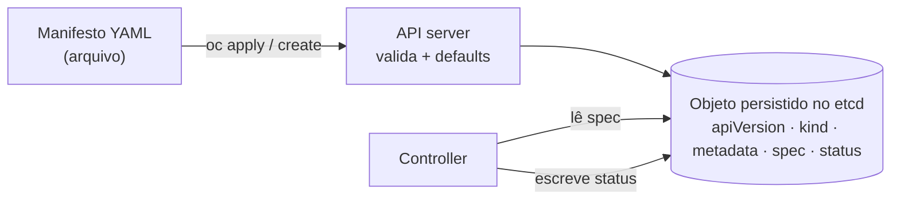

# Object (objeto)

> **ID:** 00-fundamentos-e-linguagem/object | **Termo original:** Kubernetes object / API object | **Tradução:** objeto (do Kubernetes) | **Classe ontológica:** conceito (modelo de dados da API) | **Plataforma:** Kubernetes / OpenShift | **Escopo:** cada objeto é namespaced ou cluster-scoped, conforme o seu tipo | **Disponibilidade:** nativo | **Versões validadas:** Kubernetes 1.35 / OCP 4.22 | **Nível:** básico | **Atualizado em:** 2026-11-04

## Definição em uma frase

Um objeto é uma **entidade persistente** guardada pela API do Kubernetes, que representa uma parte do estado do cluster e funciona como um **registro de intenção** (*record of intent*).

## Explicação didática

Quando você cria um Deployment, não está "executando um programa": está **gravando um registro** que diz "quero esta aplicação assim". A partir desse momento, o sistema trabalha para que o registro seja verdade. Se você apaga o objeto, a intenção deixa de existir, e os controllers desfazem o que ele tinha criado.

Todo objeto tem a mesma "carcaça" de campos:

```yaml
# Esqueleto didático (não é um manifesto para aplicar)
apiVersion: apps/v1        # grupo/versão do esquema
kind: Deployment           # tipo do objeto
metadata:                  # identidade: name, namespace, uid, labels, annotations...
  name: exemplo
  namespace: minha-app
spec:                      # desired state (escrito por você)
  replicas: 3
status:                    # current state (escrito pelo sistema)
  readyReplicas: 3
```

## Para que existe e qual problema resolve

O objeto transforma o **"o que eu quero"** em dados versionados e consultáveis. Assim, vários componentes independentes podem ler a mesma intenção e cooperar sem conversar diretamente, e o sistema tolera falhas: o que foi pedido continua registrado mesmo que um componente reinicie.

Segundo a documentação, objetos descrevem, por exemplo: quais aplicações conteinerizadas estão rodando e em quais nós; os recursos disponíveis para elas; e as políticas de comportamento (reinício, atualização, tolerância a falhas).

## Funcionamento técnico e ciclo de vida

1. **Criação:** o cliente envia o objeto (JSON) à [API](kubernetes-api.md). São obrigatórios `apiVersion`, `kind`, `metadata` (com `name`) e, nos tipos que o têm, `spec`.
2. **Persistência:** o API server valida, aplica valores padrão (*defaulting*) e grava no etcd. O sistema preenche `metadata.uid`, `metadata.resourceVersion` e `metadata.creationTimestamp`.
3. **Reconciliation:** controllers leem o [`spec`](spec.md), agem e escrevem o [`status`](status.md).
4. **Alteração:** mudanças em `spec` incrementam `metadata.generation` na maioria dos tipos; os controllers retomam a reconciliation.
5. **Exclusão:** o objeto pode passar por [finalizers](finalizer.md) e pela [garbage collection](garbage-collection.md) dos objetos dependentes.

**Unicidade:** dentro de um namespace só pode existir um objeto de um dado tipo com um dado nome. Para tipos cluster-scoped, como Node, o nome é único no cluster todo.

## Relações e dependências

- É uma instância de um [recurso](resource.md), e o seu esquema é definido pelo [kind](kind.md).
- Carrega o [desired state](desired-state.md) e o [current state](current-state.md).
- Exceções: alguns tipos não são persistidos. São "virtuais", como `SubjectAccessReview`, que representa uma operação (uma pergunta de permissão) e não uma entidade.

## Exemplo de situação real

Uma pessoa apaga por engano um Pod de um Deployment. O Pod volta sozinho, porque o **objeto** Deployment, e o ReplicaSet que ele controla, continuam registrando "três réplicas". Já se ela apagar o **Deployment**, os Pods somem: a intenção foi removida.

## Como visualizar e inspecionar (somente leitura)

```bash
# Objeto completo, como está armazenado (inclui metadata e status)
oc get deployment <nome> -n <namespace> -o yaml

# Visão resumida, com eventos relacionados
oc describe deployment <nome> -n <namespace>

# Só a identidade do objeto
oc get deployment <nome> -n <namespace> \
  -o jsonpath='{.metadata.uid}{"  "}{.metadata.resourceVersion}{"\n"}'

# Esquema dos campos de primeiro nível do tipo
oc explain deployment
```

> ⚠️ Não use `-o yaml` em **Secrets**: a saída contém `data` (base64 ≠ cifragem). Para Secrets, use apenas `oc get secret` ou `oc describe secret`.

## Como interpretar a saída

No `-o yaml`, procure **quatro blocos**:

- `apiVersion` e `kind`: o que é o objeto.
- `metadata`: identidade (`name`, `namespace`, `uid`), organização (`labels`, `annotations`), controle (`ownerReferences`, `finalizers`, `generation`, `resourceVersion`) e `managedFields` (registro de quem gerencia cada campo; pode ser longo e geralmente se ignora numa leitura rápida).
- `spec`: o que foi pedido, incluindo os valores padrão que o servidor acrescentou.
- `status`: o que o sistema observou, como `conditions`, contadores e `observedGeneration`.

Se o `status` estiver vazio logo após a criação, isso costuma significar que nenhum controller agiu ainda. Não é, por si só, um erro.

## Diferenças e confusões frequentes

- **Objeto × recurso:** a documentação usa "resource" para a instância na URL e "object" para a entidade persistente; na prática, os termos se sobrepõem. Ver [Resource](resource.md).
- **Objeto × manifesto:** o manifesto é o **arquivo** (YAML/JSON) que descreve o objeto. O objeto é o que fica **armazenado** na API, já com `uid`, `status` e padrões.
- **Objeto × processo:** um Pod é um objeto; os contêineres que ele descreve são processos nos nós.
- **`kind: List`** que aparece em algumas saídas do `oc`/`kubectl` não é um objeto da API: é um artifício do cliente.

## No OpenShift 4.22 versus Kubernetes

O modelo é idêntico. O OpenShift só acrescenta **tipos** de objeto (Route, Project, BuildConfig, ClusterOperator...), e todos seguem a mesma estrutura `apiVersion`/`kind`/`metadata`/`spec`/`status`.

## No HomeLab SNO

Use `-o yaml` e `describe` à vontade em objetos de aplicação e de leitura. Em namespaces `openshift-*` e `kube-*`, apenas **observe**: não edite nem apague objetos de plataforma.

## Diagrama Mermaid



## Termos relacionados

[Resource](resource.md) · [Kind](kind.md) · [Spec](spec.md) · [Status](status.md) · [Desired State](desired-state.md) · [API](kubernetes-api.md) · [Namespace](namespace.md)

## Fontes oficiais

- Kubernetes — Objects In Kubernetes: <https://kubernetes.io/docs/concepts/overview/working-with-objects/> (fonte: `kubernetes/website` `release-1.35`, `content/en/docs/concepts/overview/working-with-objects/_index.md`)
- Kubernetes — API Concepts, "Kubernetes API terminology" e "Object names": <https://kubernetes.io/docs/reference/using-api/api-concepts/>
- Kubernetes API Conventions — "Types (Kinds)", "Objects": <https://github.com/kubernetes/community/blob/master/contributors/devel/sig-architecture/api-conventions.md>

## Revisão editorial

- **Estado:** 🟡 desenvolvido. Fontes conferidas em 2026-11-04.
- **Pendências:** a afirmação sobre `metadata.generation` deve ser aprofundada nos verbetes *Generation* e *ObservedGeneration*. Exemplos de saída **não executados** no SNO.
