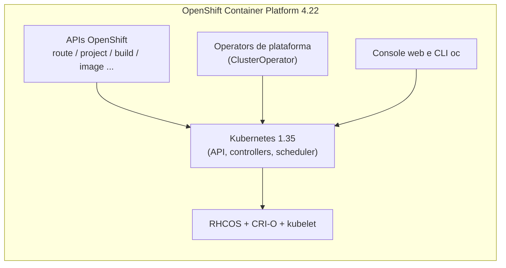

# OpenShift Container Platform

## Definição em uma frase

O OpenShift Container Platform é a **distribuição Kubernetes certificada da Red Hat**: ao Kubernetes ele acrescenta sistema operacional próprio, instalação e atualização automatizadas, APIs adicionais, Operators de plataforma e ferramentas de desenvolvimento e administração.

## Explicação didática

Pense no [Kubernetes](kubernetes.md) como um motor. Ele é poderoso, mas não vem com carroceria, painel nem manual de manutenção. O OpenShift entrega o veículo completo: o motor Kubernetes, o sistema operacional dos nós, a rede, o registry de imagens, o console web, autenticação, monitoramento e um processo de atualização que cuida de tudo isso junto.

Por ser **certificado**, o OpenShift aceita o `kubectl` e os objetos padrão do Kubernetes. O CLI `oc` faz o mesmo que o `kubectl` e acrescenta comandos próprios do OpenShift.

## Para que existe e qual problema resolve

A documentação da Red Hat destaca que o Kubernetes **não especifica nem gerencia** os requisitos de plataforma, nem o processo de implantação do próprio cluster. O OCP resolve isso com:

- **SO próprio (RHCOS):** sistema operacional orientado a contêineres, com Ignition (configuração no primeiro boot), CRI-O (runtime) e kubelet.
- **Instalação e atualização automatizadas:** o cluster controla o SO e os serviços de cada máquina a partir do control plane, e a atualização vira um processo orquestrado.
- **Gestão por Operators:** cada componente da plataforma é mantido por um Operator, e o estado de cada um é exposto num objeto `ClusterOperator`.
- **APIs adicionais:** por exemplo Route, Project, BuildConfig e ImageStream, nos grupos `*.openshift.io`.

## Funcionamento técnico e ciclo de vida

1. **Instalação:** o instalador cria o cluster com uma topologia que é **definitiva**. A documentação do SNO alerta que um cluster de nó único não pode ser convertido em HA depois.
2. **Operação:** Operators de plataforma reconciliam continuamente os componentes (API server, rede, ingress, registry...). É o mesmo modelo de [reconciliation](reconciliation.md) do Kubernetes, aplicado à própria plataforma.
3. **Atualização:** a versão desejada do cluster é declarada num objeto `ClusterVersion` (grupo `config.openshift.io`), e os Operators levam a plataforma até ela.

## Relações e dependências

- **Contém** o [Kubernetes](kubernetes.md): no 4.22, Kubernetes 1.35 com CRI-O.
- Estende a [API](kubernetes-api.md) com grupos próprios e com [CustomResourceDefinitions](../../09-operators-e-extensoes/verbetes/customresourcedefinition.md).
- Saúde da plataforma: [ClusterOperator](../../09-operators-e-extensoes/verbetes/clusteroperator.md) e [Operator](../../09-operators-e-extensoes/verbetes/operator.md).
- [Namespace](namespace.md) e Project: o Project é a forma do OpenShift de apresentar e controlar namespaces.

## Exemplo de situação real

Uma equipe migra do Kubernetes "puro" para o OCP. Os manifestos de Deployment, Service e ConfigMap continuam funcionando, porque são APIs Kubernetes padrão. A equipe passa a usar Route para publicar a aplicação e o console para acompanhar os eventos. Quem cuida do cluster atualiza o SO e o Kubernetes num único fluxo, em vez de manter cada nó separadamente.

## Como visualizar e inspecionar (somente leitura)

```bash
# Versão do OpenShift e do Kubernetes embutido
oc version

# Versão desejada e histórico de atualização do cluster
# (exige permissão de leitura em nível de cluster, por exemplo cluster-reader)
oc get clusterversion

# Estado dos Operators de plataforma
oc get clusteroperators

# APIs próprias do OpenShift publicadas neste cluster
oc api-resources --api-group=route.openshift.io
oc api-resources --api-group=project.openshift.io
```

## Como interpretar a saída

Saída **ilustrativa** de `oc get clusterversion`:

```text
NAME      VERSION   AVAILABLE   PROGRESSING   SINCE   STATUS
version   4.22.x    True        False         5d      Cluster version is 4.22.x
```

- Existe um único objeto, chamado `version`, que é cluster-scoped.
- `AVAILABLE=True` e `PROGRESSING=False` indicam um cluster estável, sem atualização em curso. `PROGRESSING=True` significa uma atualização em andamento.
- Erro `Forbidden` = **falta de permissão (RBAC)**, não ausência do recurso. `the server doesn't have a resource type` significa que a API não existe naquele cluster (por exemplo, um Kubernetes que não é OpenShift).

## Diferenças e confusões frequentes

| Termo | O que é |
|---|---|
| **OCP** | O produto comercial da Red Hat com suporte |
| **OKD** | A distribuição comunitária relacionada ao OpenShift |
| **OpenShift Kubernetes Engine (OKE)** | Uma subscrição com um conjunto **limitado de recursos suportados**, a preço menor. Segundo a Red Hat, é o mesmo software do OCP; o que muda é o escopo do suporte |
| **"OpenShift 3"** | Geração anterior, com Docker como engine; o CRI-O a substituiu no 4.x |

- O OpenShift **não substitui** objetos Kubernetes: um Deployment é o mesmo no OCP e no Kubernetes. O `DeploymentConfig`, próprio do OpenShift, está **deprecated** (desde o OCP 4.14) e não é a escolha moderna.

## No OpenShift 4.22 versus Kubernetes

- Kubernetes 1.35, runtime CRI-O.
- O control plane exige RHCOS. A documentação admite RHEL nos nós de compute, com mais manutenção manual.
- Termos como Route, Project e ClusterOperator **não existem** num Kubernetes upstream.

## No HomeLab SNO

O SNO é um OCP 4.22 completo num único nó, que acumula o papel de control plane e o de compute. Pela documentação oficial, o maior compromisso dessa topologia é a **falta de alta disponibilidade**, e não há como convertê-la em HA depois. O OVN-Kubernetes é o plugin de rede padrão. Os comandos acima são só de leitura e servem para conhecer o cluster sem alterá-lo.

## Diagrama



*Legenda: camadas conceituais; não é diagrama de implantação.*

## Termos relacionados

[Kubernetes](kubernetes.md) · [Cluster](cluster.md) · [API](kubernetes-api.md) · [Namespace](namespace.md) · [ClusterOperator](../../09-operators-e-extensoes/verbetes/clusteroperator.md) · [Operator](../../09-operators-e-extensoes/verbetes/operator.md)

## Fontes oficiais

- OCP 4.22 — Architecture (introdução e visão geral): <https://docs.redhat.com/en/documentation/openshift_container_platform/4.22/html/architecture/architecture> (fontes conferidas: `openshift/openshift-docs` `enterprise-4.22`, `modules/architecture-platform-introduction.adoc` e `modules/architecture-platform-benefits.adoc`)
- OCP 4.22 — Usage of oc and kubectl commands (fonte: `cli_reference/openshift_cli/usage-oc-kubectl.adoc`): <https://docs.redhat.com/en/documentation/openshift_container_platform/4.22/html/cli_tools/openshift-cli-oc>
- OCP 4.22 — Release notes (Kubernetes 1.35, CRI-O; DeploymentConfig deprecated): <https://docs.redhat.com/en/documentation/openshift_container_platform/4.22/html/release_notes/ocp-4-22-release-notes>
- OCP 4.22 — Single-node OpenShift (fonte: `modules/install-sno-about-installing-on-a-single-node.adoc`)
- OCP 4.22 — About OpenShift Kubernetes Engine (fonte: `welcome/oke_about.adoc`) e Glossary (fonte: `welcome/glossary.adoc`)

<details>
<summary>Ficha técnica e notas de revisão</summary>

**Ficha técnica**

- **ID:** 00-fundamentos-e-linguagem/openshift-container-platform
- **Termo original:** Red Hat OpenShift Container Platform
- **Sigla/remissão:** OCP, "OpenShift"
- **Tradução:** não se traduz
- **Classe ontológica:** tecnologia / plataforma (distribuição Kubernetes)
- **Plataforma:** OpenShift
- **Escopo:** não aplicável
- **Disponibilidade:** produto comercial da Red Hat (OKD é a distribuição comunitária)
- **Versões validadas:** OCP 4.22 (Kubernetes 1.35)
- **Nível:** básico
- **Atualizado em:** 2026-11-04

**Notas de revisão**

- **Estado:** desenvolvido. O conteúdo foi conferido nos fontes oficiais (GitHub) em 2026-11-04.
- **Pendências:** confirmar as URLs publicadas (docs.redhat.com estava bloqueado pela rede da sessão); validar `oc get clusterversion` no SNO, que **não foi executado**. Detalhar OKE e OKD num verbete próprio se entrarem no inventário.

</details>
