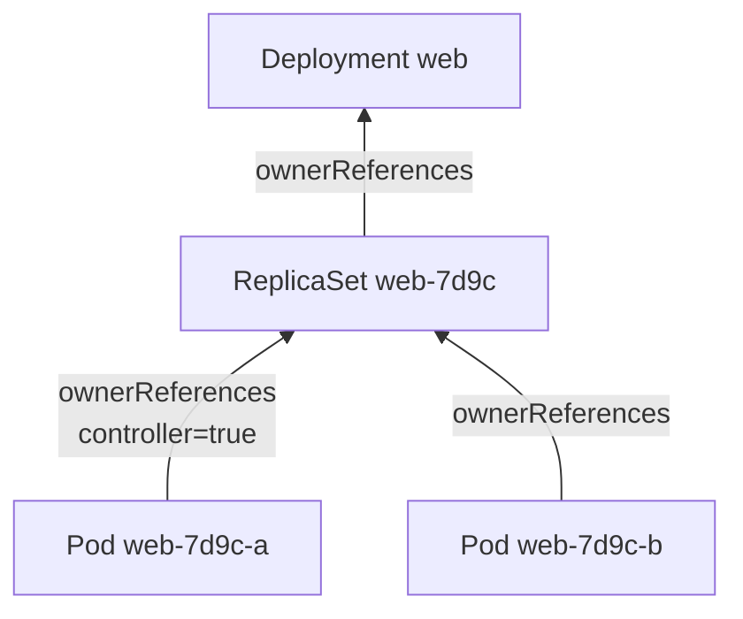

# OwnerReference

> **ID:** 00-fundamentos-e-linguagem/owner-reference | **Termo original:** owner reference (`metadata.ownerReferences`) | **Remissões:** owner, dependent, dono, dependente | **Tradução:** referência de dono | **Classe ontológica:** conceito (campo de metadata) | **Plataforma:** Kubernetes / OpenShift | **Escopo:** dono e dependente no mesmo namespace, ou dono cluster-scoped | **Disponibilidade:** nativo | **Versões validadas:** Kubernetes 1.35 / OCP 4.22 | **Nível:** intermediário | **Atualizado em:** 2026-11-04

## Definição em uma frase

`ownerReferences` é o campo em que um objeto **dependente** registra quem é o seu **dono** (*owner*), pelo nome e pelo [UID](uid.md). É isso que permite ao Kubernetes limpar os dependentes quando o dono é apagado.

## Explicação didática

Um ReplicaSet é dono dos seus Pods; um Deployment é dono dos seus ReplicaSets. Cada Pod carrega uma "certidão" dizendo: "meu dono é o ReplicaSet `web-7d9c` com UID tal". Quando o dono some, o coletor de lixo encontra os órfãos por essa certidão.

**Propriedade ≠ seleção.** Um Service usa [labels](label.md) para saber quais EndpointSlices são seus, mas cada EndpointSlice **também** tem uma owner reference para o Service. As duas coisas convivem e têm finalidades diferentes: o seletor agrupa, e a referência de dono **governa a vida** do objeto.

## Para que existe e qual problema resolve

- **Limpeza automática:** apagar um Deployment remove, em cascata, ReplicaSets e Pods.
- **Não interferência:** controllers só mexem no que é deles. O Job controller não apaga Pods de um Deployment, porque o dono registrado é outro.

## Funcionamento técnico e ciclo de vida

Cada entrada de `ownerReferences` contém `apiVersion`, `kind`, `name` e `uid` do dono, além de dois indicadores:

- **`controller: true`:** marca **o** controller gerente; no máximo um dono pode ter essa marca.
- **`blockOwnerDeletion: true`:** na exclusão em primeiro plano (*foreground*), este dependente **bloqueia** a remoção do dono até ser apagado. O Kubernetes define esse campo como `true` automaticamente quando o dono foi registrado por um controller. Um *admission controller* restringe quem pode alterar o campo, com base na permissão de exclusão sobre o dono.

O Kubernetes preenche `ownerReferences` sozinho para dependentes de ReplicaSets, DaemonSets, Deployments, Jobs, CronJobs e ReplicationControllers. É possível configurar à mão, mas raramente é necessário.

**Regras de escopo:**
- Referências **entre namespaces são proibidas** por design.
- Um dependente namespaced pode ter dono namespaced (**do mesmo namespace**) ou cluster-scoped. Se o dono namespaced não estiver no mesmo namespace, a referência é tratada como **ausente**, e o dependente pode ser apagado.
- Um dependente cluster-scoped só pode ter dono cluster-scoped. Se apontar para um kind namespaced, a referência fica **irresolvível**, e o objeto não é coletado.
- Nesses casos inválidos, o coletor emite um Event `Warning` com `reason: OwnerRefInvalidNamespace`.

## Relações e dependências

- Usa o [UID](uid.md) do dono; fica em [metadata](metadata.md).
- É a base da [Garbage Collection](garbage-collection.md) e interage com [Finalizers](finalizer.md) (exclusão *foreground* e *orphan*).
- Complementa, sem substituir, os [Selectors](selector.md).

## Exemplo de situação real

Um Pod "avulso" é criado com as mesmas labels de um ReplicaSet. O ReplicaSet pode **adotá-lo**: o controller acrescenta a owner reference se o Pod casar com o seletor e não tiver outro controller. O total de réplicas passa a contar esse Pod. É mais um motivo para seletores específicos.

## Como visualizar e inspecionar (somente leitura)

```bash
# Donos de um Pod
oc get pod <nome> -n <namespace> \
  -o jsonpath='{range .metadata.ownerReferences[*]}{.kind}/{.name} uid={.uid} controller={.controller} block={.blockOwnerDeletion}{"\n"}{end}'

# Subindo a cadeia: dono do ReplicaSet
oc get replicaset <nome> -n <namespace> \
  -o jsonpath='{range .metadata.ownerReferences[*]}{.kind}/{.name}{"\n"}{end}'

# Referências inválidas detectadas pelo coletor
oc get events -A --field-selector=reason=OwnerRefInvalidNamespace
```

## Como interpretar a saída

- A cadeia típica de um Deployment é: Pod → `ReplicaSet/<nome>` (`controller=true`) → `Deployment/<nome>`.
- Pod **sem** `ownerReferences`: foi criado diretamente (Pod "nu") e não será recriado se apagado.
- Se o `uid` do dono não corresponde ao UID atual do objeto com aquele nome, o dono original foi apagado e recriado. O dependente é, na prática, órfão.
- A consulta por `OwnerRefInvalidNamespace` retornando itens indica referências malformadas, em geral criadas por automação própria.

## Diferenças e confusões frequentes

- **OwnerReference × label/selector:** propriedade e ciclo de vida × agrupamento e alvo.
- **"Dono" ≠ "criador":** quem criou (um usuário, um pipeline) pode estar numa annotation; o dono é o objeto em `ownerReferences`.
- **Não há dono entre namespaces:** uma automação que cria objetos em vários namespaces precisa de outro mecanismo de limpeza.

## No OpenShift 4.22 versus Kubernetes

Igual. Operators (inclusive os de plataforma) definem owner references nos objetos que criam a partir dos seus recursos personalizados, e é assim que a desinstalação de um CR limpa o que ele gerou.

## No HomeLab SNO

Observar donos é seguro e muito didático. **Não** edite `ownerReferences` à mão: isso pode provocar exclusões em cascata inesperadas ou objetos que nunca são coletados.

## Diagrama Mermaid



*Legenda: a seta aponta do dependente para o dono; a exclusão em cascata percorre o caminho inverso.*

## Termos relacionados

[Garbage Collection](garbage-collection.md) · [Finalizer](finalizer.md) · [UID](uid.md) · [Selector](selector.md) · [Label](label.md) · [ReplicaSet](../../03-workloads/verbetes/replicaset.md)

## Fontes oficiais

- Kubernetes — Owners and Dependents: <https://kubernetes.io/docs/concepts/overview/working-with-objects/owners-dependents/> (fonte: `kubernetes/website` `release-1.35`, `concepts/overview/working-with-objects/owners-dependents.md`)
- Kubernetes — Garbage Collection, "Owners and dependents": <https://kubernetes.io/docs/concepts/architecture/garbage-collection/>

<details>
<summary>Notas de revisão</summary>

- **Estado:** desenvolvido. Fontes conferidas em 2026-11-04.
- **Pendências:** as regras de adoção de Pods pelo ReplicaSet devem ser conferidas na página de ReplicaSet (categoria 03), que **não foi lida** nesta rodada. Exemplos **não executados** no SNO.

</details>
