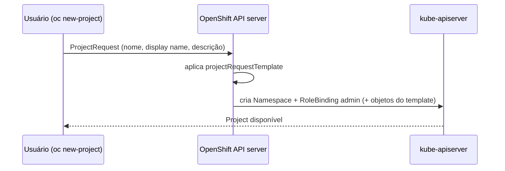

# Project (OpenShift)

> **ID:** 00-fundamentos-e-linguagem/project | **Termo original:** Project | **Remissões:** projeto, ProjectRequest | **Tradução:** projeto | **Classe ontológica:** objeto da API (OpenShift) | **API:** `apiVersion: project.openshift.io/v1`, `kind: Project` | **Plataforma:** OpenShift (não existe no Kubernetes upstream) | **Escopo:** cluster-scoped (corresponde 1:1 a um Namespace) | **Disponibilidade:** nativo do OpenShift | **Versões validadas:** OCP 4.22 | **Nível:** básico | **Atualizado em:** 2026-11-04

## Definição em uma frase

Um Project é a forma como o OpenShift apresenta e controla um [Namespace](namespace.md): um namespace com **annotations adicionais** que dão controle de acesso (RBAC) e gestão, e que permite que grupos de usuários trabalhem juntos e isolados de outros.

## Explicação didática

No Kubernetes, quem cria namespaces costuma ser o administrador. No OpenShift, um desenvolvedor **pede** um projeto (`oc new-project`), e a plataforma:

1. cria o namespace correspondente;
2. aplica um **modelo de projeto** (*project template*);
3. dá a quem pediu o papel **`admin`** naquele projeto.

Para o usuário, "projeto" e "namespace" são o mesmo espaço: os recursos ficam **no namespace**. O objeto `Project` é uma **visão** desse namespace pela API do OpenShift, filtrada pelo que cada usuário pode ver.

## Para que existe e qual problema resolve

- **Autoatendimento (*self-provisioning*):** usuários comuns podem criar o próprio espaço sem precisar de permissão de cluster, desde que o administrador permita.
- **Padronização:** o *project template* pode criar automaticamente quotas, limites, RBAC e NetworkPolicies em todo projeto novo.
- **Visão por permissão:** `oc get projects` mostra só os projetos a que você tem acesso, enquanto listar namespaces exige permissão em nível de cluster.

## Funcionamento técnico e ciclo de vida

- **Pedido:** `oc new-project` cria um `ProjectRequest` (objeto de requisição, não persistido como entidade própria). O OpenShift API server provisiona o projeto a partir do template definido em `projectRequestTemplate`, no recurso de configuração de projetos do cluster (`config.openshift.io`). Se nenhum estiver definido, o servidor usa um template padrão.
- **Parâmetros do template:** incluem o nome do projeto (`PROJECT_NAME`), o nome de exibição, a descrição e o usuário que fez o pedido.
- **Nomes reservados:** projetos que começam com `openshift-` ou `kube-` são considerados críticos. O `oc new-project` não deixa criá-los; o administrador usa `oc adm new-project`.
- **Exclusão:** apagar o projeto apaga o namespace e tudo o que está nele.

## Relações e dependências

- Corresponde a um [Namespace](namespace.md); a identidade é o mesmo nome ([Resource Name](resource-name.md)).
- Servido pelo OpenShift API server (ver [API Server](api-server.md)).
- Metadados de exibição ficam em [annotations](annotation.md) como `openshift.io/display-name`, `openshift.io/description` e `openshift.io/requester`.

## Exemplo de situação real

Uma desenvolvedora cria `oc new-project loja-dev` e já encontra uma ResourceQuota e uma NetworkPolicy que ela não criou. Não é mágica: o administrador personalizou o *project template*, e todo projeto novo nasce com essas regras.

## Como visualizar e inspecionar (somente leitura)

```bash
# Projetos que você pode ver
oc get projects

# Projeto atual do contexto
oc project -q

# Detalhes do projeto (nome de exibição, descrição, status)
oc describe project <nome>

# O mesmo espaço visto como Namespace
oc get namespace <nome> -o jsonpath='{.metadata.annotations}' ; echo

# Configuração de criação de projetos do cluster (permissão de cluster)
oc get project.config.openshift.io cluster -o yaml

# Posso pedir projetos?
oc auth can-i create projectrequests
```

## Como interpretar a saída

Saída **ilustrativa** de `oc get projects`:

```text
NAME        DISPLAY NAME   STATUS
loja-dev    Loja (dev)     Active
```

- `DISPLAY NAME` vem da annotation `openshift.io/display-name`; o `NAME` é o nome real do namespace.
- `oc auth can-i create projectrequests` respondendo `no` significa que o *self-provisioning* está desabilitado para você. Peça ao administrador.
- No `project.config.openshift.io/cluster`, `spec.projectRequestTemplate.name` vazio indica que é usado o template padrão.

## Diferenças e confusões frequentes

- **Project ≠ "projeto de software":** é um espaço do cluster, não um repositório de código.
- **`oc project` ≠ `oc new-project`:** o primeiro só **troca** o projeto atual do seu contexto (altera o arquivo kubeconfig local, não o cluster); o segundo **cria** um projeto.
- **Project × Namespace:** criar um Namespace direto (`oc create namespace`) não aplica o *project template* e exige mais permissão.

## No OpenShift 4.22 versus Kubernetes

Project, ProjectRequest e o self-provisioning existem só no OpenShift. No Kubernetes, o equivalente é criar namespaces e configurar RBAC e quotas manualmente ou por automação.

## No HomeLab SNO

`oc get projects` e `oc describe project` são leituras. Criar projetos de estudo é uma alteração leve, mas é alteração: faça só quando decidir praticar, nunca em nomes `openshift-*` ou `kube-*`.

## Diagrama Mermaid



*Legenda: fluxo conceitual. Os objetos exatos criados dependem do template do cluster.*

## Termos relacionados

[Namespace](namespace.md) · [Annotation](annotation.md) · [Resource Name](resource-name.md) · [API Server](api-server.md) · [OpenShift Container Platform](openshift-container-platform.md)

## Fontes oficiais

- OCP 4.22 — Working with projects (prefixos reservados, criação e visualização pela CLI): <https://docs.redhat.com/en/documentation/openshift_container_platform/4.22/html/building_applications/projects> (fontes: `applications/projects/working-with-projects.adoc`, `modules/creating-a-project-using-the-cli.adoc`, `modules/viewing-a-project-using-the-cli.adoc`)
- OCP 4.22 — Configuring project creation (template, parâmetros, papel `admin`, self-provisioning; fonte: `applications/projects/configuring-project-creation.adoc` → `modules/about-project-creation.adoc`)
- OCP 4.22 — Glossary, "project" (fonte: `welcome/glossary.adoc`)

<details>
<summary>Notas de revisão</summary>

- **Estado:** desenvolvido. Fontes conferidas em 2026-11-04.
- **Pendências:** confirmar no SNO o nome exato do recurso de configuração (`project.config.openshift.io/cluster`) e as colunas de `oc get projects`; detalhar o self-provisioning (papel `self-provisioner`) na categoria 07. Nada foi **executado**. A URL publicada está **a verificar**.

</details>
