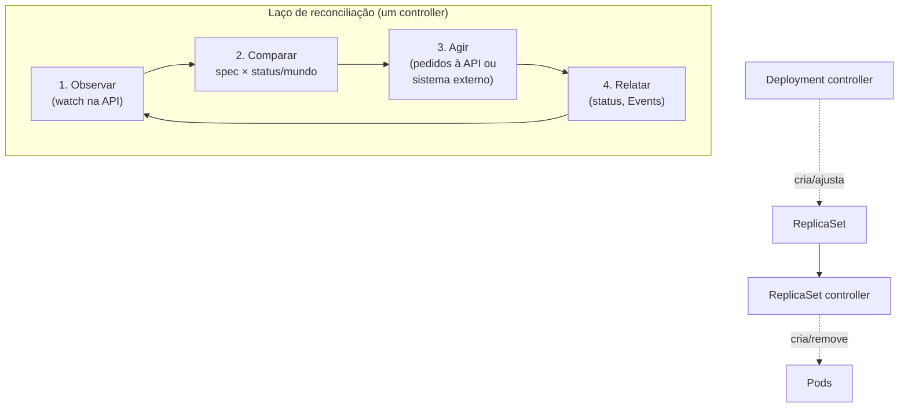

# Reconciliação (reconciliation)

> **ID:** 00-fundamentos-e-linguagem/reconciliation | **Termo original:** reconciliation, reconcile loop | **Remissões:** control loop, laço de controle | **Tradução:** reconciliação | **Classe ontológica:** padrão / conceito | **Plataforma:** Kubernetes / OpenShift | **Escopo:** não aplicável | **Disponibilidade:** nativo | **Versões validadas:** Kubernetes 1.35 / OCP 4.22 | **Nível:** básico → intermediário | **Atualizado em:** 2026-11-04

## Definição em uma frase

Reconciliação é o processo contínuo em que um **controller** compara o [estado desejado](desired-state.md) com o [estado observado](current-state.md) e age para reduzir a diferença entre eles.

## Explicação didática

É o "motor" do Kubernetes. Cada controller é um laço que não termina: **observar → comparar → agir → relatar**, e de novo. Não há um "programa principal" que comanda tudo. Há **muitos controllers pequenos**, cada um cuidando de um aspecto, como Deployments, Jobs, Namespaces ou endpoints.

O termo "reconciliar" vem dessa ideia de pôr em acordo duas versões: a pedida e a real.

**Não existe objeto "Reconciliation".** O conceito é observado indiretamente: pelo `status`, pelas `conditions`, pelo `observedGeneration` e pelos Events.

## Para que existe e qual problema resolve

- **Autorrecuperação:** falhas, como um Pod que morreu ou um nó que caiu, são simplesmente mais uma diferença a corrigir.
- **Robustez:** como a comparação é feita **por nível** (*level-based*) e não por eventos isolados (*edge-based*), um controller que reinicia e perdeu notificações continua funcionando: basta comparar o estado atual de novo.
- **Composição:** controllers simples e independentes podem falhar sem derrubar o sistema, e outros controllers se encadeiam a partir do que eles produzem.

## Funcionamento técnico e ciclo de vida

Dois modos, segundo a documentação:

1. **Controle via API server** (o caso mais comum): o controller não executa nada diretamente; ele **pede à API** que crie, altere ou remova objetos. Exemplo oficial: o controller de **Job** não roda contêineres; ele cria Pods pela API, e outros componentes (scheduler, kubelet) fazem a sua parte. Ao terminar, o controller atualiza o Job (marca-o como concluído).
2. **Controle direto:** o controller age sobre um sistema **fora** do cluster (por exemplo, provisionar máquinas ou discos num provedor) e depois relata o resultado na API.

Cada controller observa ao menos um tipo de recurso como fonte do estado desejado e geralmente **gerencia outro tipo**. Exemplo: o controller de Jobs observa Jobs e cria e acompanha Pods. Para não interferir no trabalho alheio, os controllers usam informações como labels e referências de dono (`ownerReferences`). O controller de Jobs não apaga Pods criados por um Deployment.

**Onde rodam:** os controllers nativos ficam no **kube-controller-manager**. Também podem rodar fora do plano de controle, como Pods ou até fora do cluster. É o caso dos **Operators**.

## Relações e dependências

- Insumos: [`spec`](spec.md) (desejado) e [`status`](status.md) + mundo real (observado).
- Executores: controllers nativos, [Operators](../../09-operators-e-extensoes/verbetes/operator.md) e Operators de plataforma do OpenShift ([ClusterOperator](../../09-operators-e-extensoes/verbetes/clusteroperator.md)).
- Encadeamento típico: [Deployment](../../03-workloads/verbetes/deployment.md) → [ReplicaSet](../../03-workloads/verbetes/replicaset.md) → [Pod](../../03-workloads/verbetes/pod.md) → kubelet.

## Exemplo de situação real

Alguém muda manualmente a configuração de um componente do OpenShift num namespace `openshift-*`. Minutos depois, a mudança "desaparece". Não é bug: o Operator responsável reconciliou o recurso de volta ao estado desejado que **ele** mantém. A configuração suportada deve ser feita no objeto de configuração que o Operator lê (por exemplo, em `config.openshift.io` ou `operator.openshift.io`).

## Como visualizar e inspecionar (somente leitura)

A reconciliação não tem objeto; observam-se os seus **efeitos**:

```bash
# O controller já processou a última mudança do spec?
oc get deployment <nome> -n <namespace> \
  -o jsonpath='gen={.metadata.generation} observed={.status.observedGeneration}{"\n"}'

# Acompanhar as mudanças em tempo real (watch; Ctrl+C para sair)
oc get pods -n <namespace> -w

# Encadeamento de donos: quem criou este Pod?
oc get pod <nome> -n <namespace> \
  -o jsonpath='{range .metadata.ownerReferences[*]}{.kind}/{.name}{"\n"}{end}'

# O que os controllers fizeram (eventos)
oc get events -n <namespace> --sort-by=.lastTimestamp

# OpenShift: reconciliação da plataforma pelos Operators
oc get clusteroperators
```

## Como interpretar a saída

- `gen` igual a `observed`: o controller já viu o último pedido. Se o `status` ainda não bate com o `spec`, ele está **trabalhando** ou **bloqueado**, e as condições e eventos dizem qual.
- No `-w`, a sequência típica de uma réplica substituída é: Pod antigo `Terminating`, Pod novo `Pending` → `ContainerCreating` → `Running`. É a reconciliação em ação.
- `ownerReferences` com `ReplicaSet/<nome>`: o Pod é gerenciado. Mudanças diretas nele serão desfeitas ou perdidas.
- Events com `reason` repetido e `count` crescente (ex.: `BackOff`) indicam um laço que tenta e falha. A causa não é o controller, e sim o que ele tenta fazer.

## Diferenças e confusões frequentes

- **Reconciliação ≠ "sincronização única":** ela não termina; o laço é permanente.
- **Reconciliação ≠ garantia de sucesso:** o controller tenta, mas pode ficar preso (falta de recursos, imagem inexistente, permissão).
- **Controller × Operator:** todo Operator usa controllers, mas nem todo controller é um Operator. O Operator é um padrão para gerenciar **aplicações** com conhecimento operacional, em geral junto com CRDs.
- **Control loop × reconciliação:** *control loop* é o mecanismo (o laço); *reconciliação* é o que ele faz a cada volta.
- O cluster pode **nunca ficar estável**, e isso é esperado.

## No OpenShift 4.22 versus Kubernetes

A documentação do OCP descreve o Operator como "um control loop que compara continuamente o estado desejado dos recursos com o estado real" e age para alinhá-los. No OpenShift, **a própria plataforma** é reconciliada assim: cada componente tem um Operator e um `ClusterOperator` que relata seu estado.

## No HomeLab SNO

A reconciliação consome CPU e memória do mesmo nó que roda as aplicações. Laços falhando sem parar (por exemplo, Pods em *CrashLoopBackOff*) geram carga e eventos constantes. Observe com `oc get events` e `oc get pods -w`; **não** "force" a convergência apagando objetos de plataforma.

## Diagrama Mermaid



*Legenda: cada controller roda o seu próprio laço; o encadeamento acontece porque a saída de um é a entrada de outro.*

## Termos relacionados

[Estado desejado](desired-state.md) · [Estado observado](current-state.md) · [Spec](spec.md) · [Status](status.md) · [Operator](../../09-operators-e-extensoes/verbetes/operator.md) · [ClusterOperator](../../09-operators-e-extensoes/verbetes/clusteroperator.md) · [Job](../../03-workloads/verbetes/job.md) · [Deployment](../../03-workloads/verbetes/deployment.md)

## Fontes oficiais

- Kubernetes — Controllers (padrão controller, controle via API server, controle direto, design, "Ways of running controllers"): <https://kubernetes.io/docs/concepts/architecture/controller/> (fonte: `kubernetes/website` `release-1.35`, `content/en/docs/concepts/architecture/controller.md`)
- Kubernetes Glossary — Controller: <https://kubernetes.io/docs/reference/glossary/?all=true#term-controller>
- Kubernetes API Conventions — *level-based* vs *edge-based*: <https://github.com/kubernetes/community/blob/master/contributors/devel/sig-architecture/api-conventions.md>
- OCP 4.22 — "Kubernetes overview", seção "Kubernetes resources" ("An Operator acts as a control loop..."). Fonte conferida: `openshift-docs` `enterprise-4.22`, `welcome/kubernetes-overview.adoc` → `modules/kubernetes-resources.adoc`. URL publicada **a verificar**: <https://docs.redhat.com/en/documentation/openshift_container_platform/4.22>

## Revisão editorial

- **Estado:** 🟡 desenvolvido. Fontes conferidas em 2026-11-04.
- **Pendências:** o verbete [Controller](controller.md) foi criado no lote 2, e *Control Loop* é remissão para ele e para cá. A sequência de estados no `-w` é **ilustrativa**; não foi observada no SNO.
