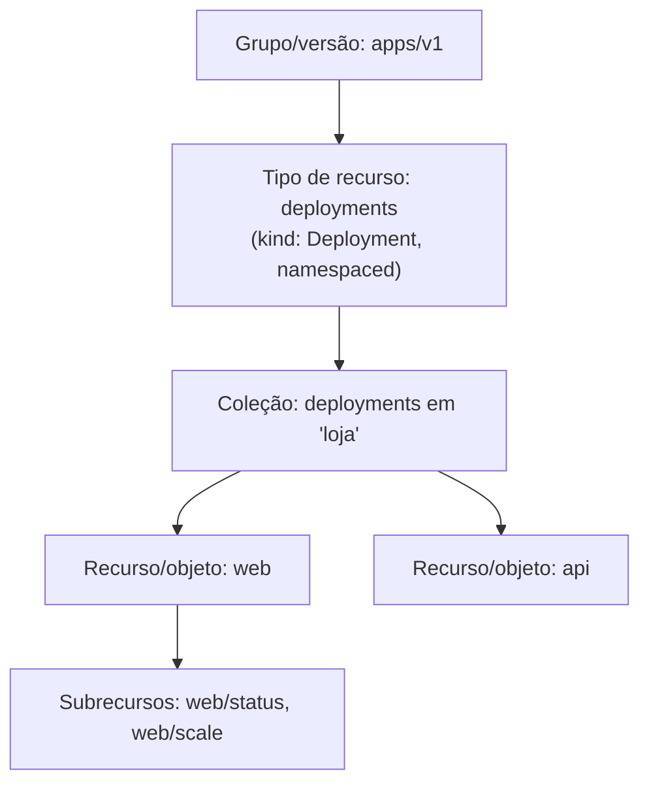

# Resource (API resource, resource type — recurso)

> **ID:** 00-fundamentos-e-linguagem/resource | **Termo original:** resource, resource type, API resource | **Tradução:** recurso, tipo de recurso | **Classe ontológica:** conceito (terminologia da API) | **Plataforma:** Kubernetes / OpenShift | **Escopo:** cada tipo de recurso é **namespaced** ou **cluster-scoped** | **Disponibilidade:** nativo | **Versões validadas:** Kubernetes 1.35 / OCP 4.22 | **Nível:** básico | **Atualizado em:** 2026-11-04

## Definição em uma frase

Na API do Kubernetes, **tipo de recurso** (*resource type*) é o nome usado na URL para um tipo de coisa (ex.: `pods`, `deployments`), e **recurso** é uma instância individual dele, normalmente um [objeto](object.md).

## Explicação didática

A palavra "recurso" tem mais de um sentido no dia a dia do Kubernetes, e isso confunde:

| Sentido | Exemplo | Onde aparece |
|---|---|---|
| **Tipo de recurso** (resource type) | `deployments` | Coluna `NAME` de `oc api-resources`, URLs, regras RBAC |
| **Recurso** (instância) | o Deployment `web` no namespace `loja` | `oc get deployment web` |
| **Coleção** (collection) | todos os Deployments de `loja` | `oc get deployments -n loja` |
| **Subrecurso** (sub-resource) | `deployments/scale`, `pods/log`, `pods/status` | URLs abaixo de um recurso; RBAC |
| **Recursos computacionais** | CPU, memória (`requests`/`limits`) | Outro conceito, da categoria de capacidade |

Este verbete trata dos quatro primeiros sentidos. CPU e memória são assunto de *requests*, *limits* e quotas.

## Para que existe e qual problema resolve

O tipo de recurso é a **unidade de endereçamento e de permissão** da API. Com ele, a API sabe qual caminho atender, e o RBAC sabe o que autorizar ("pode `list` em `pods`?"). Separar recurso (URL) de [kind](kind.md) (esquema) permite expor o mesmo dado de formas diferentes, como os subrecursos `status` e `scale`.

## Funcionamento técnico e ciclo de vida

- **Nome do recurso:** plural, minúsculo (`pods`, `services`, `routes`). O CLI também aceita singular e *short names* (`po`, `svc`, `deploy`).
- **Identificação completa:** grupo + recurso + (namespace) + nome. Exemplo: `apps` / `deployments` / `loja` / `web`.
- **Escopo:**
  - *Namespaced*: o caminho inclui `/namespaces/<ns>/`; o objeto é apagado junto com o namespace; o acesso é controlado no escopo do namespace (Pods, Services, Deployments...).
  - *Cluster-scoped*: o nome é único no cluster (Nodes, Namespaces, PersistentVolumes, ClusterRoles...).
- **Recursos virtuais:** alguns tipos não representam objetos persistidos, e sim operações (por exemplo `subjectaccessreviews` para perguntas de autorização, ou o subrecurso `eviction` de um Pod).
- **Notação `recurso.grupo`:** desambigua tipos de mesmo nome em grupos diferentes (`deployments.apps`, `routes.route.openshift.io`).

## Relações e dependências

- Cada tipo de recurso tem um [kind](kind.md) e pertence a um grupo/versão da [API](kubernetes-api.md).
- Instâncias são [objetos](object.md); o escopo se relaciona com [Namespace](namespace.md) e [Cluster](cluster.md).
- Novos tipos podem ser acrescentados com uma [CustomResourceDefinition](../../09-operators-e-extensoes/verbetes/customresourcedefinition.md): as instâncias são os *custom resources*.

## Exemplo de situação real

Uma desenvolvedora recebe `Forbidden` ao rodar `oc get pods/log`. Ela tem permissão em `pods`, mas **não** no subrecurso `pods/log`. No RBAC, subrecursos são escritos como `<recurso>/<subrecurso>` e precisam de regra própria.

## Como visualizar e inspecionar (somente leitura)

```bash
# Todos os tipos de recurso servidos, com escopo e kind
oc api-resources

# Só cluster-scoped / só namespaced
oc api-resources --namespaced=false
oc api-resources --namespaced=true

# Só os nomes, no formato recurso.grupo (útil para desambiguar)
oc api-resources -o name | head -30

# Tem instâncias? (lista vazia ≠ recurso inexistente)
oc get routes.route.openshift.io -A

# Posso fazer isto? (verifica RBAC sem tentar a ação)
oc auth can-i list pods -n <namespace>
oc auth can-i get pods --subresource=log -n <namespace>
```

## Como interpretar a saída

Distinga cuidadosamente quatro situações:

| Situação | O que se vê | Significado |
|---|---|---|
| Tipo servido, com instâncias | Tabela com itens | Normal |
| Tipo servido, sem instâncias | `No resources found in <ns> namespace.` | Nenhum objeto desse tipo ali; **não** é erro |
| Sem permissão | `Error from server (Forbidden): ... cannot list resource "x"` | RBAC; o tipo existe |
| Tipo não servido | `error: the server doesn't have a resource type "x"` | API ausente (Operator não instalado, CRD inexistente ou erro de digitação) |

Em `oc api-resources -o name`, entradas sem ponto (ex.: `pods`) pertencem ao grupo *core*.

## Diferenças e confusões frequentes

- **Recurso × kind:** `deployments` (recurso, URL, RBAC) × `Deployment` (kind, YAML). Ver [Kind](kind.md).
- **Recurso × objeto:** a terminologia oficial chama a instância de *resource* e diz que ela "normalmente representa um *object*". Neste glossário: "tipo de recurso" para a categoria, "objeto" para a instância persistida.
- **"Recursos" do Pod (CPU/memória)** não têm relação com "recurso da API".
- **`oc get all`** cobre só um subconjunto de recursos (os da categoria `all`).

## No OpenShift 4.22 versus Kubernetes

O OpenShift acrescenta dezenas de tipos de recurso em grupos `*.openshift.io`, além dos trazidos por Operators. Alguns nomes coincidem com conceitos do Kubernetes, mas são tipos distintos: `projects` (project.openshift.io) × `namespaces` (core).

## No HomeLab SNO

`oc api-resources` mostra o que o **seu** SNO serve. O resultado depende dos Operators e das *capabilities* instaladas e pode diferir de outro cluster 4.22. Não instale nada para "fazer aparecer" um recurso.

## Diagrama Mermaid



## Termos relacionados

[Kind](kind.md) · [Object](object.md) · [API](kubernetes-api.md) · [Namespace](namespace.md) · [Cluster](cluster.md) · [CustomResourceDefinition](../../09-operators-e-extensoes/verbetes/customresourcedefinition.md)

## Fontes oficiais

- Kubernetes — API Concepts: "Kubernetes API terminology", "Resource URIs": <https://kubernetes.io/docs/reference/using-api/api-concepts/> (fonte: `kubernetes/website` `release-1.35`, `content/en/docs/reference/using-api/api-concepts.md`)
- Kubernetes API Conventions — "Resources", subresources `/status`, `/scale`, `/binding`: <https://github.com/kubernetes/community/blob/master/contributors/devel/sig-architecture/api-conventions.md>

<details>
<summary>Notas de revisão</summary>

- **Estado:** desenvolvido. Fontes conferidas em 2026-11-04.
- **Pendências:** as mensagens de erro da tabela seguem o formato conhecido do `kubectl`/`oc`, mas **não foram reproduzidas** no SNO nesta rodada; validar o texto exato. Confirmar o uso de `oc auth can-i ... --subresource` com `oc auth can-i --help`.

</details>
