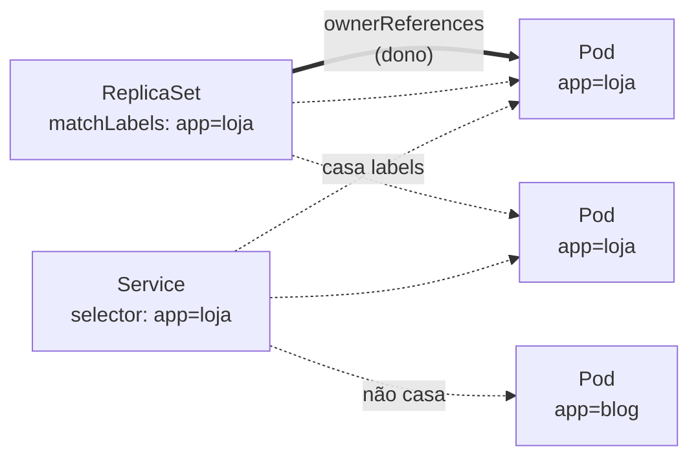

# Selector (label selector)

> **ID:** 00-fundamentos-e-linguagem/selector | **Termo original:** label selector, selector | **Remissões:** field selector, matchLabels, matchExpressions | **Tradução:** seletor | **Classe ontológica:** conceito (mecanismo de consulta e de vínculo) | **Plataforma:** Kubernetes / OpenShift | **Escopo:** não aplicável | **Disponibilidade:** nativo | **Versões validadas:** Kubernetes 1.35 / OCP 4.22 | **Nível:** básico → intermediário | **Atualizado em:** 2026-11-04

## Definição em uma frase

Um label selector é um **filtro sobre [labels](label.md)** que identifica um conjunto de objetos. É, segundo a documentação, a **primitiva central de agrupamento** do Kubernetes.

## Explicação didática

Labels são etiquetas; o seletor é a pergunta "quais objetos têm estas etiquetas?". Ele aparece em dois lugares:

1. **Na linha de comando e na API:** `oc get pods -l app=loja` (filtro de **consulta**).
2. **Dentro de objetos:** um Service, um ReplicaSet ou uma NetworkPolicy declaram um seletor para dizer **sobre quais Pods** atuam (vínculo **contínuo**: novos Pods com as labels certas entram automaticamente no conjunto).

## Para que existe e qual problema resolve

Permite relações **frouxas e dinâmicas**: o Service não lista Pods por nome (que mudam o tempo todo); ele os descreve por atributos. Assim, réplicas novas são incluídas sem nenhuma reconfiguração.

## Funcionamento técnico e ciclo de vida

**Dois tipos de requisito:**

| Tipo | Operadores | Exemplo |
|---|---|---|
| *Equality-based* | `=`, `==`, `!=` | `environment=production,tier!=frontend` |
| *Set-based* | `in`, `notin`, existência (`chave`, `!chave`) | `environment in (production, qa)`, `!partition` |

Regras importantes:
- Vários requisitos separados por vírgula funcionam como **E lógico**. **Não existe OU** entre requisitos; o "OU" só é possível entre **valores** de uma mesma chave, com `in`.
- `tier!=frontend` e `tier notin (...)` **também** selecionam objetos que **não têm** a chave `tier`.
- O significado de um seletor **vazio** depende do tipo de objeto, e cada API documenta o seu.

**Nos objetos:**
- **Service** (e o antigo ReplicationController): seletor como mapa simples, **só igualdade**.
- **Deployment, ReplicaSet, Job, DaemonSet** e tipos mais novos: `selector.matchLabels` (igualdade) e `selector.matchExpressions` (*set-based*: operadores `In`, `NotIn`, `Exists`, `DoesNotExist`).
- Para alguns tipos, como ReplicaSets, seletores de dois objetos **não devem se sobrepor** no mesmo namespace, ou o controller recebe instruções conflitantes.

**Field selectors** (outro mecanismo, remissão): filtram por **campos** do objeto (ex.: `status.phase=Running`), e não por labels, e são aceitos só em alguns campos de cada tipo.

## Relações e dependências

- Lê [labels](label.md) de [metadata](metadata.md).
- Usado por Service, ReplicaSet, Deployment, NetworkPolicy, agendamento (`nodeSelector`, afinidades) e quotas por escopo.
- Não define propriedade: o vínculo de dono é feito por [OwnerReference](owner-reference.md).

## Exemplo de situação real

Dois Deployments diferentes no mesmo namespace usam o seletor `app: web`. O Service `web` passa a mandar tráfego para os Pods **dos dois**, misturando versões. Seletores precisam ser específicos o bastante, por exemplo `app: web, component: api`.

## Como visualizar e inspecionar (somente leitura)

```bash
# Consulta com seletor de igualdade
oc get pods -n <namespace> -l app=<valor>,tier!=frontend

# Consulta com seletor set-based (aspas obrigatórias no shell)
oc get pods -n <namespace> -l 'environment in (production, qa)'

# Seletor declarado num Service e num Deployment
oc get service <nome> -n <namespace> -o jsonpath='{.spec.selector}' ; echo
oc get deployment <nome> -n <namespace> -o jsonpath='{.spec.selector}' ; echo

# Quais Pods o Service está realmente alcançando
oc get endpointslices -n <namespace> -l kubernetes.io/service-name=<nome>

# Field selector (filtro por campo, não por label)
oc get pods -n <namespace> --field-selector=status.phase=Running
```

## Como interpretar a saída

- Seletor que retorna `No resources found` pode estar certo (nenhum Pod casa) ou ter erro de digitação ou de maiúsculas nas labels. Compare com `--show-labels`.
- Um EndpointSlice **sem endpoints** para um Service quase sempre indica seletor que não casa com as labels dos Pods, ou Pods não `Ready`.
- `matchExpressions` aparece como lista de `{key, operator, values}`. Leia cada item como um requisito combinado por **E**.

## Diferenças e confusões frequentes

- **Selector × label:** a label está **no objeto-alvo**; o selector está **em quem procura**.
- **Label selector × field selector:** um filtra labels; o outro, campos (como `metadata.name` ou `status.phase`).
- **Selector × ownerReferences:** o selector diz "quais objetos me interessam"; o `ownerReferences` diz "quem é dono de quem" e governa a garbage collection.
- **`spec.selector` de Deployment é imutável** depois de criado em `apps/v1`. Mudá-lo exige recriar o Deployment.

## No OpenShift 4.22 versus Kubernetes

Mesmo mecanismo. Recursos do OpenShift também usam seletores, por exemplo seletores de namespace e de projeto em políticas e cotas multiprojeto (categoria 11).

## No HomeLab SNO

Consultas com `-l` e `--field-selector` são leituras. Use-as para **investigar** vínculos, como Service × Pods; não altere seletores de objetos de plataforma.

## Diagrama Mermaid



*Legenda: linhas tracejadas = vínculo por seletor; linha grossa = relação de dono, que é outro mecanismo.*

## Termos relacionados

[Label](label.md) · [OwnerReference](owner-reference.md) · [Metadata](metadata.md) · [Service](../../04-networking/verbetes/service.md) · [ReplicaSet](../../03-workloads/verbetes/replicaset.md) · [NetworkPolicy](../../04-networking/verbetes/networkpolicy.md)

## Fontes oficiais

- Kubernetes — Labels and Selectors (tipos de requisito, API, objetos que usam seletores): <https://kubernetes.io/docs/concepts/overview/working-with-objects/labels/> (fonte: `kubernetes/website` `release-1.35`)
- Kubernetes — Field Selectors: <https://kubernetes.io/docs/concepts/overview/working-with-objects/field-selectors/>
- Kubernetes — Deployments (seletor imutável em `apps/v1`): <https://kubernetes.io/docs/concepts/workloads/controllers/deployment/>

## Revisão editorial

- **Estado:** 🟡 desenvolvido. Fontes conferidas em 2026-11-04.
- **Pendências:** a imutabilidade do seletor do Deployment foi conferida na página Deployments (`release-1.35`). Falta conferir a label `kubernetes.io/service-name` dos EndpointSlices (categoria 04). Exemplos **não executados** no SNO.
