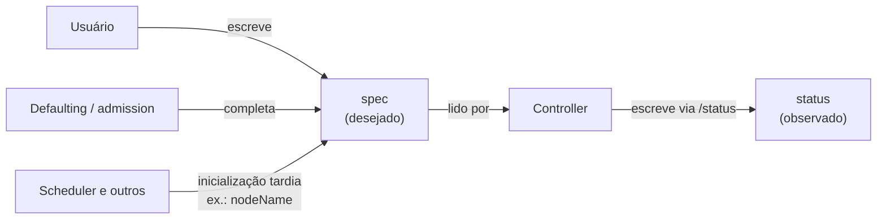

# Spec

> **ID:** 00-fundamentos-e-linguagem/spec | **Termo original:** spec (specification) | **Tradução:** especificação | **Classe ontológica:** conceito (campo convencional dos objetos) | **Plataforma:** Kubernetes / OpenShift | **Escopo:** não aplicável | **Disponibilidade:** nativo | **Versões validadas:** Kubernetes 1.35 / OCP 4.22 | **Nível:** básico | **Atualizado em:** 2026-11-04

## Definição em uma frase

`spec` é o campo de um [objeto](object.md) que descreve o seu **[desired state](desired-state.md)**: aquilo que o usuário, ou outro componente, quer que seja verdade.

## Explicação didática

O `spec` é o "pedido". Em `spec.replicas: 3` você não manda criar três Pods; você declara que **devem existir** três. Quem cumpre o pedido são os controllers, e eles relatam o resultado num campo separado, o [`status`](status.md).

O formato do `spec` muda de um kind para outro: o de um Pod lista contêineres e volumes; o de um Service lista portas e seletor; o de uma Route lista host e serviço de destino. A regra é a mesma para todos: **declarativo**, ou seja, descreve um estado, e não uma ação.

## Para que existe e qual problema resolve

Separar `spec` de `status` permite:

- **Autorizações distintas:** o usuário escreve no `spec`; o controller escreve no `status` pelo subrecurso `/status`. Gravações comuns (PUT/POST) ignoram o `status`.
- **Comportamento por nível (*level-based*):** o sistema persegue **o `spec` mais recente**, sem precisar "passar" por valores intermediários. Se `replicas` muda de 2 para 5 e logo para 3, o controller pode ir direto a 3. Isso torna o sistema robusto a mudanças intermediárias perdidas.

## Funcionamento técnico e ciclo de vida

1. **Escrita:** o usuário envia o `spec` no manifesto. Nos tipos que têm `spec`, ele é obrigatório na criação.
2. **Defaulting:** o API server, os admission controllers e, às vezes, os controllers completam o `spec` com valores padrão. O `spec` armazenado é **mais completo** que o enviado.
3. **Inicialização tardia:** outros componentes podem preencher partes do `spec` depois da criação. O exemplo clássico é o scheduler, que atribui `spec.nodeName` a um Pod.
4. **Mudança:** alterações no `spec` normalmente incrementam `metadata.generation`, o que sinaliza aos controllers que há trabalho novo.
5. Alguns tipos **não têm `spec`**. As convenções permitem omiti-lo quando o estado não pode divergir da intenção: ConfigMap e Secret usam `data`; Role usa `rules`.

## Relações e dependências

- Contraparte: [`status`](status.md).
- Conceitos: [desired state](desired-state.md) e [reconciliation](reconciliation.md).
- Templates: controllers de workload (Deployment, Job, StatefulSet...) carregam um `spec.template`, que é o **spec dos Pods** que vão criar.

## Exemplo de situação real

Alguém edita um Pod "na mão" para trocar a imagem, e o Pod volta à imagem antiga quando é recriado. O motivo: o Pod pertence a um Deployment, e é o **`spec.template` do Deployment** que define a imagem. A mudança precisa ser feita no dono, não no Pod.

## Como visualizar e inspecionar (somente leitura)

```bash
# Documentação dos campos do spec de um kind
oc explain deployment.spec
oc explain deployment.spec.template.spec.containers

# Árvore completa de campos (pode ser longa)
oc explain deployment.spec --recursive | head -60

# O spec realmente armazenado (com defaults)
oc get deployment <nome> -n <namespace> -o jsonpath='{.spec}' ; echo

# Um campo específico
oc get deployment <nome> -n <namespace> -o jsonpath='{.spec.replicas}{"\n"}'
```

## Como interpretar a saída

- Compare o manifesto que você aplicou com o `-o jsonpath='{.spec}'`: os campos a mais são **defaults** (ex.: `strategy`, `revisionHistoryLimit`, `progressDeadlineSeconds` num Deployment). Isso é normal.
- Em `oc explain`, campos marcados como `-required-` são obrigatórios; os demais são opcionais e podem receber valor padrão.
- Um campo que aparece no `spec` mas não teve efeito pode estar sendo ignorado por falta de um controller, ou rejeitado de forma assíncrona. Veja as `conditions` em [`status`](status.md) e os Events.

## Diferenças e confusões frequentes

- **`spec` ≠ manifesto:** o manifesto contém o `spec`, mas também `apiVersion`, `kind` e `metadata`.
- **`spec` ≠ comando:** campos de `spec` têm nomes **declarativos** (`replicas`, `paused`) e não imperativos ("start", "restart").
- **`metadata.labels` não fazem parte do `spec`,** embora também sejam escritos pelo usuário.
- **`spec.template` ≠ Pod:** é um *molde*; os Pods reais são outros objetos.

## No OpenShift 4.22 versus Kubernetes

A convenção vale também para os tipos do OpenShift, como `spec.host` e `spec.to` numa Route ou `spec.desiredUpdate` numa ClusterVersion (este é um campo de administração: **não altere** sem planejamento). Confira cada campo com `oc explain` no próprio cluster.

## No HomeLab SNO

Use `oc explain` para estudar o `spec` de qualquer kind sem tocar em objetos. Ler o `spec` de objetos da plataforma é seguro; alterá-lo, não.

## Diagrama Mermaid



## Termos relacionados

[Status](status.md) · [Desired State](desired-state.md) · [Reconciliation](reconciliation.md) · [Object](object.md) · [Kind](kind.md) · [Deployment](../../03-workloads/verbetes/deployment.md) · [Pod](../../03-workloads/verbetes/pod.md)

## Fontes oficiais

- Kubernetes — Objects In Kubernetes, "Object spec and status": <https://kubernetes.io/docs/concepts/overview/working-with-objects/> (fonte: `kubernetes/website` `release-1.35`)
- Kubernetes API Conventions — "Spec and Status" e "Defaulting": <https://github.com/kubernetes/community/blob/master/contributors/devel/sig-architecture/api-conventions.md>

## Revisão editorial

- **Estado:** 🟡 desenvolvido. Fontes conferidas em 2026-11-04.
- **Pendências:** a lista de defaults citados para Deployment vem da referência da API (`apps/v1`) e **não foi conferida** no SNO; validar com `oc explain deployment.spec`.
