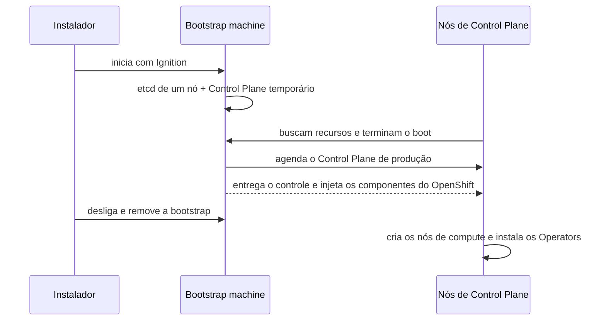

# Bootstrap

## Definição em uma frase

Bootstrap é o processo inicial de instalação do OpenShift, em que uma **máquina temporária** (*bootstrap machine*) sobe um Control Plane provisório, entrega aos nós definitivos o que eles precisam para iniciar e depois é desligada.

## Explicação didática

Para criar um cluster, alguém precisa existir antes do cluster: um etcd e uma API para os nós de Control Plane se registrarem. Esse é o papel da bootstrap machine. Ela funciona como um andaime: sustenta a obra enquanto ela é erguida e é retirada quando a estrutura definitiva fica de pé.

No [SNO](sno.md) não há uma segunda máquina: a instalação usa o modo **bootstrap-in-place**, em que o próprio nó faz o papel de bootstrap e depois se torna o nó definitivo.

## Para que existe e qual problema resolve

Resolve o "ovo e a galinha" da criação do cluster: os nós precisam de uma API e de configuração (Ignition) para entrar no cluster, mas o cluster ainda não existe.

## Funcionamento técnico e ciclo de vida

Segundo a documentação do OCP 4.22, o bootstrapping segue estes passos:

1. A bootstrap machine inicia e passa a hospedar os recursos remotos de que os nós de Control Plane precisam para iniciar.
2. Ela sobe um **etcd de um único nó** e um **Control Plane Kubernetes temporário**.
3. Os nós de Control Plane buscam esses recursos na bootstrap e terminam de iniciar.
4. O Control Plane temporário agenda o Control Plane de produção nos nós definitivos.
5. O Control Plane temporário desliga e passa o controle ao de produção.
6. A bootstrap injeta os componentes do OpenShift no Control Plane de produção.
7. O instalador desliga a bootstrap machine.
8. O Control Plane configura os nós de compute.
9. O Control Plane instala os serviços adicionais na forma de Operators.

Depois que as máquinas do cluster inicializam, a bootstrap é **destruída**. Na infraestrutura provisionada pelo usuário (UPI), vários desses passos exigem intervenção manual.

Detalhe relacionado: se o cluster for desligado antes da renovação dos certificados iniciais e religado depois de 24 horas, ele recupera os certificados expirados sozinho. A exceção são os CSRs `node-bootstrapper` pendentes, que precisam ser aprovados manualmente para recuperar os certificados do kubelet.

## Relações e dependências

- Cria o [Control Plane](control-plane.md) e, a partir dele, os [Worker Nodes](worker-node.md).
- Usa arquivos **Ignition**, o mesmo formato depois usado pelo [Machine Config Operator](machine-config-operator.md).
- O papel de máquina `bootstrap` é citado ao lado de `master` e `worker` (ver [Master Node](master-node.md)).

## Exemplo de situação real

Numa instalação em infraestrutura própria, o instalador fica parado em "waiting for bootstrap complete". Os nós de Control Plane não conseguem buscar a configuração na bootstrap, quase sempre por DNS ou balanceador de carga mal configurados para a API. O problema é de infraestrutura, e não do OpenShift.

## Como visualizar e inspecionar (somente leitura)

Depois da instalação, a bootstrap já não existe. Restam sinais indiretos:

```bash
# CSRs, incluindo os de bootstrap dos kubelets (Pending exige atenção)
oc get csr

# Topologia resultante da instalação
oc get infrastructure cluster -o jsonpath='{.status.controlPlaneTopology}{"\n"}'
```

## Como interpretar a saída

- Em `oc get csr`, pedidos com o requisitante `system:serviceaccount:openshift-machine-config-operator:node-bootstrapper` são os do kubelet entrando no cluster. `Pending` por muito tempo, depois de um cluster religado, é o cenário que exige aprovação manual. **Aprovar é uma alteração**; faça só com o procedimento oficial.
- `controlPlaneTopology` indica a topologia final (por exemplo `HighlyAvailable` ou `SingleReplica`).

## Diferenças e confusões frequentes

- **Bootstrap (instalação) × boot do nó:** o primeiro cria o cluster; o segundo é a inicialização de cada máquina.
- **Bootstrap × bootstrap-in-place:** máquina temporária separada × o próprio nó do SNO fazendo esse papel.
- **Bootstrap × `node-bootstrapper`:** o nome do CSR vem da identidade usada pelo kubelet para pedir o primeiro certificado; não é a bootstrap machine.

## No OpenShift 4.22 versus Kubernetes

Ferramentas como o kubeadm fazem o seu próprio bootstrap. O processo descrito aqui, com bootstrap machine e Ignition, é do instalador do OpenShift.

## No HomeLab SNO

O SNO foi instalado com bootstrap-in-place. Hoje, o que interessa observar são os CSRs, por exemplo depois de manter o cluster desligado por vários dias.

## Diagrama



## Termos relacionados

[Control Plane](control-plane.md) · [SNO](sno.md) · [etcd](etcd.md) · [Machine Config Operator](machine-config-operator.md) · [Master Node](master-node.md)

## Fontes oficiais

- OCP 4.22 — Architecture, "Installation and update" → "Installation process details" (passos do bootstrapping, certificados, CSRs `node-bootstrapper`): <https://docs.redhat.com/en/documentation/openshift_container_platform/4.22/html/architecture/architecture-installation> (fonte: `modules/installation-process-details.adoc`)
- OCP 4.22 — Installing on a single node (`bootstrap-in-place`; fonte: `installing/installing_sno/install-sno-installing-sno.adoc`)

<details>
<summary>Ficha técnica e notas de revisão</summary>

**Ficha técnica**

- **ID:** 01-arquitetura-e-control-plane/bootstrap
- **Termo original:** bootstrap, bootstrap machine
- **Remissões:** bootstrap-in-place
- **Tradução:** inicialização (só como apoio)
- **Classe ontológica:** conceito / processo de instalação
- **Plataforma:** OpenShift
- **Escopo:** não aplicável
- **Disponibilidade:** nativo (fase da instalação)
- **Versões validadas:** OCP 4.22
- **Nível:** intermediário
- **Atualizado em:** 2026-11-05

**Notas de revisão**

- **Estado:** desenvolvido. Fontes conferidas em 2026-11-05.
- **Pendências:** confirmar no SNO o requisitante dos CSRs `node-bootstrapper` e o campo `controlPlaneTopology`, que **não foram executados**. A URL publicada está **a verificar**.

</details>
