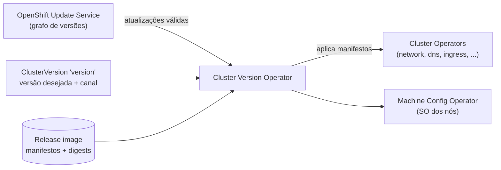

# Cluster Version Operator (CVO)

## Definição em uma frase

O Cluster Version Operator é o Operator que **gerencia o ciclo de vida dos Cluster Operators** do OpenShift: aplica os manifestos da versão desejada do cluster e conduz as atualizações da plataforma.

## Explicação didática

Se cada componente do OpenShift (rede, DNS, ingress, API server...) tem seu Operator, alguém precisa garantir que **todos** estejam na mesma versão e instalados corretamente. Esse alguém é o CVO. Você diz qual versão quer no objeto `ClusterVersion`, e o CVO aplica o conteúdo da **release image** correspondente: os manifestos de todos os Operators de plataforma.

## Para que existe e qual problema resolve

Transforma "atualizar o cluster" numa única operação declarativa e coordenada, em vez de atualizar dezenas de componentes à mão.

## Funcionamento técnico e ciclo de vida

- **Release image:** o mecanismo de entrega de uma versão do OCP. Contém os metadados da release, o binário do CVO daquela versão, todos os manifestos dos Cluster Operators e a lista, por digest SHA, de todas as imagens da versão.
- **Desired State:** o `ClusterVersion` `version` guarda a versão desejada, o canal (*channel*) e o histórico de atualizações.
- **OpenShift Update Service (OSUS):** o CVO consulta o OSUS para saber quais atualizações e caminhos são válidos a partir da versão atual. O OSUS mantém um grafo de versões verificadas.
- **Dois controllers em modo contínuo:** um aplica os manifestos do *payload* e acompanha o rollout dos Operators (disponível, atualizando, falhou); o outro consulta o OSUS para descobrir as atualizações disponíveis.
- **Só para frente:** a documentação afirma que só é suportado atualizar para uma versão mais nova. Voltar a uma versão anterior (*rollback*) não é suportado.
- Durante a atualização, o [Machine Config Operator](machine-config-operator.md) aplica a nova configuração às máquinas, pool a pool.

## Relações e dependências

- Gerencia os Operators de plataforma, cujo estado aparece em [ClusterOperator](../../09-operators-e-extensoes/verbetes/clusteroperator.md).
- Coordena-se com o [Machine Config Operator](machine-config-operator.md) para atualizar o SO dos nós.
- Parte da [OpenShift Container Platform](../../00-fundamentos-e-linguagem/verbetes/openshift-container-platform.md); o processo de atualização em si é assunto da categoria 13.

## Exemplo de situação real

Durante uma atualização, `oc get clusterversion` fica `PROGRESSING=True` por bastante tempo, e o `STATUS` cita um Operator específico. A atualização está esperando esse Cluster Operator ficar saudável na versão nova; a investigação segue por `oc get clusteroperators`.

## Como visualizar e inspecionar (somente leitura)

```bash
# Versão atual, progresso e mensagem de estado
oc get clusterversion

# Canal, versão desejada, histórico e atualizações disponíveis
oc get clusterversion version -o jsonpath='{.spec.channel}{"\n"}{.status.desired.version}{"\n"}'
oc get clusterversion version -o jsonpath='{range .status.history[*]}{.version} {.state} {.completionTime}{"\n"}{end}'

# Resumo de atualizações recomendadas (apenas consulta)
oc adm upgrade

# Pods do CVO (apenas observar)
oc get pods -n openshift-cluster-version
```

## Como interpretar a saída

- `AVAILABLE=True` e `PROGRESSING=False`: cluster estável, sem atualização em curso.
- `status.history`: a versão mais recente fica no topo; `state` `Completed` indica uma atualização concluída, e `Partial`, uma interrompida ou em andamento.
- `oc adm upgrade` **sem argumentos** só lista o estado e as atualizações recomendadas. **Com** `--to` ou `--to-latest`, ele **inicia uma atualização**: nunca use essas opções num exercício de inspeção.

## Diferenças e confusões frequentes

- **CVO × ClusterOperator:** o CVO gerencia **os** Cluster Operators; `ClusterOperator` é o objeto em que cada um relata a sua saúde.
- **CVO × OLM:** o CVO cuida dos Operators **da plataforma**, vindos da release image; o OLM cuida de Operators **opcionais** instalados pelo OperatorHub (categoria 09).
- **Release image × imagem de aplicação:** a release image é o "pacote" da versão do OpenShift inteira.

## No OpenShift 4.22 versus Kubernetes

Não há CVO no Kubernetes upstream. É um mecanismo próprio do OpenShift, que integra a atualização da plataforma e a do sistema operacional.

## No HomeLab SNO

Uma atualização num SNO deixa a API indisponível por períodos, porque não há outro nó. Os comandos acima são leituras; **iniciar** uma atualização é uma decisão operacional separada (categoria 13).

## Diagrama



## Termos relacionados

[ClusterOperator](../../09-operators-e-extensoes/verbetes/clusteroperator.md) · [Machine Config Operator](machine-config-operator.md) · [Operator](../../09-operators-e-extensoes/verbetes/operator.md) · [OpenShift Container Platform](../../00-fundamentos-e-linguagem/verbetes/openshift-container-platform.md) · [Desired State](../../00-fundamentos-e-linguagem/verbetes/desired-state.md)

## Fontes oficiais

- OCP 4.22 — Cluster Operators reference, "Cluster Version Operator" (fonte: `modules/cluster-version-operator.adoc`)
- OCP 4.22 — Architecture, "Installation and update" → "About the OpenShift Update Service" (fontes: `architecture/architecture-installation.adoc`, `modules/update-service-overview.adoc`)
- OCP 4.22 — "Release images" (fonte: `modules/update-release-images.adoc`)

<details>
<summary>Ficha técnica e notas de revisão</summary>

**Ficha técnica**

- **ID:** 01-arquitetura-e-control-plane/cluster-version-operator
- **Termo original:** Cluster Version Operator (CVO)
- **Remissões:** ClusterVersion, release image, OpenShift Update Service (OSUS)
- **Tradução:** não se traduz
- **Classe ontológica:** componente (Operator de plataforma)
- **Plataforma:** OpenShift
- **API relacionada:** `config.openshift.io/v1`, `kind: ClusterVersion` (objeto `version`, cluster-scoped)
- **Escopo:** cluster
- **Disponibilidade:** nativo
- **Versões validadas:** OCP 4.22
- **Nível:** intermediário → avançado
- **Atualizado em:** 2026-11-04

**Notas de revisão**

- **Estado:** desenvolvido. Fontes conferidas em 2026-11-04.
- **Pendências:** confirmar no SNO o namespace `openshift-cluster-version`, os valores de `state` em `status.history` e a saída de `oc adm upgrade` sem argumentos, que **não foram executados**. Detalhar canais e o processo de atualização na categoria 13.

</details>
