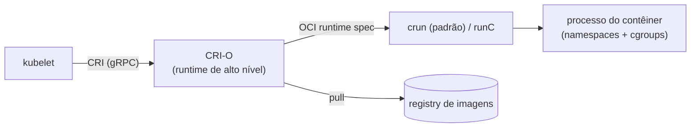

# Container Runtime

> **ID:** 01-arquitetura-e-control-plane/container-runtime | **Termo original:** container runtime | **Remissões:** container engine, high-level runtime, low-level runtime, OCI runtime, crun, runC | **Tradução:** ambiente de execução de contêineres (só como apoio) | **Classe ontológica:** componente | **Plataforma:** Kubernetes / OpenShift | **Escopo:** não aplicável (roda em cada nó) | **Disponibilidade:** nativo (obrigatório em cada nó) | **Versões validadas:** Kubernetes 1.35 / OCP 4.22 | **Nível:** intermediário | **Atualizado em:** 2026-11-04

## Definição em uma frase

O Container Runtime é o componente do nó responsável pela **execução e pelo ciclo de vida dos contêineres**: baixar imagens, criar, iniciar, parar e remover contêineres.

## Explicação didática

O [kubelet](kubelet.md) não cria contêineres sozinho: ele pede a um runtime. Na prática, há duas camadas:

| Camada | Papel | No OpenShift 4.22 |
|---|---|---|
| **Runtime de alto nível / container engine** | Fala com o kubelet pela [CRI](cri.md), gerencia imagens, Pods e contêineres | [CRI-O](cri-o.md) |
| **Runtime de baixo nível (OCI runtime)** | Cria o processo isolado do contêiner, com namespaces do kernel e cgroups | **crun** (padrão) ou **runC** (opcional) |

O Kubernetes aceita runtimes como **containerd**, **CRI-O** e qualquer outra implementação da CRI.

## Para que existe e qual problema resolve

Separa "orquestrar" (kubelet) de "executar" (runtime). Graças à CRI, trocar o runtime não exige recompilar o Kubernetes.

## Funcionamento técnico e ciclo de vida

1. O kubelet chama o runtime pela CRI (gRPC): criar o *sandbox* do Pod, baixar imagens, criar e iniciar contêineres.
2. O runtime de alto nível prepara a imagem e a configuração no formato OCI e chama o runtime de baixo nível.
3. O runtime de baixo nível cria o processo isolado; o runtime de alto nível acompanha e relata o estado ao kubelet.
4. **No OpenShift:** o runtime de baixo nível padrão é o **crun**; o **runC** pode ser habilitado com um recurso `ContainerRuntimeConfig` (alteração de configuração dos nós, categoria 02).

## Relações e dependências

- Chamado pelo [kubelet](kubelet.md) através da [CRI](cri.md).
- No OpenShift, a implementação é o [CRI-O](cri-o.md).
- Imagens e registries: categoria 10.

## Exemplo de situação real

Um Pod mostra `ErrImagePull`. O kubelet pediu a imagem ao runtime, e o runtime não conseguiu baixá-la (nome errado, registry inacessível, falta de credencial). O problema está no caminho runtime → registry, e não no scheduler.

## Como visualizar e inspecionar (somente leitura)

```bash
# Runtime e versão de cada nó (coluna CONTAINER-RUNTIME)
oc get nodes -o wide

# Mesma informação no status do Node
oc get node <nó> -o jsonpath='{.status.nodeInfo.containerRuntimeVersion}{"\n"}'

# Estado dos contêineres de um Pod, como o kubelet relatou a partir do runtime
oc get pod <nome> -n <namespace> \
  -o jsonpath='{range .status.containerStatuses[*]}{.name} ready={.ready} state={.state}{"\n"}{end}'
```

## Como interpretar a saída

- `CONTAINER-RUNTIME` no formato `cri-o://<versão>` indica CRI-O; `containerd://...` indicaria containerd.
- `state` com `waiting.reason` (ex.: `ImagePullBackOff`, `CrashLoopBackOff`, `CreateContainerConfigError`) mostra em que etapa o contêiner parou.
- O `containerID` nos `containerStatuses` vem prefixado pelo runtime (`cri-o://...`).

## Diferenças e confusões frequentes

- **Container runtime ≠ Docker:** o Docker não é o runtime do OpenShift 4. O CRI-O substituiu o Docker Container Engine usado no OpenShift 3.
- **Alto nível ≠ baixo nível:** CRI-O e containerd × crun e runC.
- **Runtime ≠ imagem:** o runtime executa a imagem; a imagem é o artefato (categoria 10).

## No OpenShift 4.22 versus Kubernetes

O Kubernetes deixa a escolha livre; o OpenShift fixa o CRI-O, com crun como padrão e runC como alternativa configurável.

## No HomeLab SNO

`oc get nodes -o wide` mostra o runtime do nó único. Não altere `ContainerRuntimeConfig` para "testar" runtimes: isso reconfigura e reinicia o nó.

## Diagrama Mermaid



## Termos relacionados

[CRI](cri.md) · [CRI-O](cri-o.md) · [kubelet](kubelet.md) · [Worker Node](worker-node.md) · [Pod](../../03-workloads/verbetes/pod.md)

## Fontes oficiais

- Kubernetes Glossary — Container Runtime: <https://kubernetes.io/docs/reference/glossary/?all=true#term-container-runtime> (fonte: `kubernetes/website` `release-1.35`, `reference/glossary/container-runtime.md`)
- Kubernetes — Container Runtime Interface (CRI): <https://kubernetes.io/docs/concepts/containers/cri/>
- OCP 4.22 — Control plane architecture, "Machine roles" (CRI-O como engine; crun padrão; runC via `ContainerRuntimeConfig`): <https://docs.redhat.com/en/documentation/openshift_container_platform/4.22/html/architecture/control-plane>
- OCP 4.22 — Architecture overview, "Custom operating system" (CRI-O substitui o Docker do OpenShift 3; fonte: `modules/architecture-platform-benefits.adoc`)

## Revisão editorial

- **Estado:** 🟡 desenvolvido. Fontes conferidas em 2026-11-04.
- **Pendências:** confirmar no SNO o formato `cri-o://` em `containerRuntimeVersion` e os `waiting.reason` citados, que **não foram executados**.
