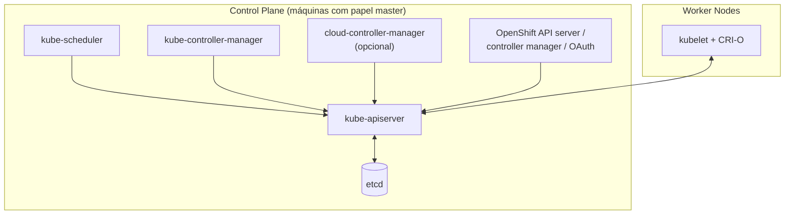

# Control Plane

> **ID:** 01-arquitetura-e-control-plane/control-plane | **Termo original:** control plane | **Remissões:** master (legado) | **Tradução:** plano de controle (só como apoio) | **Classe ontológica:** conceito / conjunto de componentes | **Plataforma:** Kubernetes / OpenShift | **Escopo:** não aplicável | **Disponibilidade:** nativo | **Versões validadas:** Kubernetes 1.35 / OCP 4.22 | **Nível:** básico | **Atualizado em:** 2026-11-04

## Definição em uma frase

O Control Plane é a camada de orquestração do cluster: o conjunto de componentes que **expõe a API e decide** como definir, implantar e gerenciar o ciclo de vida dos contêineres.

## Explicação didática

Um [Cluster](../../00-fundamentos-e-linguagem/verbetes/cluster.md) tem duas metades: quem **decide** (Control Plane) e quem **executa** ([Worker Nodes](worker-node.md)). O Control Plane não roda as aplicações. Ele guarda o Desired State, escolhe onde cada Pod vai rodar e corrige desvios.

Componentes do Control Plane no Kubernetes:

| Componente | Papel |
|---|---|
| [kube-apiserver](../../00-fundamentos-e-linguagem/verbetes/api-server.md) | Expõe a API; é a porta de entrada |
| [etcd](etcd.md) | Guarda o estado do cluster |
| [kube-scheduler](kube-scheduler.md) | Escolhe o nó de cada Pod novo |
| [kube-controller-manager](kube-controller-manager.md) | Roda os controllers nativos |
| [cloud-controller-manager](cloud-controller-manager.md) | Integra com o provedor de nuvem (opcional, depende da plataforma) |

Esses componentes podem rodar como serviços do sistema operacional ou como contêineres. As máquinas que os hospedam eram chamadas historicamente de [masters](master-node.md).

## Para que existe e qual problema resolve

Separar decisão de execução permite que o cluster continue tomando decisões coerentes mesmo com nós entrando e saindo, e que a execução das aplicações siga funcionando por algum tempo mesmo se o Control Plane ficar indisponível (sem novas mudanças nem novos agendamentos).

## Funcionamento técnico e ciclo de vida

- Todos os componentes conversam **pelo kube-apiserver**; só ele fala com o etcd.
- Em produção, o Control Plane roda em **várias máquinas** para dar alta disponibilidade.
- **No OpenShift:**
  - o Control Plane é formado por máquinas com o papel **`master`**, que rodam mais do que os serviços Kubernetes: também o OpenShift API server, o OpenShift controller manager e os componentes de OAuth;
  - a documentação exige **exatamente três** nós de Control Plane em implantações de produção. Em bare metal é possível ter três, quatro ou cinco, preferindo números ímpares por causa do **quorum** do etcd (quatro toleram a mesma falha que três; só cinco toleram duas falhas simultâneas);
  - parte dos serviços roda como **systemd** (CRI-O e kubelet, que precisam subir antes de qualquer contêiner) e parte como **[Static Pods](static-pod.md)** (etcd, kube-apiserver, kube-controller-manager, kube-scheduler, nos namespaces `openshift-etcd`, `openshift-kube-apiserver`, `openshift-kube-controller-manager` e `openshift-kube-scheduler`);
  - cada componente é mantido por um Operator, e o estado aparece em `ClusterOperator`.

## Relações e dependências

- Gerencia os [Worker Nodes](worker-node.md) e os Pods.
- Componentes: [etcd](etcd.md), [kube-scheduler](kube-scheduler.md), [kube-controller-manager](kube-controller-manager.md), [cloud-controller-manager](cloud-controller-manager.md) e [API Server](../../00-fundamentos-e-linguagem/verbetes/api-server.md).
- Executa a [Reconciliation](../../00-fundamentos-e-linguagem/verbetes/reconciliation.md) do cluster.

## Exemplo de situação real

Durante uma atualização do OpenShift, os nós de Control Plane são atualizados um de cada vez. Com três nós, o etcd mantém o quorum e a API continua respondendo. Num SNO, a mesma atualização deixa a API indisponível por alguns períodos, porque não há outro nó para assumir.

## Como visualizar e inspecionar (somente leitura)

```bash
# Nós com papel de Control Plane
oc get nodes -l node-role.kubernetes.io/control-plane

# OpenShift: Operators dos componentes do Control Plane
oc get clusteroperators etcd kube-apiserver kube-controller-manager kube-scheduler

# Pods dos componentes (apenas observar)
oc get pods -n openshift-etcd
oc get pods -n openshift-kube-scheduler
```

## Como interpretar a saída

- `ROLES` com `control-plane,master` identifica um nó de Control Plane. Num SNO aparece também `worker` no mesmo nó.
- Pods com o nome do nó no sufixo (ex.: `kube-scheduler-<nó>`) são **mirror Pods** de Static Pods: o kubelet os gerencia, e a API só os mostra.
- Pods `installer-*` e `revision-pruner-*` nesses namespaces fazem parte do mecanismo do OpenShift para trocar revisões dos Static Pods. Estarem `Completed` é normal.

## Diferenças e confusões frequentes

- **Control Plane ≠ master node:** um é a função; o outro, a máquina que a hospeda (termo legado).
- **Control Plane ≠ kube-apiserver:** o API server é só um dos componentes.
- **Control Plane fora do ar ≠ aplicações fora do ar:** os Pods em execução continuam, sem mudanças e sem reagendamentos.

## No OpenShift 4.22 versus Kubernetes

O OpenShift acrescenta componentes próprios ao Control Plane, faz tudo ser gerenciado por Operators e define regras de topologia (três nós em produção, SNO, two-node e Hosted Control Planes, estes da categoria 01, lote 3).

## No HomeLab SNO

Um único nó acumula Control Plane e compute: **não há alta disponibilidade**. Observe com `oc get clusteroperators`; nunca reinicie Pods nem edite manifests de Static Pods do Control Plane.

## Diagrama Mermaid



## Termos relacionados

[Worker Node](worker-node.md) · [Master Node](master-node.md) · [etcd](etcd.md) · [kube-scheduler](kube-scheduler.md) · [kube-controller-manager](kube-controller-manager.md) · [Static Pod](static-pod.md) · [API Server](../../00-fundamentos-e-linguagem/verbetes/api-server.md) · [Cluster](../../00-fundamentos-e-linguagem/verbetes/cluster.md)

## Fontes oficiais

- Kubernetes Glossary — Control Plane: <https://kubernetes.io/docs/reference/glossary/?all=true#term-control-plane> (fonte: `kubernetes/website` `release-1.35`, `reference/glossary/control-plane.md`)
- Kubernetes — Components: <https://kubernetes.io/docs/concepts/overview/components/>
- OCP 4.22 — Control plane architecture, "Machine roles" (papel `master`, três nós, quorum, systemd × static pods): <https://docs.redhat.com/en/documentation/openshift_container_platform/4.22/html/architecture/control-plane> (fonte: `modules/architecture-machine-roles.adoc`)

<details>
<summary>Notas de revisão</summary>

- **Estado:** desenvolvido. Fontes conferidas em 2026-11-04.
- **Pendências:** confirmar no SNO a label `node-role.kubernetes.io/control-plane` e os nomes dos ClusterOperators; confirmar a URL publicada. Nada foi **executado**.

</details>
