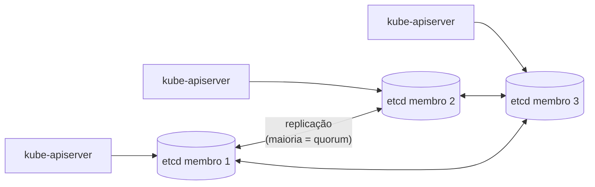

# etcd

> **ID:** 01-arquitetura-e-control-plane/etcd | **Termo original:** etcd | **Tradução:** não se traduz | **Classe ontológica:** componente (banco chave-valor distribuído) | **Plataforma:** Kubernetes / OpenShift | **Escopo:** não aplicável (roda no Control Plane) | **Disponibilidade:** nativo | **Versões validadas:** Kubernetes 1.35 / OCP 4.22 | **Nível:** intermediário | **Atualizado em:** 2026-11-04

## Definição em uma frase

O etcd é um **banco chave-valor consistente e altamente disponível** que serve de armazenamento de todos os dados do cluster Kubernetes.

## Explicação didática

Tudo o que você cria (Deployments, Secrets, ConfigMaps, Routes...) vira um registro no etcd. O [kube-apiserver](../../00-fundamentos-e-linguagem/verbetes/api-server.md) é o **único** componente que fala com ele; os outros leem e escrevem pela API.

Ele foi feito para guardar **pouca informação**, que cabe inteira em memória, com **consistência forte**: todos os membros concordam sobre o valor atual antes de confirmar uma escrita.

## Para que existe e qual problema resolve

Dá ao cluster uma **memória confiável e replicada**: se um nó de Control Plane cai, os outros membros do etcd têm os mesmos dados. Sem o etcd, não há Desired State persistido.

## Funcionamento técnico e ciclo de vida

- **Membros e quorum:** o etcd roda como um conjunto de membros que precisa de **maioria** (quorum) para aceitar escritas. Com 3 membros, tolera 1 falha; com 5, tolera 2. A documentação do OpenShift observa que **4** membros toleram a mesma falha que 3 e exigem 3 saudáveis.
- **Consistência:** escritas só são confirmadas depois de replicadas para a maioria.
- **Versionamento:** a `resourceVersion` dos objetos é hoje baseada na revisão do etcd, um detalhe de implementação em que os clientes não devem confiar. Ver [ResourceVersion](../../00-fundamentos-e-linguagem/verbetes/resource-version.md).
- **Backup:** a documentação Kubernetes recomenda ter um plano de backup para os dados do etcd.
- **No OpenShift:** o etcd é gerenciado pelo **etcd Operator** (cluster operator `etcd`), que cria e remove membros, faz backups e atualizações. Ele roda como [Static Pod](static-pod.md) nos nós de Control Plane, no namespace `openshift-etcd`.

## Relações e dependências

- Acessado só pelo [API Server](../../00-fundamentos-e-linguagem/verbetes/api-server.md).
- Parte do [Control Plane](control-plane.md); define a regra de número ímpar de nós de Control Plane.

## Exemplo de situação real

Num cluster de 3 nós de Control Plane, dois ficam fora do ar. O etcd perde o quorum: a API para de aceitar mudanças, embora os Pods já em execução continuem rodando. Recuperar o quorum, ou restaurar um backup, é então prioridade máxima.

## Como visualizar e inspecionar (somente leitura)

```bash
# OpenShift: saúde do Operator do etcd
oc get clusteroperator etcd

# Membros do etcd como Pods (apenas observar)
oc get pods -n openshift-etcd -l app=etcd

# Condições detalhadas reportadas pelo Operator
oc describe clusteroperator etcd
```

## Como interpretar a saída

- `AVAILABLE=True`, `DEGRADED=False`: o etcd está saudável segundo o Operator.
- Em `oc describe clusteroperator etcd`, as mensagens das condições costumam citar quantos membros estão saudáveis (ex.: "3 members are available"). Leia o texto exato no seu cluster.
- Pods `etcd-<nó>` são mirror Pods de Static Pods: aparecem na API, mas são gerenciados pelo kubelet.

## Diferenças e confusões frequentes

- **etcd ≠ banco da aplicação:** não use o etcd do cluster para dados de aplicações.
- **etcd fora do quorum ≠ cluster parado por completo:** as cargas em execução seguem; o que para é o Control Plane.
- **Backup de etcd ≠ backup de aplicações:** volumes persistentes e dados externos precisam de outra estratégia (categoria 05).

## No OpenShift 4.22 versus Kubernetes

O OpenShift automatiza o ciclo de vida do etcd por Operator e documenta procedimentos próprios de backup e restauração (categoria 13). **Não** use procedimentos genéricos de etcd do Kubernetes num OpenShift.

## No HomeLab SNO

Há **um único membro** do etcd, logo nenhuma tolerância a falhas. Um backup do etcd é especialmente valioso no SNO; faça-o pelo procedimento oficial do OpenShift, que é uma **ação administrativa** (categoria 13), e não um comando de inspeção.

## Diagrama Mermaid



*Legenda: com 3 membros, o quorum é 2; a perda de um membro é tolerada.*

## Termos relacionados

[Control Plane](control-plane.md) · [API Server](../../00-fundamentos-e-linguagem/verbetes/api-server.md) · [Static Pod](static-pod.md) · [ResourceVersion](../../00-fundamentos-e-linguagem/verbetes/resource-version.md) · [ClusterOperator](../../09-operators-e-extensoes/verbetes/clusteroperator.md)

## Fontes oficiais

- Kubernetes Glossary — etcd: <https://kubernetes.io/docs/reference/glossary/?all=true#term-etcd> (fonte: `kubernetes/website` `release-1.35`, `reference/glossary/etcd.md`)
- OCP 4.22 — Control plane architecture, "etcd key-value store" (fonte: `modules/etcd-overview.adoc`) e "Machine roles" (quorum com 3, 4 e 5 nós): <https://docs.redhat.com/en/documentation/openshift_container_platform/4.22/html/architecture/control-plane>
- Projeto etcd (fonte externa ao Kubernetes): <https://etcd.io/docs/>

## Revisão editorial

- **Estado:** 🟡 desenvolvido. Fontes conferidas em 2026-11-04.
- **Pendências:** confirmar a label `app=etcd` dos Pods e o texto das condições do Operator no SNO, que **não foram executados**. Detalhar backup e restore na categoria 13.
