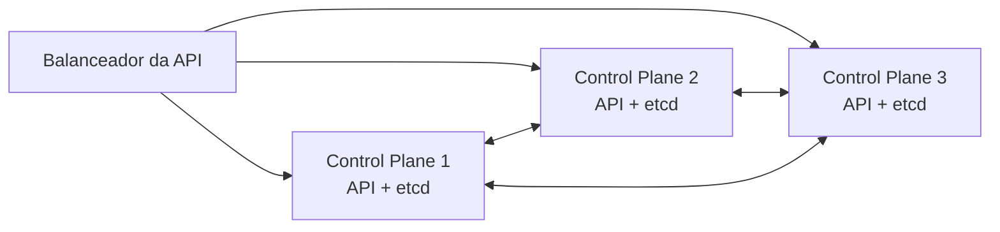

# High Availability (HA)

## Definição em uma frase

High Availability é a capacidade de um cluster **continuar funcionando quando um componente ou uma máquina falha**, obtida pela redundância do [Control Plane](control-plane.md), do [etcd](etcd.md) e das cargas de trabalho.

## Explicação didática

HA não é uma peça que se instala; é uma propriedade do **desenho** do cluster. No Control Plane, ela vem de ter vários nós, de modo que o etcd mantenha o [quorum](quorum.md) e os API servers possam ser atendidos por mais de uma máquina. Nas aplicações, vem de ter várias réplicas espalhadas por nós diferentes.

## Para que existe e qual problema resolve

Evita que a falha de uma máquina, uma manutenção ou uma atualização derrube o cluster ou as aplicações.

## Funcionamento técnico e ciclo de vida

**No Kubernetes**, a documentação descreve duas topologias de HA para o Control Plane:

- **stacked etcd:** cada nó de Control Plane roda kube-apiserver, kube-scheduler, kube-controller-manager e um membro do etcd. É mais simples, mas a perda de um nó leva junto um membro do etcd e uma instância do Control Plane;
- **external etcd:** o etcd roda em nós separados, o que desacopla as falhas e exige mais máquinas.

Em ambas, o kube-apiserver é exposto aos nós por um balanceador de carga.

**No OpenShift 4.22**, o Control Plane usa o modelo *stacked*: o etcd roda nos próprios nós de Control Plane. As topologias são definidas na instalação e **não podem ser convertidas depois**:

| Topologia | Control Plane | Observação |
|---|---|---|
| **Padrão HA** | 3 nós (em bare metal, 3 a 5) | Exigido em produção; números ímpares |
| **Compact / three-node** | 3 nós, que também rodam cargas | Sem workers dedicados |
| **Two-Node with Arbiter** | 2 nós + 1 árbitro | O árbitro guarda o etcd completo para manter o quorum; GA no 4.22 |
| **Two-node com fencing** | 2 nós | Pacemaker isola o nó que não responde (via BMC); GA no 4.22 |
| **[SNO](sno.md)** | 1 nó | **Sem HA** |
| **[Hosted Control Planes](hosted-control-plane.md)** | Pods num cluster de gerenciamento | Outro modelo de implantação |

Os nós de cada pool são atualizados um de cada vez (`maxUnavailable: 1`), justamente para preservar a disponibilidade durante as atualizações.

## Relações e dependências

- Depende do [quorum](quorum.md) do [etcd](etcd.md) e do número de nós de [Control Plane](control-plane.md).
- Nas aplicações, depende de réplicas, afinidades e *PodDisruptionBudgets* (categorias 03 e 11).

## Exemplo de situação real

Num cluster com três nós de Control Plane, um deles é reiniciado para manutenção. A API continua respondendo pelos outros dois, e o etcd mantém o quorum. Num SNO, a mesma manutenção deixa o cluster inacessível até o nó voltar.

## Como visualizar e inspecionar (somente leitura)

```bash
# Topologia do Control Plane e da infraestrutura
oc get infrastructure cluster -o jsonpath='{.status.controlPlaneTopology}{"  "}{.status.infrastructureTopology}{"\n"}'

# Quantos nós de Control Plane existem
oc get nodes -l node-role.kubernetes.io/control-plane
```

## Como interpretar a saída

- `HighlyAvailable`: Control Plane redundante. `SingleReplica`: um único nó (SNO). Outros valores podem aparecer em topologias especiais, como a de árbitro. Confirme com `oc explain infrastructure.status.controlPlaneTopology`.
- `infrastructureTopology` descreve onde rodam os componentes de infraestrutura (como o router), e não o Control Plane.

## Diferenças e confusões frequentes

- **HA × backup:** HA protege contra falhas de máquinas; backup protege contra perda ou corrupção de dados. Um não substitui o outro.
- **HA do Control Plane × HA das aplicações:** um cluster HA não torna uma aplicação de réplica única tolerante a falhas.
- **Mais nós × mais HA:** quatro nós de Control Plane toleram a mesma falha que três. Ver [Quorum](quorum.md).

## No OpenShift 4.22 versus Kubernetes

O Kubernetes descreve as topologias de forma genérica; o OpenShift define as **suportadas**, com regras de número de nós e a impossibilidade de mudar a topologia depois da instalação.

## No HomeLab SNO

O SNO, por definição, **não tem HA**: a documentação aponta a falta de alta disponibilidade como o principal compromisso dessa topologia. Planeje backups e aceite períodos de indisponibilidade em atualizações e reinicializações.

## Diagrama



*Legenda: topologia stacked, a do OpenShift; cada nó hospeda um membro do etcd.*

## Termos relacionados

[Quorum](quorum.md) · [etcd](etcd.md) · [Control Plane](control-plane.md) · [SNO](sno.md) · [Hosted Control Plane](hosted-control-plane.md) · [MachineConfigPool](machineconfigpool.md)

## Fontes oficiais

- Kubernetes — Options for Highly Available Topology (stacked × external etcd): <https://kubernetes.io/docs/setup/production-environment/tools/kubeadm/ha-topology/> (fonte: `kubernetes/website` `release-1.35`)
- OCP 4.22 — Control plane architecture, "Machine roles" (três nós em produção; 3 a 5 em bare metal): <https://docs.redhat.com/en/documentation/openshift_container_platform/4.22/html/architecture/control-plane>
- OCP 4.22 — Two-Node with Arbiter; Preparing to install a two-node OpenShift cluster with fencing (fontes: `installing/installing_two_node_cluster/...`)
- OCP 4.22 — Release notes, tabela de Technology Preview (arbiter e two-node com fencing como GA no 4.22; fonte: `modules/rn-ocp-release-notes-technology-preview.adoc`)

<details>
<summary>Ficha técnica e notas de revisão</summary>

**Ficha técnica**

- **ID:** 01-arquitetura-e-control-plane/high-availability
- **Termo original:** high availability (HA)
- **Remissões:** stacked etcd, external etcd, compact cluster, three-node cluster, Two-Node with Arbiter, two-node with fencing
- **Tradução:** alta disponibilidade (só como apoio)
- **Classe ontológica:** conceito (propriedade de arquitetura)
- **Plataforma:** Kubernetes / OpenShift
- **Escopo:** não aplicável
- **Disponibilidade:** depende da topologia escolhida na instalação
- **Versões validadas:** Kubernetes 1.35 / OCP 4.22
- **Nível:** intermediário
- **Atualizado em:** 2026-11-05

**Notas de revisão**

- **Estado:** desenvolvido. Fontes conferidas em 2026-11-05.
- **Pendências:** os valores possíveis de `controlPlaneTopology` para a topologia de árbitro, e a confirmação de que o OpenShift não oferece etcd externo, devem ser verificados com `oc explain` e na documentação de instalação. O status GA das topologias de dois nós foi lido na tabela de Technology Preview das release notes (colunas 4.20, 4.21 e 4.22).

</details>
