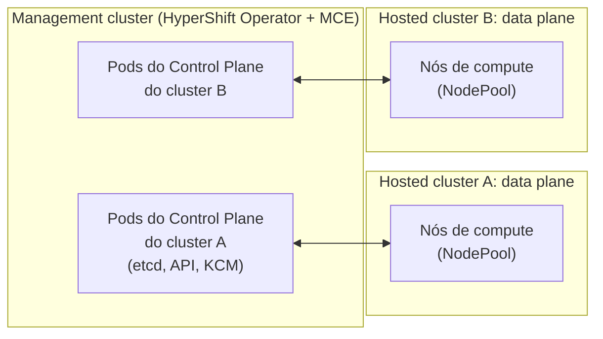

# Hosted Control Plane (HCP)

## Definição em uma frase

Hosted Control Planes é o modelo de implantação do OpenShift em que o **Control Plane de um cluster roda como Pods num outro cluster**, o *management cluster*, em vez de usar máquinas dedicadas.

## Explicação didática

No modelo tradicional (*standalone*), cada cluster tem os seus próprios nós de Control Plane. No modelo hospedado, o etcd, o kube-apiserver, o kube-controller-manager e os demais componentes de um cluster viram cargas de trabalho comuns, rodando como Pods dentro de um cluster de gerenciamento. O cluster "hospedado" (*hosted cluster*) fica só com os nós de compute (o *data plane*).

## Para que existe e qual problema resolve

Segundo a documentação, os principais benefícios são:

- **fronteira de segurança mais forte** entre gerenciamento e cargas de trabalho, porque o Control Plane fica desacoplado, num cluster dedicado;
- **custo menor**, porque muitos Control Planes cabem em poucos nós;
- **início rápido**, porque os Control Planes são Pods, e as mesmas práticas de monitoramento, logging e autoscaling valem para eles.

## Funcionamento técnico e ciclo de vida

Conceitos e termos da documentação:

| Termo | Significado |
|---|---|
| **management cluster** (= *hosting cluster*) | Cluster OpenShift onde o **HyperShift Operator** está implantado e onde ficam os Control Planes dos hosted clusters |
| **hosted cluster** | Cluster cujo Control Plane e API são hospedados no management cluster |
| **hosted control plane** | O Control Plane de um hosted cluster, com etcd, Kubernetes API server, controller manager e uma VPN |
| **data plane** | Compute, storage e rede onde rodam as cargas do hosted cluster |
| **node pool** | Recurso que gerencia um conjunto de nós de compute de um hosted cluster |

- **Criação:** em vez do `openshift-install`, usam-se os recursos da API `hypershift.openshift.io`, como `HostedCluster` e `NodePool`, num cluster OpenShift existente.
- **Configuração:** o que afeta o Control Plane é configurado no recurso `HostedCluster`, e não nos objetos `config.openshift.io` do próprio cluster.
- **Ferramenta de ciclo de vida:** o HCP é configurado pelo **multicluster engine for Kubernetes Operator** (MCE). O MCE faz parte do Red Hat Advanced Cluster Management, mas o RHACM **não é obrigatório**.
- **Plataformas** citadas no 4.22: bare metal (via Agent), OpenShift Virtualization, AWS, IBM Z e IBM Power, além de opções em Technology Preview (Agent em máquinas que não são bare metal, Red Hat OpenStack 17.1).

## Relações e dependências

- Alternativa ao [Control Plane](control-plane.md) standalone.
- Implementado pelo projeto [HyperShift](hypershift.md) e pelo HyperShift Operator.
- Exige um management cluster com o MCE (categoria 16, componentes opcionais).

## Exemplo de situação real

Um provedor interno de plataforma precisa entregar dezenas de clusters a equipes diferentes. Com HCP, mantém um management cluster e cria um hosted cluster por equipe. Os Control Planes ficam sob a administração do provedor, e as equipes recebem só os nós de compute e o endpoint da API.

## Como visualizar e inspecionar (somente leitura)

Num **management cluster** com HCP configurado:

```bash
# A API do HyperShift está disponível?
oc api-resources --api-group=hypershift.openshift.io

# Hosted clusters e node pools (somente se a API existir e houver permissão)
oc get hostedclusters -A
oc get nodepools -A
```

Num cluster **standalone**, como o SNO, a primeira consulta normalmente não lista nada: a API não está instalada.

## Como interpretar a saída

- `oc api-resources --api-group=hypershift.openshift.io` vazio: o cluster não é management cluster. Isso **não** é erro.
- Em `oc get hostedclusters`, as colunas de versão e de disponibilidade mostram o estado de cada hosted cluster. Verifique os nomes exatos com `oc explain hostedcluster.status`.

## Diferenças e confusões frequentes

- **Hosted cluster × managed cluster:** *managed cluster* é um termo do RHACM e MCE para um cluster gerenciado por um hub. A documentação alerta que ele **não** é o mesmo que *management cluster*.
- **HCP × SNO:** o HCP separa o Control Plane do data plane; o SNO junta tudo num nó.
- **HCP × ROSA/ARO com HCP:** serviços gerenciados na nuvem também usam o modelo hospedado, mas com outras responsabilidades e documentação própria.

## No OpenShift 4.22 versus Kubernetes

Não há equivalente nativo no Kubernetes upstream. O modelo existe no ecossistema OpenShift, pelo projeto HyperShift.

## No HomeLab SNO

**Não instalado e não recomendável** num SNO com recursos limitados: um management cluster precisa de capacidade para hospedar vários Control Planes. Estude o conceito; a prática exige outro ambiente.

## Diagrama



## Termos relacionados

[HyperShift](hypershift.md) · [Control Plane](control-plane.md) · [High Availability](high-availability.md) · [SNO](sno.md) · [etcd](etcd.md)

## Fontes oficiais

- OCP 4.22 — Hosted control planes overview (introdução, arquitetura, benefícios, diferenças com o standalone, relação com MCE e RHACM, glossário de conceitos): <https://docs.redhat.com/en/documentation/openshift_container_platform/4.22/html/hosted_control_planes/index> (fontes: `hosted_control_planes/index.adoc`, `modules/hosted-control-planes-overview.adoc`, `modules/hcp-ocp-differences.adoc`, `modules/hcp-mce-acm-relationship-intro.adoc`, `modules/hosted-control-planes-concepts-personas.adoc`)

<details>
<summary>Ficha técnica e notas de revisão</summary>

**Ficha técnica**

- **ID:** 01-arquitetura-e-control-plane/hosted-control-plane
- **Termo original:** hosted control planes (HCP)
- **Remissões:** hosted cluster, management cluster, hosting cluster, node pool, data plane
- **Tradução:** Control Plane hospedado (só como apoio)
- **Classe ontológica:** conceito (modelo de implantação) / extensão opcional
- **Plataforma:** OpenShift (com multicluster engine)
- **API:** `hypershift.openshift.io` (`HostedCluster`, `NodePool`)
- **Escopo:** não aplicável
- **Disponibilidade:** depende do multicluster engine Operator; plataformas específicas
- **Versões validadas:** OCP 4.22
- **Nível:** avançado
- **Atualizado em:** 2026-11-05

**Notas de revisão**

- **Estado:** desenvolvido. Fontes conferidas em 2026-11-05.
- **Pendências:** confirmar o escopo (namespaced) de `HostedCluster` e `NodePool` e as colunas de `oc get hostedclusters` num management cluster; o SNO do autor não tem essa API. Detalhar o MCE na categoria 16.

</details>
