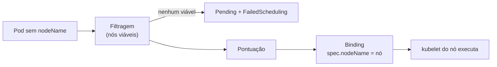

# kube-scheduler

## Definição em uma frase

O kube-scheduler é o componente do [Control Plane](control-plane.md) que observa **Pods novos sem nó atribuído** e escolhe o nó em que cada um vai rodar.

## Explicação didática

Quando um Pod é criado, ele ainda não tem "endereço". O scheduler olha para os nós disponíveis e decide o melhor lugar, considerando o que o Pod pede (CPU, memória), restrições (afinidades, taints, seletores de nó) e o estado de cada nó. Ele **não roda** o Pod: só grava a decisão. Quem roda é o [kubelet](kubelet.md) do nó escolhido.

## Para que existe e qual problema resolve

Distribui a carga de forma automática e respeitando regras, sem que o usuário precise escolher máquinas. É o "bin packing" do Kubernetes.

## Funcionamento técnico e ciclo de vida

1. **Fila:** o scheduler pega Pods com `spec.nodeName` vazio.
2. **Filtragem (*filtering*):** descarta os nós inviáveis (sem recursos, com taint não tolerado, fora da afinidade...). Os que sobram são os nós **viáveis** (*feasible*).
3. **Pontuação (*scoring*):** dá nota aos nós viáveis e escolhe o de maior nota.
4. **Binding:** informa a decisão ao API server, que grava o nó em `spec.nodeName`.
5. Se **nenhum** nó for viável, o Pod fica **não agendado** (`Pending`) até a situação mudar, e o scheduler emite um Event `FailedScheduling`.

Fatores considerados: requisitos de recursos individuais e coletivos, restrições de hardware, software e política, afinidade e anti-afinidade, localidade dos dados, interferência entre cargas e prazos. É possível escrever um scheduler próprio e usá-lo no lugar do padrão, ou indicar o nó direto na criação do Pod, o que é incomum.

## Relações e dependências

- Lê Pods e Nodes pela [API](../../00-fundamentos-e-linguagem/verbetes/kubernetes-api.md); grava o binding.
- Depende das *requests* dos contêineres e das labels e taints dos nós (categoria 11).
- No OpenShift, é gerenciado pelo Operator `kube-scheduler` e roda como [Static Pod](static-pod.md) no namespace `openshift-kube-scheduler`.

## Exemplo de situação real

Um Pod fica `Pending` com o evento `0/1 nodes are available: 1 node(s) had untolerated taint {...}`. O nó existe e tem recursos, mas um *taint* impede o agendamento. A correção envolve tolerations ou o nó-alvo, e não "reiniciar o scheduler".

## Como visualizar e inspecionar (somente leitura)

```bash
# Onde um Pod foi agendado (vazio = ainda não agendado)
oc get pod <nome> -n <namespace> -o jsonpath='{.spec.nodeName}{"\n"}'

# Pods pendentes e o motivo
oc get pods -n <namespace> --field-selector=status.phase=Pending
oc get events -n <namespace> --field-selector reason=FailedScheduling

# Condição PodScheduled
oc get pod <nome> -n <namespace> \
  -o jsonpath='{range .status.conditions[?(@.type=="PodScheduled")]}{.status} {.reason} {.message}{"\n"}{end}'

# OpenShift: saúde do scheduler e configuração do cluster
oc get clusteroperator kube-scheduler
oc get scheduler cluster -o yaml
```

## Como interpretar a saída

- `PodScheduled=False` com `reason=Unschedulable`: a mensagem diz quantos nós foram descartados e por quê (`Insufficient memory`, `untolerated taint`, `didn't match Pod's node affinity/selector`...).
- `spec.nodeName` preenchido: o scheduler já decidiu; problemas a partir daí são do nó (kubelet, imagem, volume).
- O objeto `scheduler.config.openshift.io/cluster` guarda a configuração do scheduler no OpenShift, por exemplo se o Control Plane aceita cargas comuns (`mastersSchedulable`).

## Diferenças e confusões frequentes

- **Scheduler ≠ controller de reconciliação:** ele decide posicionamento; não cria nem apaga Pods.
- **Scheduler ≠ kubelet:** decisão × execução.
- **`Pending` nem sempre é do scheduler:** um Pod já agendado pode ficar `Pending` por causa da imagem ou de volumes. Veja `spec.nodeName` e os Events.

## No OpenShift 4.22 versus Kubernetes

Mesmo componente, gerenciado por Operator, com configuração de cluster em `scheduler.config.openshift.io`. Perfis e plugins avançados ficam na categoria 11.

## No HomeLab SNO

Há um único nó possível, então o scheduler só decide entre "cabe" e "não cabe". `Pending` por falta de CPU ou memória é comum num SNO com poucos recursos.

## Diagrama



## Termos relacionados

[Control Plane](control-plane.md) · [kubelet](kubelet.md) · [Worker Node](worker-node.md) · [Static Pod](static-pod.md) · [Events](../../00-fundamentos-e-linguagem/verbetes/events.md) · [Conditions](../../00-fundamentos-e-linguagem/verbetes/conditions.md)

## Fontes oficiais

- Kubernetes — Kubernetes Scheduler (filtragem, pontuação, binding): <https://kubernetes.io/docs/concepts/scheduling-eviction/kube-scheduler/> (fonte: `kubernetes/website` `release-1.35`, `concepts/scheduling-eviction/kube-scheduler.md`)
- Kubernetes Glossary — kube-scheduler: <https://kubernetes.io/docs/reference/glossary/?all=true#term-kube-scheduler>
- OCP 4.22 — Control plane architecture, "Machine roles": <https://docs.redhat.com/en/documentation/openshift_container_platform/4.22/html/architecture/control-plane>

<details>
<summary>Ficha técnica e notas de revisão</summary>

**Ficha técnica**

- **ID:** 01-arquitetura-e-control-plane/kube-scheduler
- **Termo original:** kube-scheduler, scheduler
- **Remissões:** scheduling, binding
- **Tradução:** escalonador (só como apoio)
- **Classe ontológica:** componente
- **Plataforma:** Kubernetes / OpenShift
- **Escopo:** não aplicável (roda no Control Plane)
- **Disponibilidade:** nativo
- **Versões validadas:** Kubernetes 1.35 / OCP 4.22
- **Nível:** intermediário
- **Atualizado em:** 2026-11-04

**Notas de revisão**

- **Estado:** desenvolvido. Fontes conferidas em 2026-11-04.
- **Pendências:** confirmar no SNO o recurso `scheduler.config.openshift.io/cluster` e o campo `mastersSchedulable`, conhecidos da documentação de configuração do scheduler, que **não foi lida** nesta rodada. Os textos das mensagens de `FailedScheduling` são ilustrativos.

</details>
