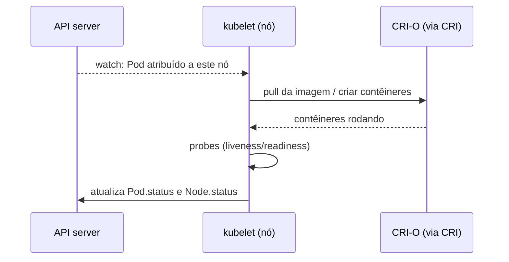

# kubelet

> **ID:** 01-arquitetura-e-control-plane/kubelet | **Termo original:** kubelet | **Remissões:** Node Agent | **Tradução:** não se traduz (agente do nó) | **Classe ontológica:** componente | **Plataforma:** Kubernetes / OpenShift | **Escopo:** não aplicável (roda em cada nó) | **Disponibilidade:** nativo | **Versões validadas:** Kubernetes 1.35 / OCP 4.22 | **Nível:** básico → intermediário | **Atualizado em:** 2026-11-04

## Definição em uma frase

O kubelet é o **agente que roda em cada nó** e garante que os contêineres descritos nos Pods atribuídos àquele nó estejam rodando e saudáveis.

## Explicação didática

O [kube-scheduler](kube-scheduler.md) decide "este Pod vai para o nó X". No nó X, o kubelet percebe o Pod novo, pede ao [Container Runtime](container-runtime.md) (pela [CRI](cri.md)) que baixe a imagem e suba os contêineres, executa as *probes* de saúde e relata o resultado no `status` do Pod. Ele também mantém o objeto Node atualizado (condições e capacidade) e envia *heartbeats*.

O kubelet **não gerencia contêineres que não foram criados pelo Kubernetes**.

## Para que existe e qual problema resolve

É a ponte entre o Desired State na API e o que de fato roda na máquina: sem ele, um nó seria só um computador ligado, sem participar do cluster.

## Funcionamento técnico e ciclo de vida

- Recebe um conjunto de PodSpecs, principalmente pela API e também por arquivos locais ([Static Pods](static-pod.md)), e garante que os contêineres correspondam a eles.
- **Saúde:** executa *liveness*, *readiness* e *startup probes* e reinicia contêineres conforme a `restartPolicy`.
- **Nó:** atualiza as condições do Node (`Ready`, pressões de memória, disco e PID) e renova o Lease do nó em `kube-node-lease` (heartbeat).
- **Recursos:** aplica limites, faz despejos (*evictions*) sob pressão e coleta imagens e contêineres não usados.
- **No OpenShift:** roda como **serviço systemd** no host (não como contêiner), porque precisa estar de pé antes de qualquer contêiner. A versão do kubelet não pode ser mais nova que a do kube-apiserver; a defasagem suportada depende de a versão menor do OCP ser par (até duas versões) ou ímpar (até uma).

## Relações e dependências

- Fala com o [API Server](../../00-fundamentos-e-linguagem/verbetes/api-server.md) e com o [Container Runtime](container-runtime.md) via [CRI](cri.md).
- Executa Pods atribuídos pelo [kube-scheduler](kube-scheduler.md) e os [Static Pods](static-pod.md).
- Representa o [Node](../../02-compute-e-nodes/verbetes/node.md) na API.

## Exemplo de situação real

Um nó aparece `NotReady`. Os Pods nele param de receber atualizações, e depois de um tempo o Control Plane os considera perdidos. A causa costuma estar no kubelet (serviço parado, certificado expirado, disco cheio) ou na rede até a API.

## Como visualizar e inspecionar (somente leitura)

```bash
# Estado e versão do kubelet de cada nó
oc get nodes -o wide

# Condições do nó e eventos do kubelet
oc describe node <nó>

# Heartbeats dos nós (Leases)
oc get leases -n kube-node-lease

# Logs do kubelet sem acessar o nó por SSH (exige permissão de administrador)
oc adm node-logs <nó> -u kubelet --tail=50
```

## Como interpretar a saída

- `oc get nodes`: `STATUS=Ready` e a coluna `VERSION` (versão do kubelet, ex.: `v1.35.x`).
- `oc describe node`: em `Conditions`, `Ready=True` e as pressões em `False`; `Events` com `reason` como `NodeNotReady` ou `EvictionThresholdMet` apontam problemas.
- Leases com `renewTime` recente significam heartbeats em dia; um Lease parado sugere kubelet sem contato com a API.

## Diferenças e confusões frequentes

- **kubelet ≠ Container Runtime:** o kubelet orquestra no nó; o runtime executa os contêineres.
- **kubelet ≠ kube-proxy/service proxy:** rede de Services é outro componente (categoria 01, lote 2).
- **kubelet não aparece como Pod:** é um serviço do sistema; não procure por ele em `oc get pods`.

## No OpenShift 4.22 versus Kubernetes

Configurado pela plataforma (`KubeletConfig` e MachineConfig) em vez de arquivos editados à mão no nó. A documentação define as regras de defasagem de versão entre kubelet e API server.

## No HomeLab SNO

O kubelet do único nó roda os Pods de **plataforma e** de aplicação. `oc adm node-logs` é a forma suportada de ler os logs sem SSH; ainda assim, é uma consulta administrativa.

## Diagrama Mermaid



## Termos relacionados

[Container Runtime](container-runtime.md) · [CRI](cri.md) · [CRI-O](cri-o.md) · [Static Pod](static-pod.md) · [kube-scheduler](kube-scheduler.md) · [Worker Node](worker-node.md) · [Node](../../02-compute-e-nodes/verbetes/node.md)

## Fontes oficiais

- Kubernetes Glossary — kubelet: <https://kubernetes.io/docs/reference/glossary/?all=true#term-kubelet> (fonte: `kubernetes/website` `release-1.35`, `reference/glossary/kubelet.md`)
- Kubernetes — Nodes (heartbeats, Leases): <https://kubernetes.io/docs/concepts/architecture/nodes/>
- OCP 4.22 — Control plane architecture, "Machine roles" (kubelet como systemd; defasagem de versão): <https://docs.redhat.com/en/documentation/openshift_container_platform/4.22/html/architecture/control-plane>

<details>
<summary>Notas de revisão</summary>

- **Estado:** desenvolvido. Fontes conferidas em 2026-11-04.
- **Pendências:** confirmar a sintaxe de `oc adm node-logs ... -u kubelet --tail` no cliente 4.22 e os `reason` de eventos citados, que **não foram verificados**. A página Nodes foi baixada, mas lida só em parte.

</details>
