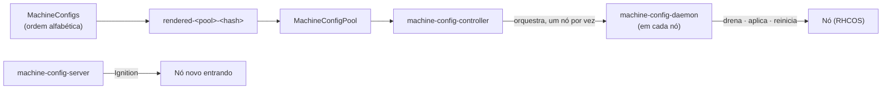

# Machine Config Operator (MCO)

## Definição em uma frase

O Machine Config Operator gerencia o **ciclo de vida do sistema operacional dos nós**: coordena atualizações do RHCOS e mudanças de configuração (systemd, CRI-O, kubelet, kernel, NetworkManager...) a partir de objetos [MachineConfig](machineconfig.md) aplicados a [pools](machineconfigpool.md) de máquinas.

## Explicação didática

No OpenShift não se configura um nó entrando nele por SSH e editando arquivos. Declara-se a configuração num `MachineConfig`, e o MCO leva essa configuração a todos os nós do pool, de forma ordenada: um nó de cada vez, drenando os Pods, aplicando a mudança e reiniciando quando necessário. É a [Reconciliation](../../00-fundamentos-e-linguagem/verbetes/reconciliation.md) aplicada ao sistema operacional.

## Para que existe e qual problema resolve

Integra a gestão do cluster com a do sistema operacional: as atualizações do OpenShift trazem junto as do RHCOS, e toda máquina nova de um pool nasce com a mesma configuração.

## Funcionamento técnico e ciclo de vida

Três peças principais:

| Componente | Onde roda | Papel |
|---|---|---|
| **machine-config-controller** | Control Plane | Coordena as atualizações; observa os nós e orquestra a aplicação das configurações |
| **machine-config-daemon (MCD)** | DaemonSet, em cada nó | Aplica a configuração no nó: drena os Pods, atualiza e reinicia |
| **machine-config-server** | DaemonSet | Entrega os arquivos Ignition aos nós que entram no cluster |

- A configuração é um subconjunto do formato **Ignition** (especificação v3). O MCD decide se precisa de uma atualização OSTree ou só de mudanças em arquivos, unidades systemd e kubelet.
- Os MachineConfigs de um pool são processados em **ordem alfabética** e combinados num **rendered MachineConfig**, que é o que vai para os nós.
- O MCO só escreve em `/etc` e `/var`. Ele não "toma conta" do nó inteiro: só gerencia o que foi declarado.
- **Configuration drift:** se um arquivo gerenciado for alterado fora do MCO, o MCD marca o nó como **degraded** e não sobrescreve o arquivo.
- A documentação **desaconselha fortemente** mudanças manuais nos nós: elas se perdem quando o nó é substituído.
- Para ajustes do kubelet, usa-se o recurso `KubeletConfig`, que o MCO transforma em configuração do nó.

## Relações e dependências

- Lê [MachineConfig](machineconfig.md) e atua por [MachineConfigPool](machineconfigpool.md).
- Coordena-se com o [Cluster Version Operator](cluster-version-operator.md) nas atualizações.
- Afeta [kubelet](kubelet.md) e [CRI-O](cri-o.md), que são configurados por ele.

## Exemplo de situação real

Depois de alguém editar `/etc/...` à mão num nó, o pool fica `DEGRADED=True`, e a mensagem do nó cita uma divergência de conteúdo de arquivo. É o *drift* detectado pelo MCD; a correção é desfazer a edição manual ou levar a mudança para um MachineConfig.

## Como visualizar e inspecionar (somente leitura)

```bash
# Saúde do Operator
oc get clusteroperator machine-config

# Pools e estado de atualização
oc get machineconfigpools

# MachineConfigs existentes (inclui os "rendered-*")
oc get machineconfigs

# Estado do MCO por nó (anotações do MCD)
oc get node <nó> -o jsonpath='{.metadata.annotations.machineconfiguration\.openshift\.io/state}{"\n"}'

# Pods do MCO (apenas observar)
oc get pods -n openshift-machine-config-operator
```

## Como interpretar a saída

- No nó, a annotation `machineconfiguration.openshift.io/state` costuma mostrar `Done` quando ele está atualizado, `Working` durante uma aplicação e `Degraded` com problema.
- Em `oc get machineconfigpools`, `UPDATED=True` e `DEGRADED=False` indicam um pool em dia.
- MachineConfigs com prefixo `rendered-<pool>-<hash>` são os resultados combinados; os demais são as peças de origem (padrões do sistema e personalizações).

## Diferenças e confusões frequentes

- **MCO × Machine API:** a Machine API **cria e remove máquinas**; o MCO **configura o SO** das máquinas.
- **MachineConfig × KubeletConfig × ContainerRuntimeConfig:** os dois últimos são formas de alto nível de pedir mudanças que o MCO transforma em configuração de nó.
- **Aplicar um MachineConfig não é imediato:** pode exigir drenagem e reinicialização de **cada** nó do pool.

## No OpenShift 4.22 versus Kubernetes

Não há MCO no Kubernetes upstream: lá a configuração do SO dos nós é responsabilidade externa (Ansible, imagens, etc.).

## No HomeLab SNO

Qualquer MachineConfig aplicado ao SNO pode **reiniciar o único nó** e derrubar o cluster durante o processo. Use os comandos acima só para observar; mudanças de configuração ficam para um planejamento explícito.

## Diagrama



## Termos relacionados

[MachineConfig](machineconfig.md) · [MachineConfigPool](machineconfigpool.md) · [Cluster Version Operator](cluster-version-operator.md) · [kubelet](kubelet.md) · [CRI-O](cri-o.md) · [Worker Node](worker-node.md)

## Fontes oficiais

- OCP 4.22 — Machine configuration overview, "About the Machine Config Operator" e "Machine config overview" (fontes: `machine_configuration/index.adoc`, `modules/understanding-machine-config-operator.adoc`, `modules/machine-config-overview.adoc`)
- OCP 4.22 — "Node configuration management with machine config pools" (fonte: `modules/architecture-machine-config-pools.adoc`)
- Ignition Configuration Specification v3.5.0 (fonte externa): <https://coreos.github.io/ignition/configuration-v3_5/>

<details>
<summary>Ficha técnica e notas de revisão</summary>

**Ficha técnica**

- **ID:** 01-arquitetura-e-control-plane/machine-config-operator
- **Termo original:** Machine Config Operator (MCO)
- **Remissões:** machine-config-controller, machine-config-daemon (MCD), machine-config-server
- **Tradução:** não se traduz
- **Classe ontológica:** componente (Operator de plataforma)
- **Plataforma:** OpenShift
- **Escopo:** cluster
- **Disponibilidade:** nativo
- **Versões validadas:** OCP 4.22
- **Nível:** intermediário → avançado
- **Atualizado em:** 2026-11-04

**Notas de revisão**

- **Estado:** desenvolvido. Fontes conferidas em 2026-11-04.
- **Pendências:** a annotation `machineconfiguration.openshift.io/state` e seus valores, o nome do ClusterOperator `machine-config` e o namespace `openshift-machine-config-operator` são conhecidos da documentação de status do MCO (`checking-mco-node-status`), que **não foi lida** nesta rodada; validar no SNO.

</details>
