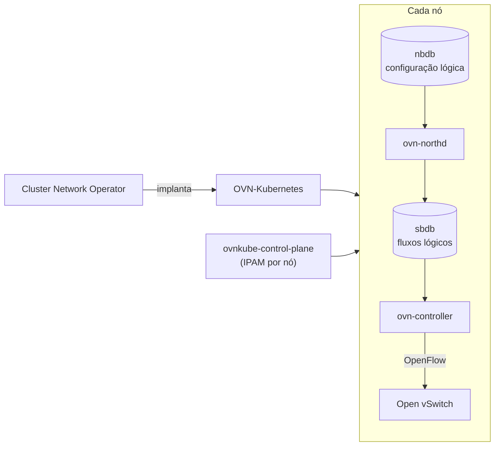

# OVN-Kubernetes

## Definição em uma frase

O OVN-Kubernetes é o **network plugin padrão do OpenShift**: implementa a rede virtual de Pods e Services como uma *overlay*, baseada em OVN (Open Virtual Network) e Open vSwitch (OVS), traduzindo a configuração de rede em regras OpenFlow.

## Explicação didática

Cada Pod precisa de um IP e precisa alcançar outros Pods, mesmo em nós diferentes. O OVN-Kubernetes cria essa rede virtual por cima da rede física: em cada nó roda um OVS, que funciona como um switch virtual, e o OVN programa esse switch com regras que dizem para onde cada pacote deve ir. O resultado é uma rede de Pods e de Services que parece única, embora atravesse vários nós.

## Para que existe e qual problema resolve

Dá conectividade entre Pods e implementa Services, NetworkPolicies, Egress IPs, *egress firewall*, IPsec, multicast, IPv6 e roteamento. É um único componente que também cumpre a função que, no Kubernetes tradicional, seria do [kube-proxy](kube-proxy.md).

## Funcionamento técnico e ciclo de vida

Componentes principais, segundo a documentação do OCP 4.22:

| Componente | Papel |
|---|---|
| **Northbound database (`nbdb`)** | Guarda a configuração lógica da rede (switches, roteadores e portas lógicas): o estado pretendido |
| **`ovn-northd`** | Traduz a configuração lógica do `nbdb` em fluxos lógicos no `sbdb` |
| **Southbound database (`sbdb`)** | Guarda o estado físico e lógico para o OVS de cada nó |
| **`ovn-controller`** | Lê os fluxos do `sbdb`, converte-os em OpenFlow e programa o OVS do nó |
| **`ovnkube-control-plane`** | Nos nós de Control Plane, faz a alocação central de IPs por nó (IPAM); há dois Pods em nós distintos, com um líder |

- `northd`, `nbdb` e `sbdb` rodam **em cada nó** e tratam principalmente informação local.
- Há DaemonSets para os bancos e para o controller em todos os nós.
- O plugin é implantado e mantido pelo **Cluster Network Operator** (API `network` do grupo `operator.openshift.io`).

## Relações e dependências

- Implementa [Service](../../04-networking/verbetes/service.md) e [NetworkPolicy](../../04-networking/verbetes/networkpolicy.md) (categoria 04).
- Substitui o [kube-proxy](kube-proxy.md) no OpenShift.
- Usa o [Cluster DNS](cluster-dns.md) para a resolução de nomes (componente separado).

## Exemplo de situação real

Pods em nós diferentes não se comunicam, mas no mesmo nó funcionam. A investigação passa pelos Pods `ovnkube-node` dos nós envolvidos e pelo estado do ClusterOperator `network`, e não pela aplicação.

## Como visualizar e inspecionar (somente leitura)

```bash
# Plugin de rede e redes do cluster
oc get network.config.openshift.io cluster -o jsonpath='{.status.networkType}{"\n"}'
oc get network.config.openshift.io cluster -o jsonpath='{.status.clusterNetwork}{"\n"}{.status.serviceNetwork}{"\n"}'

# Saúde do Cluster Network Operator
oc get clusteroperator network

# Pods do OVN-Kubernetes (apenas observar)
oc get pods -n openshift-ovn-kubernetes -o wide
```

## Como interpretar a saída

- `networkType` igual a `OVNKubernetes` confirma o plugin.
- `clusterNetwork` mostra a faixa de IPs dos Pods; `serviceNetwork`, a dos Services (de onde vêm os ClusterIPs).
- Em `openshift-ovn-kubernetes`, espere Pods `ovnkube-node-*`, um por nó, com vários contêineres (`ovn-controller`, `nbdb`, `sbdb`, `northd`...), e `ovnkube-control-plane-*`. Contêineres não prontos indicam problemas de rede **naquele nó**.

## Diferenças e confusões frequentes

- **OVN-Kubernetes × OpenShift SDN:** o OpenShift SDN é o plugin antigo. A documentação diz que ele **não é suportado** com SNO, e que o OVN-Kubernetes é o padrão.
- **OVN × OVS:** o OVN é o plano de controle lógico da rede virtual; o OVS é o switch virtual que executa as regras em cada nó.
- **CNI:** é a interface padrão de plugins de rede do Kubernetes; o OVN-Kubernetes é uma implementação.

## No OpenShift 4.22 versus Kubernetes

No Kubernetes upstream o plugin de rede é uma escolha do instalador. No OpenShift 4.22, o padrão é o OVN-Kubernetes, gerenciado pelo Cluster Network Operator.

## No HomeLab SNO

Todos os componentes rodam no único nó, e não há tráfego entre nós. Observe o ClusterOperator `network` e os Pods em `openshift-ovn-kubernetes`; **não** altere a configuração de rede do cluster.

## Diagrama



## Termos relacionados

[kube-proxy](kube-proxy.md) · [Cluster DNS](cluster-dns.md) · [Service](../../04-networking/verbetes/service.md) · [NetworkPolicy](../../04-networking/verbetes/networkpolicy.md) · [Worker Node](worker-node.md)

## Fontes oficiais

- OCP 4.22 — About the OVN-Kubernetes network plugin (fonte: `networking/ovn_kubernetes_network_provider/about-ovn-kubernetes.adoc`)
- OCP 4.22 — OVN-Kubernetes architecture (fonte: `modules/ovn-kubernetes-architecture-con.adoc`)
- OCP 4.22 — Cluster Network Operator (fonte: `modules/nw-cluster-network-operator.adoc`)
- OCP 4.22 — Single-node OpenShift (OpenShiftSDN não suportado; OVN-Kubernetes padrão; fonte: `modules/install-sno-about-installing-on-a-single-node.adoc`)
- Open Virtual Network (fonte externa): <https://www.ovn.org/en/>

<details>
<summary>Ficha técnica e notas de revisão</summary>

**Ficha técnica**

- **ID:** 01-arquitetura-e-control-plane/ovn-kubernetes
- **Termo original:** OVN-Kubernetes network plugin
- **Remissões:** OVN, OVS (Open vSwitch), CNI
- **Tradução:** não se traduz
- **Classe ontológica:** componente (network plugin)
- **Plataforma:** OpenShift (padrão) / Kubernetes (opcional)
- **Escopo:** não aplicável (roda em todos os nós)
- **Disponibilidade:** nativo; plugin de rede **padrão** do OCP 4.22 e do SNO
- **Versões validadas:** OCP 4.22
- **Nível:** intermediário → avançado
- **Atualizado em:** 2026-11-04

**Notas de revisão**

- **Estado:** desenvolvido. Fontes conferidas em 2026-11-04.
- **Pendências:** confirmar no SNO o namespace `openshift-ovn-kubernetes`, os nomes dos Pods e contêineres e os caminhos `status.clusterNetwork`/`status.serviceNetwork`, que **não foram executados**. No SNO pode haver um só `ovnkube-control-plane`; a documentação fala em dois Pods para clusters com vários nós de Control Plane. URLs publicadas **a verificar**.

</details>
