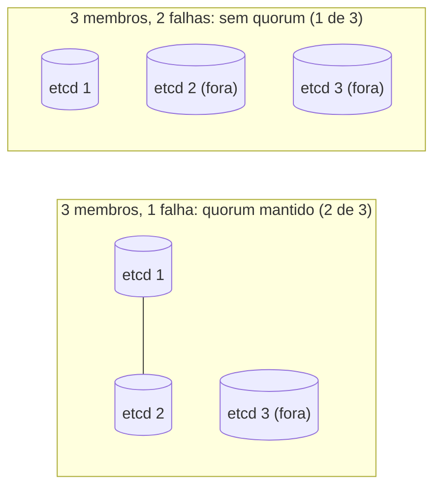

# Quorum

## Definição em uma frase

Quorum é a **maioria mínima de membros** de um sistema distribuído (no Kubernetes, os membros do [etcd](etcd.md)) que precisa estar disponível e de acordo para que o sistema aceite escritas com segurança.

## Explicação didática

Imagine um conselho de três pessoas que só aprova decisões por maioria. Com duas presentes, decide; com uma só, não. O etcd funciona assim: com **N** membros, precisa de **N/2 + 1** (arredondado para baixo) para escrever. Isso impede que duas partes isoladas do cluster tomem decisões diferentes ao mesmo tempo, a chamada **split brain**.

| Membros do etcd | Quorum | Falhas toleradas |
|---|---|---|
| 1 | 1 | 0 |
| 3 | 2 | 1 |
| 4 | 3 | 1 |
| 5 | 3 | 2 |

Por isso a documentação do OpenShift recomenda números **ímpares** de nós de Control Plane: quatro nós toleram a mesma falha que três, e só cinco toleram duas falhas simultâneas.

## Para que existe e qual problema resolve

Garante **consistência**: nenhuma escrita é confirmada sem que a maioria a tenha registrado, de modo que perder uma minoria de membros não perde dados nem cria versões conflitantes do estado do cluster.

## Funcionamento técnico e ciclo de vida

- Com quorum, o etcd aceita leituras e escritas normalmente.
- **Sem quorum**, o etcd deixa de aceitar escritas: a API não consegue gravar mudanças, embora os Pods que já estão rodando continuem rodando.
- **Recuperação no OpenShift:** a documentação de *disaster recovery* trata a perda da maioria dos hosts de Control Plane como cenário próprio. Há procedimentos para **restaurar o quorum** em clusters HA e para **restaurar a partir de um snapshot** do etcd. Esses procedimentos são ações administrativas de alto risco.
- Ao acrescentar um quarto nó de Control Plane, o quorum passa a exigir três membros. Até o novo nó ficar saudável, perder um dos originais derruba o cluster.

## Relações e dependências

- Propriedade do [etcd](etcd.md); define o dimensionamento do [Control Plane](control-plane.md).
- Base da [High Availability](high-availability.md) do Control Plane.
- No *Two-Node with Arbiter*, o nó árbitro existe justamente para manter o quorum (ver [High Availability](high-availability.md)).

## Exemplo de situação real

Num cluster de três nós de Control Plane, uma falha de rede separa um nó dos outros dois. O lado com dois membros mantém o quorum e continua operando. O nó isolado não consegue confirmar escritas. Quando a rede volta, ele se ressincroniza com a maioria.

## Como visualizar e inspecionar (somente leitura)

```bash
# Saúde do etcd segundo o Operator (as mensagens citam os membros disponíveis)
oc get clusteroperator etcd
oc describe clusteroperator etcd

# Quantos membros (Pods etcd) existem e em que nós
oc get pods -n openshift-etcd -l app=etcd -o wide
```

## Como interpretar a saída

- Em `oc describe clusteroperator etcd`, as condições costumam informar quantos membros estão saudáveis. Compare com o total para saber a folga até perder o quorum.
- Número de Pods `etcd-*` igual ao número de nós de Control Plane: cada nó hospeda um membro.

## Diferenças e confusões frequentes

- **Quorum × réplicas de aplicação:** réplicas de um Deployment não votam; o quorum é uma regra de consenso do etcd (e de outros sistemas distribuídos).
- **Perda de quorum × cluster parado por completo:** as aplicações em execução seguem; o que para é a capacidade de mudar o estado do cluster.
- **Mais nós nem sempre é melhor:** um número par não aumenta a tolerância a falhas.

## No OpenShift 4.22 versus Kubernetes

A regra é a mesma do etcd em qualquer Kubernetes. O OpenShift define as topologias suportadas (três nós em produção; SNO; Two-Node with Arbiter; two-node com fencing) e documenta os procedimentos de recuperação.

## No HomeLab SNO

Com **um único membro**, o quorum é 1, e não há tolerância a falhas. Se o nó para, o etcd para junto. A proteção é ter backup do etcd, pelo procedimento oficial (categoria 13).

## Diagrama



## Termos relacionados

[etcd](etcd.md) · [High Availability](high-availability.md) · [Control Plane](control-plane.md) · [SNO](sno.md)

## Fontes oficiais

- OCP 4.22 — Control plane architecture, "Machine roles" (três, quatro e cinco nós; tolerância do etcd): <https://docs.redhat.com/en/documentation/openshift_container_platform/4.22/html/architecture/control-plane> (fonte: `modules/architecture-machine-roles.adoc`)
- OCP 4.22 — Disaster recovery (perda de quorum, restauração de quorum, restauração por snapshot; fontes: `backup_and_restore/control_plane_backup_and_restore/disaster_recovery/about-disaster-recovery.adoc`, `modules/dr-restoring-etcd-quorum-ha.adoc`)
- OCP 4.22 — Two-Node with Arbiter (o árbitro mantém o quorum e evita split brain; fonte: `installing/installing_two_node_cluster/about-two-node-arbiter-installation.adoc`)

<details>
<summary>Ficha técnica e notas de revisão</summary>

**Ficha técnica**

- **ID:** 01-arquitetura-e-control-plane/quorum
- **Termo original:** quorum
- **Remissões:** split brain
- **Tradução:** quórum (só como apoio)
- **Classe ontológica:** conceito (consenso em sistemas distribuídos)
- **Plataforma:** Kubernetes / OpenShift
- **Escopo:** não aplicável
- **Disponibilidade:** nativo
- **Versões validadas:** Kubernetes 1.35 / OCP 4.22
- **Nível:** intermediário
- **Atualizado em:** 2026-11-05

**Notas de revisão**

- **Estado:** desenvolvido. Fontes conferidas em 2026-11-05.
- **Pendências:** a fórmula N/2+1 é a regra do consenso do etcd (Raft); a tabela foi derivada dela e das observações da documentação do OCP. Confirmar no SNO o texto das condições do Operator, que **não foi executado**.

</details>
