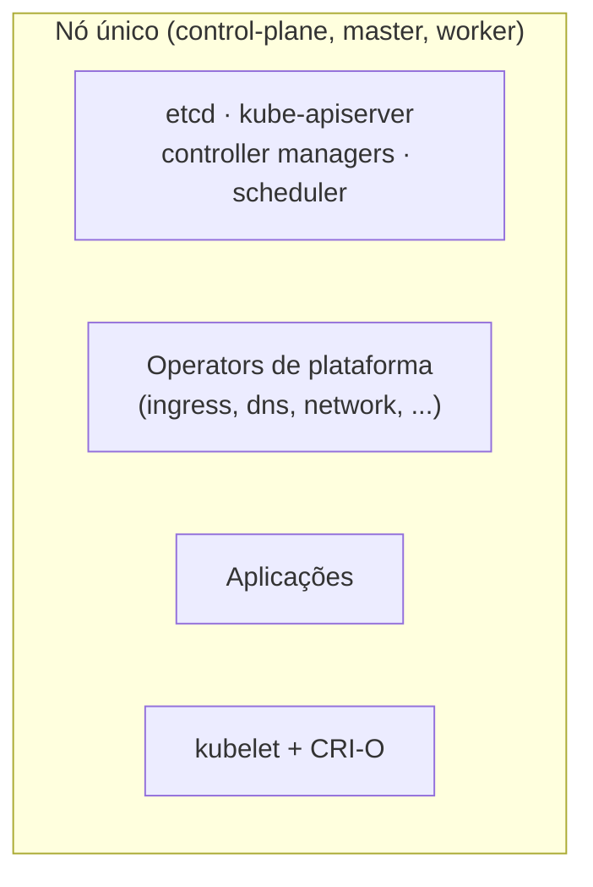

# SNO (Single-Node OpenShift)

## Definição em uma frase

O SNO é a topologia do OpenShift em que **um único nó** acumula os papéis de [Control Plane](control-plane.md) e de compute: um cluster completo numa só máquina, **sem alta disponibilidade**.

## Explicação didática

Tudo o que um cluster OpenShift tem (etcd, API servers, Operators, router, registry, aplicações) roda no mesmo nó. É o mesmo OpenShift dos clusters maiores, com a mesma API, os mesmos Operators e as mesmas ferramentas, só que sem redundância.

## Para que existe e qual problema resolve

A documentação cita como principal caso de uso a **computação de borda** (*edge*): ambientes com conectividade intermitente, nuvens portáteis e redes 5G de acesso por rádio (RAN) próximas às estações base. Ambientes de laboratório e estudo também se beneficiam do tamanho reduzido.

## Funcionamento técnico e ciclo de vida

- **Instalação:** especializada, com um arquivo Ignition próprio e o modo **bootstrap-in-place** (sem máquina de bootstrap separada; ver [Bootstrap](bootstrap.md)).
- **Topologia fixa:** depois de instalado, **não há como converter** um SNO em cluster HA ou de dois nós. A topologia escolhida vale para toda a vida do cluster.
- **Rede:** o OVN-Kubernetes é o plugin padrão. O OpenShift SDN **não é suportado** no SNO.
- **Plataforma:** é suportado em bare metal e em hipervisores certificados. Na maioria dos casos, usa-se `platform.none: {}` no `install-config.yaml`; também há suporte em AWS, Google Cloud e Azure.
- **Recursos mínimos** segundo a documentação: 4 vCPUs, 16 GB de RAM e 120 GB de disco. É um mínimo para a plataforma; as cargas de trabalho somam-se a isso.
- **Atualizações e reinicializações** deixam o cluster indisponível por períodos, porque não há outro nó para assumir.
- **Workers adicionais:** a documentação tem um capítulo sobre acrescentar workers a um SNO. O Control Plane continua sendo de um único nó.

## Relações e dependências

- É uma das topologias de [High Availability](high-availability.md), justamente a que **não** tem HA.
- [Quorum](quorum.md) de um membro só no [etcd](etcd.md).
- Rede pelo [OVN-Kubernetes](ovn-kubernetes.md).

## Exemplo de situação real

Uma operadora instala SNOs em centenas de antenas de telefonia. Cada site precisa de capacidade local de processamento, mas não comporta três servidores. A falta de HA é aceita, porque a resiliência vem da quantidade de sites, e não de cada cluster.

## Como visualizar e inspecionar (somente leitura)

```bash
# Topologia: SingleReplica indica um Control Plane de um nó
oc get infrastructure cluster -o jsonpath='{.status.controlPlaneTopology}{"  "}{.status.platformStatus.type}{"\n"}'

# Um nó com todos os papéis
oc get nodes

# Recursos do nó e quanto já está reservado
oc describe node <nó> | sed -n '/Allocated resources/,/Events/p'
```

## Como interpretar a saída

- `controlPlaneTopology` igual a `SingleReplica` confirma o SNO; `platformStatus.type` igual a `None` é o caso típico em hipervisor.
- `ROLES` com `control-plane,master,worker` no mesmo nó.
- Em `Allocated resources`, percentuais altos de *requests* de CPU e memória mostram que sobra pouco espaço para novas cargas. É comum num SNO.

## Diferenças e confusões frequentes

- **SNO × compact (three-node):** um nó sem HA × três nós com HA e sem workers dedicados.
- **SNO × "OpenShift Local" (antigo CRC):** o OpenShift Local é uma ferramenta de desenvolvimento para estação de trabalho; o SNO é uma topologia suportada de cluster. Detalhes na categoria 13.
- **SNO não é "OpenShift reduzido":** a API e os Operators são os mesmos; o que falta é redundância.

## No OpenShift 4.22 versus Kubernetes

O SNO é uma topologia do OpenShift. No Kubernetes também é possível rodar um cluster de nó único, mas sem o mesmo conjunto suportado de instalação, rede e Operators.

## No HomeLab SNO

Este glossário usa o SNO do autor como referência de laboratório: um nó único, com recursos limitados. Para estudo, prefira sempre os comandos de leitura, porque qualquer reinicialização ou mudança de configuração da plataforma afeta o cluster inteiro.

## Diagrama



## Termos relacionados

[High Availability](high-availability.md) · [Quorum](quorum.md) · [Bootstrap](bootstrap.md) · [Control Plane](control-plane.md) · [OVN-Kubernetes](ovn-kubernetes.md) · [Cluster](../../00-fundamentos-e-linguagem/verbetes/cluster.md)

## Fontes oficiais

- OCP 4.22 — Single-node OpenShift (casos de uso, topologia fixa, OVN-Kubernetes; fonte: `modules/install-sno-about-installing-on-a-single-node.adoc`): <https://docs.redhat.com/en/documentation/openshift_container_platform/4.22/html/installing_on_a_single_node/index>
- OCP 4.22 — Requirements for installing OpenShift on a single node (plataformas, `platform.none`, recursos mínimos; fonte: `modules/install-sno-requirements-for-installing-on-a-single-node.adoc`)
- OCP 4.22 — Installing OpenShift on a single node (`bootstrap-in-place`; fonte: `installing/installing_sno/install-sno-installing-sno.adoc`)

<details>
<summary>Ficha técnica e notas de revisão</summary>

**Ficha técnica**

- **ID:** 01-arquitetura-e-control-plane/sno
- **Termo original:** Single-Node OpenShift (SNO)
- **Remissões:** single-node cluster
- **Tradução:** OpenShift de nó único (só como apoio)
- **Classe ontológica:** conceito (topologia de instalação)
- **Plataforma:** OpenShift
- **Escopo:** não aplicável
- **Disponibilidade:** nativo (escolhido na instalação)
- **Versões validadas:** OCP 4.22
- **Nível:** básico → intermediário
- **Atualizado em:** 2026-11-05

**Notas de revisão**

- **Estado:** desenvolvido. Fontes conferidas em 2026-11-05.
- **Pendências:** confirmar no SNO do autor `controlPlaneTopology`, `platformStatus.type` e a seção `Allocated resources`, que **não foram executados**. A URL publicada do guia de SNO está **a verificar**. A comparação com o OpenShift Local deve ser conferida na categoria 13.

</details>
