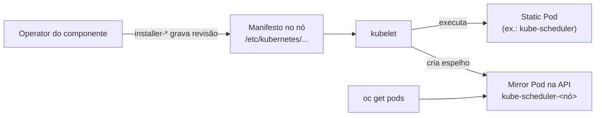

# Static Pod

> **ID:** 01-arquitetura-e-control-plane/static-pod | **Termo original:** static Pod | **Remissões:** mirror Pod | **Tradução:** Pod estático (só como apoio) | **Classe ontológica:** conceito / padrão de execução | **Plataforma:** Kubernetes / OpenShift | **Escopo:** sempre ligado a um nó; o mirror Pod aparece num namespace | **Disponibilidade:** nativo | **Versões validadas:** Kubernetes 1.35 / OCP 4.22 | **Nível:** intermediário | **Atualizado em:** 2026-11-04

## Definição em uma frase

Um Static Pod é um Pod **gerenciado diretamente pelo [kubelet](kubelet.md)** de um nó específico, a partir de um manifesto local, **sem que o API server o controle**.

## Explicação didática

Pods comuns nascem na API e são agendados pelo scheduler. Static Pods nascem de **arquivos no próprio nó**: o kubelet lê o manifesto, sobe o Pod e o reinicia se falhar. Para que você o enxergue, o kubelet cria na API um **mirror Pod**, um "espelho" com o nome do nó no sufixo. Pela API você **vê**, mas **não controla**: apagar o mirror Pod não apaga o Static Pod.

É assim que o Control Plane pode rodar em contêineres **antes** de haver um Control Plane: o kubelet sobe o etcd e o kube-apiserver a partir de arquivos locais.

## Para que existe e qual problema resolve

Resolve o "ovo e a galinha" do bootstrap: componentes que precisam existir **para** a API funcionar não podem depender da API para serem criados.

## Funcionamento técnico e ciclo de vida

- **Vínculo:** cada Static Pod pertence a **um** kubelet, num nó específico.
- **Mirror Pod:** o kubelet tenta criar automaticamente um mirror Pod para cada Static Pod; o nome recebe o hostname do nó como sufixo, precedido de hífen.
- **Restrições:** o `spec` de um Static Pod **não pode** referenciar outros objetos da API (ServiceAccount, ConfigMap, Secret...), e Static Pods **não suportam** contêineres efêmeros.
- **Quando não usar:** para rodar algo em todos os nós num cluster comum, a documentação recomenda um **DaemonSet**.
- **No OpenShift:** etcd, kube-apiserver, kube-controller-manager e kube-scheduler rodam como Static Pods nos nós de Control Plane. Os Operators de cada componente escrevem novas **revisões** dos manifestos por meio dos Pods `installer-*`, e os `revision-pruner-*` limpam as revisões antigas. Esses Pods precisam de permissão de root porque gravam em `/etc/kubernetes`.

## Relações e dependências

- Executado pelo [kubelet](kubelet.md); visível como mirror Pod na API.
- Base do [Control Plane](control-plane.md) do OpenShift: [etcd](etcd.md), [kube-scheduler](kube-scheduler.md), [kube-controller-manager](kube-controller-manager.md) e [API Server](../../00-fundamentos-e-linguagem/verbetes/api-server.md).
- Alternativa para cargas comuns: [DaemonSet](../../03-workloads/verbetes/daemonset.md).

## Exemplo de situação real

Alguém apaga `oc delete pod kube-scheduler-<nó> -n openshift-kube-scheduler` para "reiniciar o scheduler". O mirror Pod some e reaparece logo, porque o Static Pod nunca foi parado: quem manda nele é o kubelet, a partir do arquivo no nó. **Não faça isso**; os Operators têm mecanismos próprios de rollout.

## Como visualizar e inspecionar (somente leitura)

```bash
# Mirror Pods do Control Plane (sufixo com o nome do nó)
oc get pods -n openshift-kube-scheduler -o wide

# Um mirror Pod tem dono "Node" e uma annotation de espelho
oc get pod <nome> -n openshift-kube-scheduler \
  -o jsonpath='{range .metadata.ownerReferences[*]}{.kind}/{.name}{"\n"}{end}'
oc get pod <nome> -n openshift-kube-scheduler -o jsonpath='{.metadata.annotations}' ; echo

# Revisões e instaladores do componente
oc get pods -n openshift-kube-scheduler | grep -E 'installer|revision-pruner'
```

## Como interpretar a saída

- Mirror Pods costumam ter `ownerReferences` apontando para o **Node** e annotations como `kubernetes.io/config.mirror` e `kubernetes.io/config.source`. Confira os nomes exatos no seu cluster.
- Pods `installer-<n>-<nó>` em `Completed` mostram as revisões aplicadas; o número `<n>` cresce a cada nova revisão.
- Mirror Pod ausente com o componente funcionando pode indicar só falha em criar o espelho; o Static Pod continua sob o kubelet.

## Diferenças e confusões frequentes

- **Static Pod × mirror Pod:** o primeiro roda no nó; o segundo é só o reflexo na API.
- **Static Pod × DaemonSet:** arquivo local por nó × objeto da API gerenciado por controller.
- **Static Pod ≠ "Pod que não muda":** "static" quer dizer que não é gerenciado pela API, e não que seja imutável.

## No OpenShift 4.22 versus Kubernetes

O conceito é o mesmo. O OpenShift o usa para todo o núcleo do Control Plane e acrescenta o mecanismo de revisões controlado por Operators.

## No HomeLab SNO

Os Static Pods do Control Plane rodam no único nó. Observe os mirror Pods e as revisões; **nunca** edite manifests em `/etc/kubernetes` do nó nem apague mirror Pods.

## Diagrama Mermaid



## Termos relacionados

[kubelet](kubelet.md) · [Control Plane](control-plane.md) · [etcd](etcd.md) · [kube-scheduler](kube-scheduler.md) · [kube-controller-manager](kube-controller-manager.md) · [DaemonSet](../../03-workloads/verbetes/daemonset.md) · [OwnerReference](../../00-fundamentos-e-linguagem/verbetes/owner-reference.md)

## Fontes oficiais

- Kubernetes — Create static Pods: <https://kubernetes.io/docs/tasks/configure-pod-container/static-pod/> (fonte: `kubernetes/website` `release-1.35`, `tasks/configure-pod-container/static-pod.md`)
- Kubernetes Glossary — Static Pod: <https://kubernetes.io/docs/reference/glossary/?all=true#term-static-pod>
- OCP 4.22 — Control plane architecture, "Machine roles" (systemd × static pods; `installer-*` e `revision-pruner-*`; namespaces): <https://docs.redhat.com/en/documentation/openshift_container_platform/4.22/html/architecture/control-plane>

<details>
<summary>Notas de revisão</summary>

- **Estado:** desenvolvido. Fontes conferidas em 2026-11-04.
- **Pendências:** confirmar no SNO o dono `Node` dos mirror Pods e os nomes das annotations `kubernetes.io/config.*`, conhecidos do comportamento do kubelet, mas **não verificados** nesta rodada.

</details>
