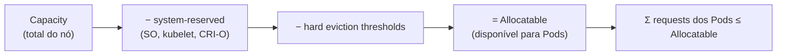

# Allocatable

## Definição em uma frase

Allocatable é a **parte da capacidade de um nó disponível para os Pods**: o que sobra da [Capacity](capacity.md) depois de descontadas as reservas do sistema e os limiares de despejo.

## Explicação didática

Se a Capacity é o tamanho do terreno, o Allocatable é a área que se pode construir: descontam-se a área reservada para a "infraestrutura" (SO, kubelet, CRI-O) e uma margem de segurança. O scheduler **nunca** reserva além do Allocatable.

No OpenShift 4.22, a fórmula documentada é:

```text
Allocatable = Capacity − system-reserved − hard eviction thresholds
```

## Para que existe e qual problema resolve

Protege o nó: sem reserva, os Pods poderiam consumir os recursos de que o kubelet e o sistema precisam, e o nó inteiro poderia ficar instável.

## Funcionamento técnico e ciclo de vida

- **No Kubernetes:** podem ser reservados recursos para duas categorias de daemons do sistema (`kube-reserved` e `system-reserved`), e o Allocatable vale para `cpu`, `memory` e `ephemeral-storage`.
- **No OpenShift 4.22:**
  - Por padrão, na inicialização do nó, o OpenShift **calcula e reserva automaticamente** CPU e memória para os componentes do nó e do sistema, no cgroup `system.slice`.
  - **Memória** (reserva ponderada): 25% dos primeiros 4 GiB, 20% dos 4 GiB seguintes, 10% dos 8 GiB seguintes, 6% dos 112 GiB seguintes e 2% do que passar de 128 GiB. Exemplo da documentação: num nó de 16 GiB, reserva cerca de 2,6 GiB.
  - **CPU:** 60 milicores para o primeiro núcleo, mais 12 milicores por núcleo adicional, com mínimo de 0,5 CPU. Exemplo da documentação: num nó de 4 núcleos, reserva 0,5 vCPU.
  - O parâmetro `kubeReserved` **não é suportado** no OpenShift; ajustes manuais usam `system-reserved` num `KubeletConfig`.
  - **Atenção:** em clusters atualizados a partir de versões anteriores à 4.21, a reserva automática vem **desabilitada** por padrão (há um MachineConfig `50-worker-auto-sizing-disabled`).

## Relações e dependências

- Derivado da [Capacity](capacity.md); limite para a soma dos [Resource Requests](resource-request.md) num nó.
- Configurado pelo `KubeletConfig`, aplicado pelo [Machine Config Operator](../../01-arquitetura-e-control-plane/verbetes/machine-config-operator.md).

## Exemplo de situação real

Um Pod que pede 14 GiB de memória fica `Pending` num nó de 16 GiB, com `Insufficient memory`. O Allocatable de memória do nó é de cerca de 13 GiB, e o scheduler compara o pedido com ele, e não com os 16 GiB.

## Como visualizar e inspecionar (somente leitura)

```bash
# Capacity × Allocatable
oc get node <nó> -o jsonpath='{.status.capacity.memory} -> {.status.allocatable.memory}{"\n"}{.status.capacity.cpu} -> {.status.allocatable.cpu}{"\n"}'

# Quanto do Allocatable já foi reservado por requests e limits
oc describe node <nó> | sed -n '/Allocated resources/,/Events/p'

# Configurações de kubelet personalizadas (se houver)
oc get kubeletconfigs
```

## Como interpretar a saída

- A diferença entre Capacity e Allocatable é a reserva (system-reserved + limiar de despejo).
- Em `Allocated resources`, a coluna `Requests` com valores perto de 100% indica que **não cabe** mais nada que peça recursos, mesmo que o uso real esteja baixo.
- `Limits` acima de 100% é permitido (*overcommit*): os limites podem passar do Allocatable, os requests não.

## Diferenças e confusões frequentes

- **Allocatable × livre:** allocatable é o total disponível para Pods, e não o que ainda resta.
- **Allocatable × uso real:** o scheduler olha *requests*, e não o consumo.
- **`kubeReserved` no OpenShift:** não suportado; use `system-reserved`.

## No OpenShift 4.22 versus Kubernetes

O conceito é do Kubernetes. O OpenShift acrescenta o cálculo automático da reserva, as fórmulas acima e a restrição ao `kubeReserved`.

## No HomeLab SNO

Num SNO de 16 GiB, cerca de 2,6 GiB ficam reservados para o sistema, e os componentes da plataforma consomem boa parte do restante. Sobra pouco para aplicações; confira em `Allocated resources`.

## Diagrama



## Termos relacionados

[Capacity](capacity.md) · [Resource Request](resource-request.md) · [Resource Limit](resource-limit.md) · [Node](node.md) · [cgroups](cgroups.md) · [Machine Config Operator](../../01-arquitetura-e-control-plane/verbetes/machine-config-operator.md)

## Fontes oficiais

- Kubernetes — Reserve Compute Resources for System Daemons, "Node Allocatable": <https://kubernetes.io/docs/tasks/administer-cluster/reserve-compute-resources/> (fonte: `kubernetes/website` `release-1.35`)
- OCP 4.22 — Allocating resources for nodes in an OpenShift Container Platform cluster (cálculo automático, fórmulas, `kubeReserved` não suportado, clusters atualizados de antes da 4.21; fontes: `nodes/nodes/nodes-nodes-resources-configuring.adoc`, `modules/nodes-nodes-resources-configuring-about.adoc`)

<details>
<summary>Ficha técnica e notas de revisão</summary>

**Ficha técnica**

- **ID:** 02-compute-e-nodes/allocatable
- **Termo original:** allocatable (node allocatable)
- **Remissões:** system-reserved, kube-reserved
- **Tradução:** alocável (só como apoio)
- **Classe ontológica:** conceito (campo `status.allocatable` do Node)
- **Plataforma:** Kubernetes / OpenShift
- **Escopo:** não aplicável
- **Disponibilidade:** nativo
- **Versões validadas:** Kubernetes 1.35 / OCP 4.22
- **Nível:** intermediário
- **Atualizado em:** 2026-11-05

**Notas de revisão**

- **Estado:** desenvolvido. Fontes conferidas em 2026-11-05.
- **Pendências:** confirmar no SNO os valores reais de Capacity e Allocatable e se a reserva automática está ativa (o cluster pode ter sido instalado direto no 4.22). **Não executado**.

</details>
