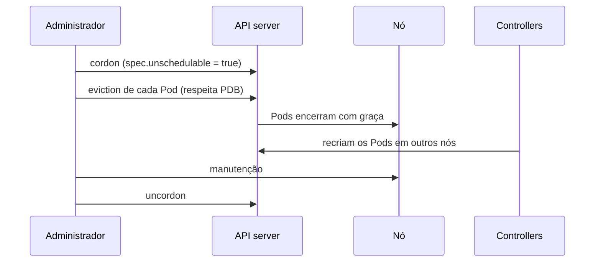

# Drain

## Definição em uma frase

*Drain* é **esvaziar um nó com segurança**: marcá-lo como não agendável ([cordon](cordon.md)) e despejar os seus Pods, respeitando o encerramento gracioso e os *PodDisruptionBudgets*, para que os controllers os recriem em outros nós.

## Explicação didática

Antes de desligar uma máquina para manutenção, é preciso tirar as cargas dela de forma ordenada. O drain faz isso: pede o despejo de cada Pod pela API (*eviction*), espera os Pods terminarem e só termina quando o nó está vazio, exceto pelo que não deve sair, como os Pods de DaemonSets.

## Para que existe e qual problema resolve

Permite manutenção (atualização de kernel, troca de hardware) sem interrupção desnecessária das aplicações, desde que elas tenham réplicas em outros nós.

## Funcionamento técnico e ciclo de vida

1. O nó é marcado como não agendável (cordon).
2. Os Pods são despejados com **encerramento gracioso** e respeitando os **PodDisruptionBudgets** definidos.
3. Por padrão, o drain ignora alguns Pods de sistema que não podem ser encerrados. Pods de DaemonSet exigem a opção `--ignore-daemonsets`.
4. Quando o comando termina com sucesso, todos os Pods (exceto os excluídos) foram despejados, e o nó pode ser desligado.

Pontos importantes:
- **Pods sem controller** ("Pods nus"), que não são gerenciados por um ReplicaSet ou similar, não são recriados em outro lugar. A documentação do OpenShift observa que, por padrão, eles não são afetados pela evacuação.
- É possível drenar só parte dos Pods com `--pod-selector`.
- Pods que toleram o taint `node.kubernetes.io/unschedulable`, ou com `nodeName` fixo, ainda podem cair no nó.

## Relações e dependências

- Começa com [Cordon](cordon.md); usa a API de despejo (*eviction*).
- Respeita *PodDisruptionBudget* (categoria 17) e o encerramento gracioso dos Pods (categoria 03).
- O [Machine Config Operator](../../01-arquitetura-e-control-plane/verbetes/machine-config-operator.md) drena os nós automaticamente ao aplicar configurações.

## Exemplo de situação real

Um drain fica parado indefinidamente. Um PodDisruptionBudget exige pelo menos 2 réplicas disponíveis, e a aplicação tem só 2. Despejar uma violaria o orçamento, então o drain espera. É preciso escalar a aplicação ou rever o PDB.

## Como visualizar e inspecionar (somente leitura)

```bash
# O que está rodando no nó antes de um drain
oc get pods -A --field-selector spec.nodeName=<nó> -o wide

# PodDisruptionBudgets que podem bloquear o drain
oc get pdb -A
```

**Alteração (NÃO EXECUTAR AUTOMATICAMENTE):**

```bash
oc adm drain <nó> --ignore-daemonsets
oc adm drain <nó> --ignore-daemonsets --pod-selector=<label>=<valor>
```

## Como interpretar a saída

- A lista de Pods no nó mostra quais serão afetados. Pods sem controller merecem atenção, porque não voltam sozinhos.
- Em `oc get pdb`, a coluna `ALLOWED DISRUPTIONS` igual a `0` indica um PDB que vai bloquear o despejo.

## Diferenças e confusões frequentes

- **Drain × cordon:** esvaziar × só bloquear novos.
- **Drain (eviction pela API) × despejo por pressão (pelo kubelet):** o primeiro respeita PDB e encerramento gracioso; o segundo, sob pressão, não respeita PDB.
- **Drain × delete:** apagar Pods ignora os PDBs; o drain os respeita.

## No OpenShift 4.22 versus Kubernetes

Comando em `oc adm drain`. A documentação do OCP 4.22 afirma que **a opção de drenar o nó não está disponível em clusters SNO**, e trata o caso de reinicialização sem drain, em que podem sobrar Pods com `UnexpectedAdmissionError`.

## No HomeLab SNO

**Não aplicável:** não há outro nó para onde mover os Pods. A própria documentação diz que o drain não está disponível para SNO. Manutenções do nó único implicam indisponibilidade.

## Diagrama



## Termos relacionados

[Cordon](cordon.md) · [Node](node.md) · [Taint](taint.md) · [Machine Config Operator](../../01-arquitetura-e-control-plane/verbetes/machine-config-operator.md) · [SNO](../../01-arquitetura-e-control-plane/verbetes/sno.md)

## Fontes oficiais

- Kubernetes — Safely Drain a Node: <https://kubernetes.io/docs/tasks/administer-cluster/safely-drain-node/> (fonte: `kubernetes/website` `release-1.35`, `tasks/administer-cluster/safely-drain-node.md`)
- OCP 4.22 — Working with nodes, "Evacuate pods on nodes" e "Handling errors in single-node OpenShift clusters when the node reboots without draining application pods" (fontes: `modules/nodes-nodes-working-evacuating.adoc`, `modules/sno-clusters-reboot-without-drain.adoc`)

<details>
<summary>Ficha técnica e notas de revisão</summary>

**Ficha técnica**

- **ID:** 02-compute-e-nodes/drain
- **Termo original:** drain (node drain)
- **Remissões:** evacuate, eviction
- **Tradução:** drenar (só como apoio)
- **Classe ontológica:** ferramenta / procedimento
- **Plataforma:** Kubernetes / OpenShift
- **Escopo:** não aplicável
- **Disponibilidade:** nativo; indisponível em SNO, segundo a documentação do OCP
- **Versões validadas:** Kubernetes 1.35 / OCP 4.22
- **Nível:** intermediário
- **Atualizado em:** 2026-11-07

**Notas de revisão**

- **Estado:** desenvolvido. Fontes conferidas em 2026-11-07.
- **Pendências:** o field selector `spec.nodeName` em `oc get pods` é suportado no upstream; confirmar no cliente 4.22. Detalhar PodDisruptionBudget na categoria 17.

</details>
