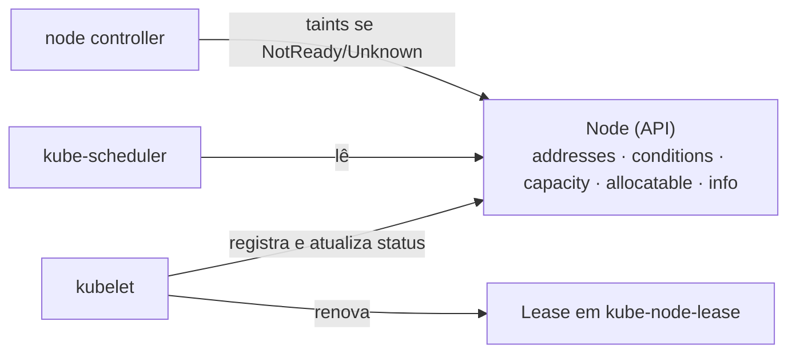

# Node

## Definição em uma frase

Node é o **objeto da API que representa uma máquina** (física ou virtual) do cluster capaz de executar Pods: registra a identidade, a capacidade, as condições de saúde e as informações do software que roda nela.

## Explicação didática

A máquina existe fora da API; o objeto Node é o "registro" dela dentro do cluster. Quem cria e atualiza esse registro é o [kubelet](../../01-arquitetura-e-control-plane/verbetes/kubelet.md) da própria máquina: ele informa quantos recursos ela tem, se está saudável e quais versões de software roda. O [kube-scheduler](../../01-arquitetura-e-control-plane/verbetes/kube-scheduler.md) lê esses objetos para decidir onde colocar cada Pod.

"Worker" e "Control Plane" são **papéis** de um Node, indicados por labels. O objeto é sempre o mesmo `kind: Node`. Ver [Worker Node](../../01-arquitetura-e-control-plane/verbetes/worker-node.md) e [Control Plane](../../01-arquitetura-e-control-plane/verbetes/control-plane.md).

## Para que existe e qual problema resolve

Dá ao Control Plane uma visão padronizada de cada máquina: quanto ela oferece, se está apta a receber Pods e como está mudando. Sem esse registro, não haveria agendamento nem detecção de falhas de nós.

## Funcionamento técnico e ciclo de vida

O `status` de um Node traz:

| Bloco | Conteúdo | Verbete |
|---|---|---|
| **Addresses** | IPs e hostname | — |
| **Conditions** | `Ready`, `MemoryPressure`, `DiskPressure`, `PIDPressure`, `NetworkUnavailable` | [Node Condition](node-condition.md) |
| **Capacity / Allocatable** | Recursos totais e os disponíveis para Pods | [Capacity](capacity.md), [Allocatable](allocatable.md) |
| **Info** | Versões do kubelet, do runtime, do kernel e do SO | — |

- **Registro:** o kubelet registra o Node ao iniciar (no OpenShift, após a aprovação dos certificados do kubelet).
- **Heartbeats:** o kubelet atualiza o `status` e renova um Lease no namespace `kube-node-lease`; o Control Plane usa isso para detectar falhas.
- **Falhas:** se o `Ready` fica `Unknown` ou `False` além do prazo de tolerância (50 segundos por padrão), o Control Plane adiciona taints como `node.kubernetes.io/unreachable` ou `node.kubernetes.io/not-ready`, o que afeta o agendamento e pode despejar Pods.
- **Nome:** é único no cluster (cluster-scoped). A documentação alerta que recriar uma máquina com o mesmo nome sem recriar o objeto Node faz o Kubernetes tratá-la como a máquina antiga.

## Relações e dependências

- Mantido pelo [kubelet](../../01-arquitetura-e-control-plane/verbetes/kubelet.md); lido pelo [kube-scheduler](../../01-arquitetura-e-control-plane/verbetes/kube-scheduler.md).
- No OpenShift, pode ter uma *Machine* associada (Machine API, lote 3 desta categoria) e é configurado pelo [Machine Config Operator](../../01-arquitetura-e-control-plane/verbetes/machine-config-operator.md).

## Exemplo de situação real

Um nó passa a `NotReady`. Em menos de um minuto, recebe o taint `node.kubernetes.io/not-ready`, e novos Pods deixam de ir para ele. Os Pods que já estavam lá podem ser despejados depois do tempo de tolerância e recriados por seus controllers em outros nós.

## Como visualizar e inspecionar (somente leitura)

```bash
# Nós, estado, papéis, versão do kubelet, IPs, SO e runtime
oc get nodes -o wide

# Visão completa: condições, capacidade, alocação, eventos
oc describe node <nó>

# Informações de software do nó
oc get node <nó> -o jsonpath='{.status.nodeInfo}' ; echo

# Uso real de CPU e memória (depende do monitoramento da plataforma)
oc adm top nodes
```

## Como interpretar a saída

- `STATUS=Ready`: o nó aceita Pods. `Ready,SchedulingDisabled` significa nó saudável mas *cordoned* (lote 2 desta categoria).
- Em `oc describe node`: `Conditions` (saúde), `Capacity`/`Allocatable` (recursos), `Allocated resources` (o quanto já foi reservado por *requests* e *limits*) e `Events`.
- `oc adm top nodes` mostra **uso real**; `Allocated resources` mostra **reservas**. Os dois números costumam ser bem diferentes.

## Diferenças e confusões frequentes

- **Node × máquina:** o objeto × o computador. Apagar o objeto Node não desliga a máquina.
- **Node × Machine (OpenShift):** o Node é a visão do Kubernetes; a Machine é a visão da infraestrutura (Machine API).
- **Node × Worker Node:** objeto × papel.

## No OpenShift 4.22 versus Kubernetes

O objeto é o mesmo. O OpenShift acrescenta a gestão do SO do nó pelo MCO, a Machine API para criar e substituir máquinas e a reserva automática de recursos do sistema.

## No HomeLab SNO

Há um único Node, com todos os papéis. `oc describe node` é o comando mais útil para entender a capacidade do seu laboratório.

## Diagrama



## Termos relacionados

[Node Condition](node-condition.md) · [Capacity](capacity.md) · [Allocatable](allocatable.md) · [kubelet](../../01-arquitetura-e-control-plane/verbetes/kubelet.md) · [Worker Node](../../01-arquitetura-e-control-plane/verbetes/worker-node.md) · [Resource Request](resource-request.md)

## Fontes oficiais

- Kubernetes — Nodes: <https://kubernetes.io/docs/concepts/architecture/nodes/> (fonte: `kubernetes/website` `release-1.35`, `concepts/architecture/nodes.md`)
- Kubernetes — Node Status (conditions, capacity, taints automáticos): <https://kubernetes.io/docs/reference/node/node-status/> (fonte: `reference/node/node-status.md`)

<details>
<summary>Ficha técnica e notas de revisão</summary>

**Ficha técnica**

- **ID:** 02-compute-e-nodes/node
- **Termo original:** Node
- **Tradução:** nó (só como apoio)
- **Classe ontológica:** objeto da API
- **API:** `apiVersion: v1` (grupo *core*), `kind: Node`
- **Plataforma:** Kubernetes / OpenShift
- **Escopo:** cluster-scoped
- **Disponibilidade:** nativo
- **Versões validadas:** Kubernetes 1.35 / OCP 4.22
- **Nível:** básico
- **Atualizado em:** 2026-11-05

**Notas de revisão**

- **Estado:** desenvolvido (antes era uma versão inicial). Fontes conferidas em 2026-11-05.
- **Pendências:** `oc adm top nodes` depende do monitoramento da plataforma; confirmar no SNO, assim como as colunas de `oc get nodes -o wide`, que **não foram executadas**.

</details>
