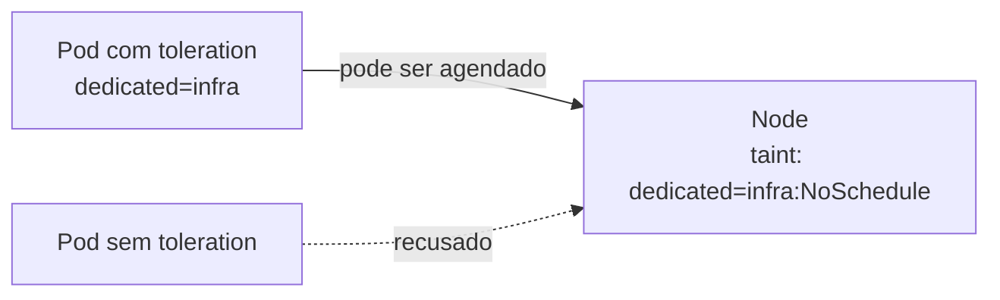

# Taint

## Definição em uma frase

Um taint é uma **marca aplicada a um [Node](node.md) que repele Pods**: apenas Pods com uma [toleration](toleration.md) correspondente podem ser agendados ali e, conforme o efeito, continuar rodando no nó.

## Explicação didática

A [Node Affinity](node-affinity.md) faz os Pods **buscarem** certos nós; o taint faz o nó **afastar** Pods. É como um aviso de "acesso restrito": só entra quem tem a credencial certa, que é a toleration.

Cada taint tem **chave**, **valor** (opcional) e **efeito**:

| Efeito | O que faz |
|---|---|
| `NoSchedule` | Pods sem toleration **não são agendados** no nó; os que já estão lá ficam |
| `PreferNoSchedule` | Versão "suave": o scheduler **tenta evitar**, sem garantia |
| `NoExecute` | Além de não agendar, **despeja** os Pods que já estão no nó e não toleram o taint (imediatamente, ou após `tolerationSeconds`) |

Forma textual: `chave=valor:Efeito`, por exemplo `dedicated=infra:NoSchedule`.

## Para que existe e qual problema resolve

- Reservar nós para cargas específicas (infra, GPU, cargas de um cliente).
- Proteger nós com problemas: o próprio Control Plane aplica taints quando um nó adoece.

## Funcionamento técnico e ciclo de vida

- **Vários taints e tolerations** funcionam como um filtro: dos taints do nó, ignoram-se os que o Pod tolera. Restando algum `NoSchedule`, o Pod não é agendado; restando só `PreferNoSchedule`, o scheduler tenta evitar; restando algum `NoExecute`, o Pod é despejado.
- **Taints automáticos por condição:** o Control Plane cria taints `NoSchedule` para condições do nó, como `node.kubernetes.io/memory-pressure`, `node.kubernetes.io/disk-pressure`, `node.kubernetes.io/not-ready` e `node.kubernetes.io/unreachable`. O scheduler olha os **taints**, e não as condições.
- **Taint de cordon:** marcar o nó como não agendável aplica `node.kubernetes.io/unschedulable`. Ver [Cordon](cordon.md).
- **Ignorando o scheduler:** um Pod com `spec.nodeName` definido manualmente vai para o nó mesmo com taint `NoSchedule`; com `NoExecute`, o kubelet o expulsa, se não houver toleration.
- **Operadores numéricos** (`Gt` e `Lt`) em tolerations dependem do *feature gate* `TaintTolerationComparisonOperators`; não presuma que estejam habilitados no OCP 4.22.

## Relações e dependências

- Contraparte da [Toleration](toleration.md).
- Gerado automaticamente a partir de [Node Condition](node-condition.md) e de [Cordon](cordon.md).
- Usado em [Infrastructure Nodes](../../01-arquitetura-e-control-plane/verbetes/infrastructure-node.md) para afastar aplicações.

## Exemplo de situação real

Os Control Planes de um cluster com workers dedicados têm o taint `node-role.kubernetes.io/master:NoSchedule`. Por isso as aplicações não rodam neles, enquanto os componentes da plataforma, que têm a toleration, rodam.

## Como visualizar e inspecionar (somente leitura)

```bash
# Taints de cada nó
oc get nodes -o custom-columns=NOME:.metadata.name,TAINTS:.spec.taints

# Detalhe de um nó (linha Taints)
oc describe node <nó> | grep -A3 '^Taints'
```

**Alteração (NÃO EXECUTAR AUTOMATICAMENTE):**

```bash
oc adm taint nodes <nó> dedicated=infra:NoSchedule
oc adm taint nodes <nó> dedicated=infra:NoSchedule-   # remove
```

## Como interpretar a saída

- `<none>`: o nó não tem taints e aceita qualquer Pod (respeitadas as outras regras).
- Taints com prefixo `node.kubernetes.io/` são automáticos e indicam um problema ou um cordon.
- Num SNO, normalmente **não** aparece o taint de master, porque o nó único precisa rodar as aplicações.

## Diferenças e confusões frequentes

- **Taint × label:** a label só atrai quando usada por um seletor; o taint repele sozinho.
- **Taint × toleration:** o taint fica no nó; a toleration, no Pod.
- **Toleration não obriga:** tolerar um taint **permite** ir ao nó, mas não **força**. Para forçar, combine com node selector ou afinidade.

## No OpenShift 4.22 versus Kubernetes

Mesmo mecanismo. O OpenShift usa taints em nós de Control Plane (em clusters com workers separados) e recomenda taints em infra nodes; também permite tolerations padrão por projeto.

## No HomeLab SNO

Não adicione taints `NoSchedule` ou `NoExecute` ao nó único: você pode impedir ou despejar os próprios componentes e aplicações do cluster.

## Diagrama



## Termos relacionados

[Toleration](toleration.md) · [Node Affinity](node-affinity.md) · [Node Condition](node-condition.md) · [Cordon](cordon.md) · [Infrastructure Node](../../01-arquitetura-e-control-plane/verbetes/infrastructure-node.md) · [kube-scheduler](../../01-arquitetura-e-control-plane/verbetes/kube-scheduler.md)

## Fontes oficiais

- Kubernetes — Taints and Tolerations (efeitos, filtro, taints por condição, operadores numéricos): <https://kubernetes.io/docs/concepts/scheduling-eviction/taint-and-toleration/> (fonte: `kubernetes/website` `release-1.35`, `concepts/scheduling-eviction/taint-and-toleration.md`)
- Kubernetes — Node Status, taints automáticos: <https://kubernetes.io/docs/reference/node/node-status/>
- OCP 4.22 — Controlling pod placement using node taints (fonte: `nodes/scheduling/nodes-scheduler-taints-tolerations.adoc`)

<details>
<summary>Ficha técnica e notas de revisão</summary>

**Ficha técnica**

- **ID:** 02-compute-e-nodes/taint
- **Termo original:** taint
- **Remissões:** NoSchedule, PreferNoSchedule, NoExecute
- **Tradução:** não se traduz (literalmente, "mancha")
- **Classe ontológica:** conceito (campo `spec.taints` do Node)
- **Plataforma:** Kubernetes / OpenShift
- **Escopo:** não aplicável
- **Disponibilidade:** nativo
- **Versões validadas:** Kubernetes 1.35 / OCP 4.22
- **Nível:** intermediário
- **Atualizado em:** 2026-11-07

**Notas de revisão**

- **Estado:** desenvolvido. Fontes conferidas em 2026-11-07.
- **Pendências:** confirmar no SNO a ausência do taint de master, e num cluster com workers separados o nome exato do taint (`master` ou `control-plane`). O estágio do *feature gate* de operadores numéricos no 1.35 **não foi verificado**.

</details>
