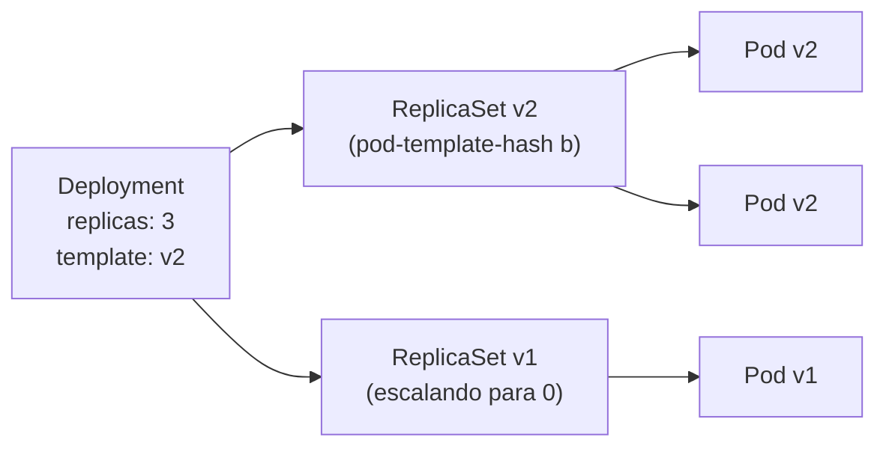

# Deployment

## Definição em uma frase

O Deployment é o workload padrão para **aplicações sem estado**: declara quantas réplicas de um [Pod](pod.md) devem rodar e gerencia [ReplicaSets](replicaset.md) para criá-las e para **atualizar a aplicação de forma controlada** (rollouts e rollbacks).

## Explicação didática

Você diz "quero 3 réplicas desta imagem", e o Deployment cuida do resto. Quando você troca a imagem, ele não altera os Pods existentes: cria um **ReplicaSet novo** com o novo template e vai transferindo as réplicas do ReplicaSet antigo para o novo, aos poucos. Se algo der errado, dá para voltar para a revisão anterior.

```text
Deployment ─┬─► ReplicaSet (revisão nova)  ─► Pods novos
            └─► ReplicaSet (revisão antiga) ─► Pods antigos (escalando para 0)
```

## Para que existe e qual problema resolve

Automatiza o ciclo de vida de aplicações sem estado: manter o número de réplicas, atualizar sem indisponibilidade, pausar, retomar e voltar versões.

## Funcionamento técnico e ciclo de vida

- **Rollout:** é disparado **se e somente se** o Pod Template (`.spec.template`) mudar. Mudar só `replicas` não cria revisão nova.
- **Estratégias:** `RollingUpdate` (padrão) e `Recreate`. No RollingUpdate, os padrões são `maxUnavailable: 25%` (ao menos 75% das réplicas disponíveis) e `maxSurge: 25%` (até 125% das réplicas existindo durante a troca). Detalhes no lote 3 desta categoria.
- **Label `pod-template-hash`:** adicionada pelo controller aos ReplicaSets e Pods para distinguir as revisões. Não a altere.
- **Seletor imutável:** em `apps/v1`, o `.spec.selector` precisa ser definido e é **imutável** depois da criação; ele deve casar com as labels do template.
- **Histórico:** ReplicaSets antigos são mantidos (escalados a 0) para permitir rollback, segundo o `revisionHistoryLimit`.
- **Progresso:** se o rollout não avança dentro do `progressDeadlineSeconds`, a condição `Progressing` fica `False` com `reason: ProgressDeadlineExceeded`.

## Relações e dependências

- Gerencia [ReplicaSets](replicaset.md), que gerenciam [Pods](pod.md) (cadeia de [OwnerReference](../../00-fundamentos-e-linguagem/verbetes/owner-reference.md)).
- Reconciliado pelo controller de Deployment no [kube-controller-manager](../../01-arquitetura-e-control-plane/verbetes/kube-controller-manager.md).
- Exposto por [Service](../../04-networking/verbetes/service.md) e escalado automaticamente por HPA (lote 3).
- Substitui o [DeploymentConfig](deploymentconfig.md), deprecated no OpenShift.

## Exemplo de situação real

Uma nova versão com defeito é publicada. Os Pods novos não ficam prontos, o rollout para (o RollingUpdate não derruba os Pods antigos além do `maxUnavailable`) e a condição `Progressing` acusa o atraso. O time faz rollback e a versão anterior volta a atender.

## Como visualizar e inspecionar (somente leitura)

```bash
# Réplicas desejadas, atualizadas, disponíveis
oc get deployments -n <namespace>

# Condições, estratégia, eventos de rollout
oc describe deployment <nome> -n <namespace>

# ReplicaSets do Deployment (revisões)
oc get replicasets -n <namespace> -l <label-do-app>

# Histórico e estado do rollout (leitura)
oc rollout history deployment/<nome> -n <namespace>
oc rollout status deployment/<nome> -n <namespace>
```

## Como interpretar a saída

- `READY 3/3`, `UP-TO-DATE 3`, `AVAILABLE 3`: Deployment estável na última revisão.
- `UP-TO-DATE` menor que o desejado: rollout em andamento.
- Condições: `Available=True` (réplicas mínimas disponíveis) e `Progressing=True` com `reason: NewReplicaSetAvailable` (rollout concluído). `ProgressDeadlineExceeded` indica rollout travado.
- Vários ReplicaSets com `DESIRED 0` são as revisões antigas guardadas para rollback.

## Diferenças e confusões frequentes

- **Deployment × ReplicaSet:** quem gerencia versões × quem mantém o número de réplicas de uma versão.
- **Deployment × StatefulSet:** réplicas intercambiáveis × réplicas com identidade e armazenamento próprios.
- **Deployment × DeploymentConfig:** o padrão do Kubernetes × o recurso legado do OpenShift, deprecated desde o 4.14.

## No OpenShift 4.22 versus Kubernetes

Mesmo objeto (`apps/v1`). No OpenShift é **o** recurso recomendado para aplicações sem estado, no lugar do DeploymentConfig.

## No HomeLab SNO

Use Deployments com poucas réplicas e requests modestos nas aplicações de estudo. Os comandos acima são de leitura; `oc rollout undo` e `oc scale` são alterações.

## Diagrama



## Termos relacionados

[ReplicaSet](replicaset.md) · [Pod](pod.md) · [Pod Template](pod-template.md) · [StatefulSet](statefulset.md) · [DeploymentConfig](deploymentconfig.md) · [Service](../../04-networking/verbetes/service.md) · [Conditions](../../00-fundamentos-e-linguagem/verbetes/conditions.md)

## Fontes oficiais

- Kubernetes — Deployments (rollout pelo template, `pod-template-hash`, 25%/25%, seletor imutável, `ProgressDeadlineExceeded`): <https://kubernetes.io/docs/concepts/workloads/controllers/deployment/> (fonte: `kubernetes/website` `release-1.35`, `concepts/workloads/controllers/deployment.md`)
- OCP 4.22 — Release notes, tabela de deprecated (`DeploymentConfig`): <https://docs.redhat.com/en/documentation/openshift_container_platform/4.22/html/release_notes/ocp-4-22-release-notes>

<details>
<summary>Ficha técnica e notas de revisão</summary>

**Ficha técnica**

- **ID:** 03-workloads/deployment
- **Termo original:** Deployment
- **Tradução:** implantação (só como apoio)
- **Classe ontológica:** objeto da API
- **API:** `apiVersion: apps/v1`, `kind: Deployment`
- **Plataforma:** Kubernetes / OpenShift
- **Escopo:** namespaced
- **Disponibilidade:** nativo
- **Versões validadas:** Kubernetes 1.35 / OCP 4.22
- **Nível:** básico
- **Atualizado em:** 2026-11-08

**Notas de revisão**

- **Estado:** desenvolvido (antes era uma versão inicial). Fontes conferidas em 2026-11-08.
- **Pendências:** os valores padrão de `revisionHistoryLimit` (10) e `progressDeadlineSeconds` (600 s) são conhecidos da referência da API, mas **não foram localizados** literalmente na página lida; confirmar com `oc explain deployment.spec`.

</details>
