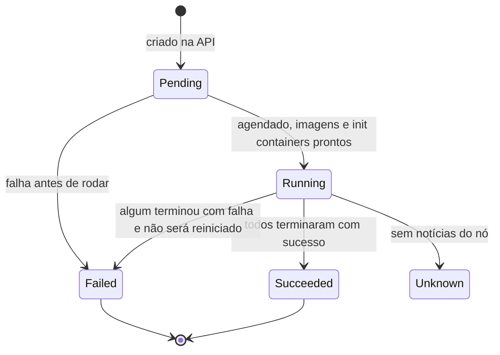

# Pod Lifecycle

## Definição em uma frase

O Pod Lifecycle é a **sequência de estágios por que um [Pod](pod.md) passa**, da criação na API até o término e a remoção, acompanhada pela [Pod Phase](pod-phase.md), pelas [Pod Conditions](pod-condition.md) e pelos estados de cada contêiner.

## Explicação didática

A vida de um Pod, em linhas gerais:

1. **Criado** na API (por você ou por um controller).
2. **Agendado** uma única vez: o scheduler escolhe o nó (*scheduling*) e grava a escolha (*binding*).
3. **Preparado** no nó: sandbox, rede, volumes, imagens, [init containers](init-container.md).
4. **Em execução:** os contêineres rodam; o kubelet os reinicia conforme a [Restart Policy](restart-policy.md).
5. **Término:** os contêineres terminam sozinhos (Jobs) ou o Pod é apagado ou despejado; há um [Termination Grace Period](termination-grace-period.md) para encerrar com segurança.
6. **Removido** da API.

Um Pod **nunca é reagendado para outro nó**: se o nó falha, o Pod é perdido, e o controller cria **outro** Pod.

## Para que existe e qual problema resolve

Entender o ciclo permite saber **em que ponto** algo deu errado: agendamento, preparação, execução ou término.

## Funcionamento técnico e ciclo de vida

- O kubelet reconcilia periodicamente o `spec` do Pod com o estado real dos contêineres. Por isso, o que se vê na API pode ter um pequeno atraso em relação ao nó.
- O `status` do Pod tem um resumo (`phase`), uma lista de condições e o estado de cada contêiner.
- *Scheduling gates* permitem adiar o agendamento até que certas condições sejam removidas.
- Desde o Kubernetes 1.27, o kubelet leva os Pods apagados a uma fase terminal (`Failed` ou `Succeeded`) antes de removê-los da API, exceto Static Pods e Pods apagados à força.

## Relações e dependências

- Indicadores: [Pod Phase](pod-phase.md), [Pod Condition](pod-condition.md) e [Container Lifecycle](container-lifecycle.md).
- Etapas: [Init Container](init-container.md), [Restart Policy](restart-policy.md), [Termination Grace Period](termination-grace-period.md) e [Terminating](terminating.md).
- Atores: [kube-scheduler](../../01-arquitetura-e-control-plane/verbetes/kube-scheduler.md) e [kubelet](../../01-arquitetura-e-control-plane/verbetes/kubelet.md).

## Exemplo de situação real

Um Pod fica `Pending`. Pelo ciclo, há duas hipóteses: não foi agendado (sem nó compatível) ou foi agendado e está preparando-se (baixando a imagem, esperando volume). `spec.nodeName` e os Events dizem qual é o caso.

## Como visualizar e inspecionar (somente leitura)

```bash
# Fase, nó e condições
oc get pod <nome> -n <namespace> -o jsonpath='phase={.status.phase} node={.spec.nodeName}{"\n"}{range .status.conditions[*]}{.type}={.status}{"\n"}{end}'

# Linha do tempo pelos eventos
oc get events -n <namespace> --field-selector involvedObject.name=<nome> --sort-by=.lastTimestamp
```

## Como interpretar a saída

- `node` vazio: o Pod ainda não foi agendado.
- A ordem em que `PodScheduled`, `Initialized`, `ContainersReady` e `Ready` ficam `True` mostra o avanço no ciclo.
- Eventos `Scheduled`, `Pulling`, `Pulled`, `Created`, `Started` contam a preparação passo a passo.

## Diferenças e confusões frequentes

- **Ciclo do Pod × ciclo do contêiner:** o Pod pode estar `Running` enquanto um contêiner reinicia.
- **Reiniciar contêiner × recriar Pod:** o kubelet reinicia contêineres no mesmo Pod; os controllers criam Pods novos.

## No OpenShift 4.22 versus Kubernetes

Mesmo ciclo do Kubernetes 1.35.

## No HomeLab SNO

Bom exercício: crie um Pod de estudo e acompanhe os eventos de ponta a ponta com o comando acima.

## Diagrama



## Termos relacionados

[Pod Phase](pod-phase.md) · [Pod Condition](pod-condition.md) · [Container Lifecycle](container-lifecycle.md) · [Restart Policy](restart-policy.md) · [Termination Grace Period](termination-grace-period.md) · [Pod](pod.md)

## Fontes oficiais

- Kubernetes — Pod Lifecycle, "Pod lifetime" e "Pod phase": <https://kubernetes.io/docs/concepts/workloads/pods/pod-lifecycle/> (fonte: `kubernetes/website` `release-1.35`, `concepts/workloads/pods/pod-lifecycle.md`)

<details>
<summary>Ficha técnica e notas de revisão</summary>

**Ficha técnica**

- **ID:** 03-workloads/pod-lifecycle
- **Termo original:** Pod lifecycle
- **Remissões:** scheduling, binding, scheduling gates
- **Tradução:** ciclo de vida do Pod (só como apoio)
- **Classe ontológica:** conceito
- **Plataforma:** Kubernetes / OpenShift
- **Escopo:** não aplicável
- **Disponibilidade:** nativo
- **Versões validadas:** Kubernetes 1.35 / OCP 4.22
- **Nível:** básico
- **Atualizado em:** 2026-11-08

**Notas de revisão**

- **Estado:** desenvolvido. Fontes conferidas em 2026-11-08.
- **Pendências:** os `reason` dos eventos (`Pulling`, `Pulled`, `Created`, `Started`) são os mostrados na documentação; confirmar no SNO.

</details>
