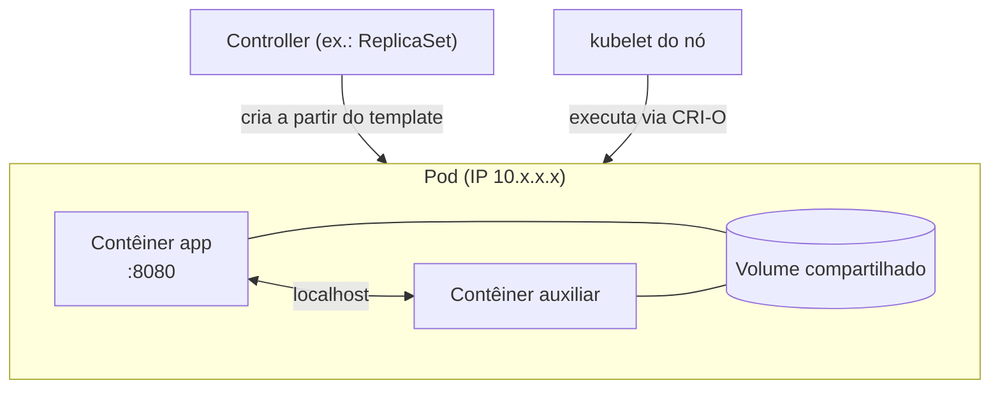

# Pod

## Definição em uma frase

O Pod é a **menor unidade implantável** do Kubernetes: um grupo de um ou mais [contêineres](container.md) que são agendados juntos no mesmo nó e compartilham rede, armazenamento e o mesmo contexto de execução.

## Explicação didática

O Pod **não é um contêiner**. É o "host lógico" onde os contêineres vivem: um ambiente com um IP próprio, volumes e limites de recursos. No caso mais comum, o Pod tem um único contêiner, e o Kubernetes gerencia o Pod, e não o contêiner diretamente. Às vezes, um Pod reúne vários contêineres fortemente acoplados, que precisam dividir recursos (por exemplo, a aplicação e um auxiliar que coleta os seus logs).

Pods são **efêmeros e descartáveis**. Você quase nunca os cria diretamente: quem os cria são os controllers de workload ([Deployment](deployment.md), [StatefulSet](statefulset.md), [Job](job.md)...) a partir de um [Pod Template](pod-template.md).

## Para que existe e qual problema resolve

Dá ao Kubernetes uma unidade padronizada de execução, com identidade, rede e recursos próprios, sobre a qual controllers, scheduler e kubelet trabalham.

## Funcionamento técnico e ciclo de vida

- **Contexto compartilhado:** um conjunto de namespaces do Linux e [cgroups](../../02-compute-e-nodes/verbetes/cgroups.md). Os contêineres do mesmo Pod dividem o **IP e o espaço de portas** e se falam por `localhost`.
- **Ciclo:** criado na API → agendado num nó pelo [kube-scheduler](../../01-arquitetura-e-control-plane/verbetes/kube-scheduler.md) → executado pelo [kubelet](../../01-arquitetura-e-control-plane/verbetes/kubelet.md). O Pod fica no nó até terminar, ser apagado, ser despejado por falta de recursos ou o nó falhar.
- **Reiniciar um contêiner ≠ reiniciar o Pod:** o Pod é um ambiente, não um processo; ele persiste até ser apagado.
- **Atualização:** a maior parte do `spec` é imutável. Mudanças no template de um workload geram **Pods novos**, em vez de alterar os existentes.
- **Nome:** um *DNS subdomain* válido. Para compatibilidade com o hostname, a documentação recomenda seguir as regras mais estritas de *DNS label*.

## Relações e dependências

- Criado por controllers a partir de um [Pod Template](pod-template.md); dono típico: [ReplicaSet](replicaset.md), [StatefulSet](statefulset.md), [DaemonSet](daemonset.md) ou [Job](job.md).
- Recebe IP da rede do cluster ([OVN-Kubernetes](../../01-arquitetura-e-control-plane/verbetes/ovn-kubernetes.md)); é alcançado por um [Service](../../04-networking/verbetes/service.md).
- Recursos e QoS: [Resource Request](../../02-compute-e-nodes/verbetes/resource-request.md) e [QoS Class](../../02-compute-e-nodes/verbetes/qos-class.md).

## Exemplo de situação real

Alguém apaga um Pod de um Deployment para "reiniciá-lo", e ele volta com outro nome e outro IP. É o comportamento esperado: o controller recriou o Pod a partir do template. Por isso as aplicações se comunicam por Services, e não pelo IP de Pods.

## Como visualizar e inspecionar (somente leitura)

```bash
# Pods do namespace com nó, IP e estado
oc get pods -n <namespace> -o wide

# Detalhes: contêineres, condições, eventos
oc describe pod <nome> -n <namespace>

# Dono do Pod (quem o recria)
oc get pod <nome> -n <namespace> -o jsonpath='{range .metadata.ownerReferences[*]}{.kind}/{.name}{"\n"}{end}'

# Logs de um contêiner
oc logs <nome> -n <namespace> -c <contêiner>
```

## Como interpretar a saída

- `READY 1/1`: contêineres prontos sobre o total. `STATUS` é um resumo (`Running`, `Pending`, `CrashLoopBackOff`...); os detalhes de fase e estados estão no lote 2 desta categoria.
- `RESTARTS` crescente: um contêiner está terminando e sendo reiniciado. Veja `oc describe` e os logs com `--previous`.
- Pod sem `ownerReferences`: foi criado diretamente e não será recriado se apagado.

## Diferenças e confusões frequentes

- **Pod × contêiner:** ambiente × processo isolado dentro dele.
- **Pod × Deployment:** a instância × quem mantém as instâncias.
- **Vários contêineres no Pod ≠ escalar:** para mais réplicas, use mais Pods (um workload), e não mais contêineres no mesmo Pod.

## No OpenShift 4.22 versus Kubernetes

O objeto é o mesmo. No OpenShift, os Pods passam pelas SCCs (por padrão, `restricted-v2`, que impede rodar como root; categoria 08) e recebem rede do OVN-Kubernetes.

## No HomeLab SNO

Todos os Pods, da plataforma e das aplicações, rodam no mesmo nó. Observe com `oc get pods -A -o wide` para ver o conjunto.

## Diagrama



## Termos relacionados

[Container](container.md) · [Pod Template](pod-template.md) · [Deployment](deployment.md) · [ReplicaSet](replicaset.md) · [Service](../../04-networking/verbetes/service.md) · [kubelet](../../01-arquitetura-e-control-plane/verbetes/kubelet.md) · [Static Pod](../../01-arquitetura-e-control-plane/verbetes/static-pod.md)

## Fontes oficiais

- Kubernetes — Pods (o que é, uso com controllers, templates, atualização, rede): <https://kubernetes.io/docs/concepts/workloads/pods/> (fonte: `kubernetes/website` `release-1.35`, `concepts/workloads/pods/_index.md`)

<details>
<summary>Ficha técnica e notas de revisão</summary>

**Ficha técnica**

- **ID:** 03-workloads/pod
- **Termo original:** Pod
- **Tradução:** não se traduz (literalmente, "cápsula" ou "grupo")
- **Classe ontológica:** objeto da API
- **API:** `apiVersion: v1` (grupo *core*), `kind: Pod`
- **Plataforma:** Kubernetes / OpenShift
- **Escopo:** namespaced
- **Disponibilidade:** nativo
- **Versões validadas:** Kubernetes 1.35 / OCP 4.22
- **Nível:** básico
- **Atualizado em:** 2026-11-08

**Notas de revisão**

- **Estado:** desenvolvido (antes era uma versão inicial). Fontes conferidas em 2026-11-08.
- **Pendências:** confirmar no SNO a SCC aplicada por padrão (`openshift.io/scc` nas annotations do Pod), o que **não foi executado**.

</details>
