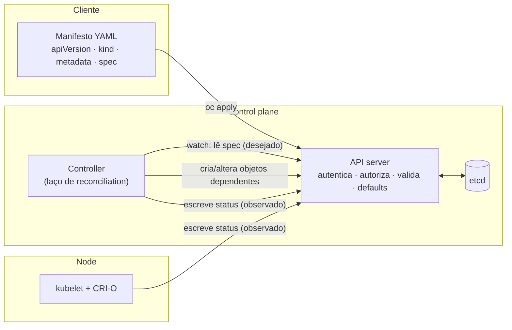

# Modelo declarativo — do manifesto à reconciliation

**Como ler:**

1. O manifesto vira um [objeto](../categorias/00-fundamentos-e-linguagem/verbetes/object.md) persistido. O [`spec`](../categorias/00-fundamentos-e-linguagem/verbetes/spec.md) é o [desired state](../categorias/00-fundamentos-e-linguagem/verbetes/desired-state.md).
2. Controllers observam pela API, comparam e agem: é a [reconciliation](../categorias/00-fundamentos-e-linguagem/verbetes/reconciliation.md). Eles nunca falam direto com o etcd.
3. O resultado volta como [`status`](../categorias/00-fundamentos-e-linguagem/verbetes/status.md), que é o [current state](../categorias/00-fundamentos-e-linguagem/verbetes/current-state.md).

*Simplificação didática: o scheduler, os admission webhooks e o encadeamento entre vários controllers foram omitidos.*
