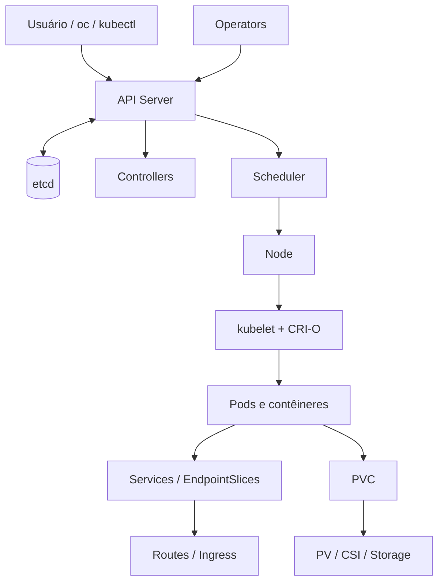

# Mapa mental — Kubernetes e OpenShift

As setas simplificam relações e não representam todos os fluxos físicos de tráfego. A publicação Route/Ingress é operacionalizada por controladores próprios.
