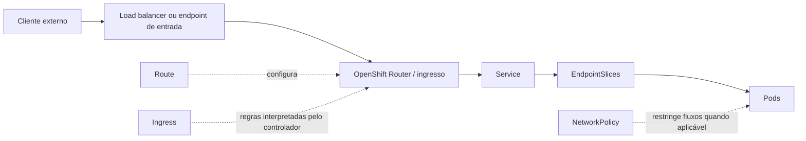

# Tráfego e publicação de aplicações

`Ingress` (objeto), `Route` (objeto OpenShift) e `IngressController` (recurso do operador) não são a mesma coisa. O desenho representa um cenário típico, não topologia obrigatória de todos os clusters.
