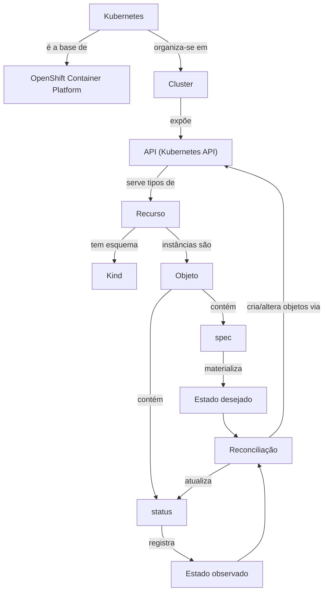

# Mapa de relações

> Relações entre os verbetes **desenvolvidos**. As setas indicam o sentido da relação descrita no rótulo; não indicam fluxo de rede. Ele cresce a cada lote.

## Categoria 00 — o modelo declarativo

## Tabela de relações (lote 1)

| De | Relação | Para |
|---|---|---|
| [Kubernetes](../categorias/00-fundamentos-e-linguagem/verbetes/kubernetes.md) | é a base de | [OpenShift Container Platform](../categorias/00-fundamentos-e-linguagem/verbetes/openshift-container-platform.md) |
| [Cluster](../categorias/00-fundamentos-e-linguagem/verbetes/cluster.md) | contém | [Node](../categorias/02-compute-e-nodes/verbetes/node.md), [Namespace](../categorias/00-fundamentos-e-linguagem/verbetes/namespace.md) |
| [API](../categorias/00-fundamentos-e-linguagem/verbetes/kubernetes-api.md) | serve | [Recurso](../categorias/00-fundamentos-e-linguagem/verbetes/resource.md) |
| [Recurso](../categorias/00-fundamentos-e-linguagem/verbetes/resource.md) | é descrito pelo | [Kind](../categorias/00-fundamentos-e-linguagem/verbetes/kind.md) |
| [Recurso](../categorias/00-fundamentos-e-linguagem/verbetes/resource.md) | pode ser estendido por | [CustomResourceDefinition](../categorias/09-operators-e-extensoes/verbetes/customresourcedefinition.md) |
| [Objeto](../categorias/00-fundamentos-e-linguagem/verbetes/object.md) | tem | [Spec](../categorias/00-fundamentos-e-linguagem/verbetes/spec.md) e [Status](../categorias/00-fundamentos-e-linguagem/verbetes/status.md) |
| [Spec](../categorias/00-fundamentos-e-linguagem/verbetes/spec.md) | materializa | [Estado desejado](../categorias/00-fundamentos-e-linguagem/verbetes/desired-state.md) |
| [Status](../categorias/00-fundamentos-e-linguagem/verbetes/status.md) | registra | [Estado observado](../categorias/00-fundamentos-e-linguagem/verbetes/current-state.md) |
| [Reconciliação](../categorias/00-fundamentos-e-linguagem/verbetes/reconciliation.md) | é executada por | [Operator](../categorias/09-operators-e-extensoes/verbetes/operator.md), controllers nativos |
| [Reconciliação](../categorias/00-fundamentos-e-linguagem/verbetes/reconciliation.md) | encadeia | [Deployment](../categorias/03-workloads/verbetes/deployment.md) → [ReplicaSet](../categorias/03-workloads/verbetes/replicaset.md) → [Pod](../categorias/03-workloads/verbetes/pod.md) |
| [OpenShift Container Platform](../categorias/00-fundamentos-e-linguagem/verbetes/openshift-container-platform.md) | relata a saúde da plataforma em | [ClusterOperator](../categorias/09-operators-e-extensoes/verbetes/clusteroperator.md) |

## Distinções críticas já tratadas

- **Recurso × Kind × Objeto:** `deployments` (URL/RBAC) × `Deployment` (esquema) × o Deployment `web` (instância).
- **`status` (campo) × coluna `STATUS` × kind `Status`:** três coisas diferentes.
- **Estado desejado no Git × estado desejado na API:** só vale o que está na API.

## Categoria 00 — lote 2: API, identidade e formatos

| De | Relação | Para |
|---|---|---|
| [Manifest](../categorias/00-fundamentos-e-linguagem/verbetes/manifest.md) | é escrito em | [YAML](../categorias/00-fundamentos-e-linguagem/verbetes/yaml.md) ou [JSON](../categorias/00-fundamentos-e-linguagem/verbetes/json.md) |
| [API Server](../categorias/00-fundamentos-e-linguagem/verbetes/api-server.md) | serve | [API Group](../categorias/00-fundamentos-e-linguagem/verbetes/api-group.md) → [API Version](../categorias/00-fundamentos-e-linguagem/verbetes/api-version.md) |
| [Metadata](../categorias/00-fundamentos-e-linguagem/verbetes/metadata.md) | identifica por | [Resource Name](../categorias/00-fundamentos-e-linguagem/verbetes/resource-name.md), [UID](../categorias/00-fundamentos-e-linguagem/verbetes/uid.md), [Namespace](../categorias/00-fundamentos-e-linguagem/verbetes/namespace.md) |
| [Controller](../categorias/00-fundamentos-e-linguagem/verbetes/controller.md) | executa | [Reconciliação](../categorias/00-fundamentos-e-linguagem/verbetes/reconciliation.md) |

## Distinções críticas do lote 2

- **API × API Server × OpenShift API server:** contrato × componente × servidor dos grupos `*.openshift.io`.
- **Nome × UID:** o nome se reutiliza; o UID nunca.
- **Controller (código) × "controllers de workload" (objetos) × IngressController (objeto de configuração).**
- **UID do objeto × UID do processo (SCC).**
