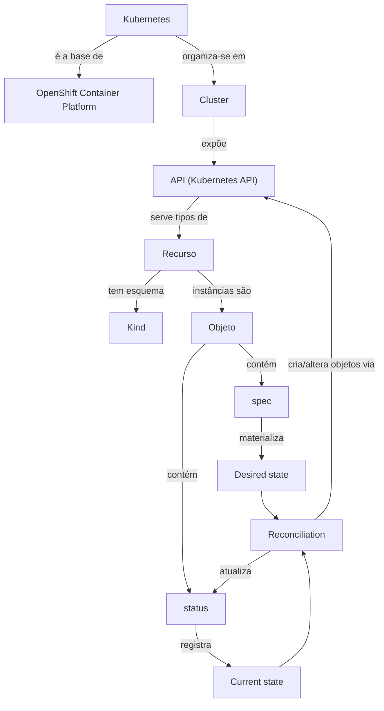
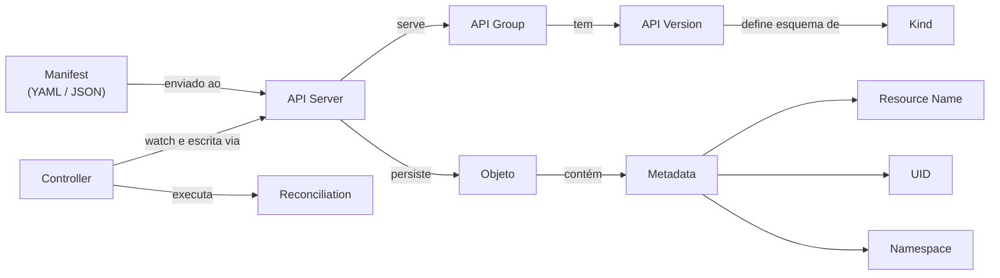
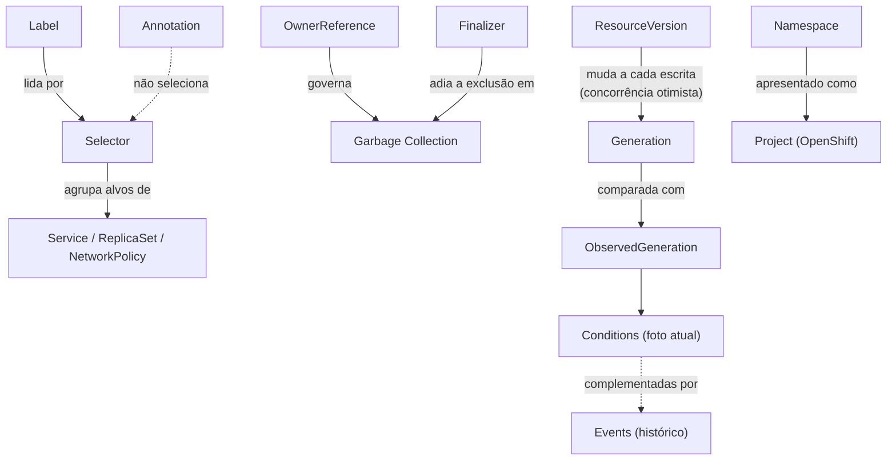
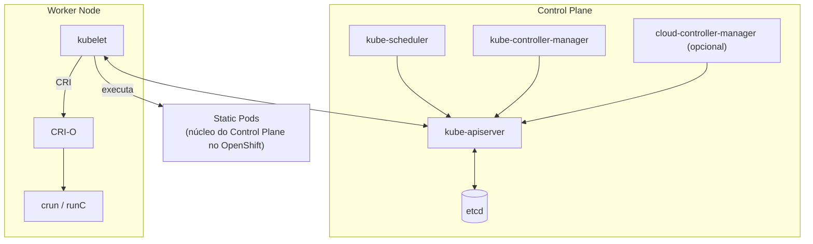
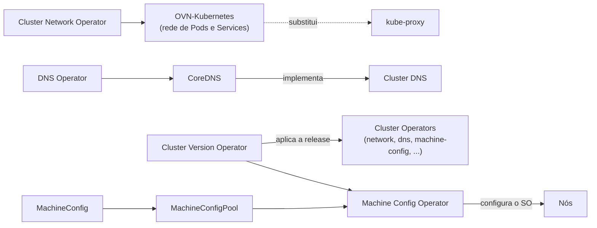
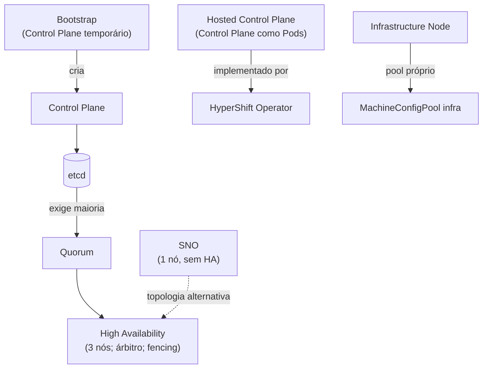

# Mapa de relações

Como os termos do glossário se conectam. As setas indicam o sentido da relação descrita no rótulo, e não fluxo de rede.

## O modelo declarativo

## Relações do modelo declarativo

| De | Relação | Para |
|---|---|---|
| [Kubernetes](../categorias/00-fundamentos-e-linguagem/verbetes/kubernetes.md) | é a base de | [OpenShift Container Platform](../categorias/00-fundamentos-e-linguagem/verbetes/openshift-container-platform.md) |
| [Cluster](../categorias/00-fundamentos-e-linguagem/verbetes/cluster.md) | contém | [Node](../categorias/02-compute-e-nodes/verbetes/node.md), [Namespace](../categorias/00-fundamentos-e-linguagem/verbetes/namespace.md) |
| [API](../categorias/00-fundamentos-e-linguagem/verbetes/kubernetes-api.md) | serve | [Resource](../categorias/00-fundamentos-e-linguagem/verbetes/resource.md) |
| [Resource](../categorias/00-fundamentos-e-linguagem/verbetes/resource.md) | é descrito pelo | [Kind](../categorias/00-fundamentos-e-linguagem/verbetes/kind.md) |
| [Resource](../categorias/00-fundamentos-e-linguagem/verbetes/resource.md) | pode ser estendido por | [CustomResourceDefinition](../categorias/09-operators-e-extensoes/verbetes/customresourcedefinition.md) |
| [Object](../categorias/00-fundamentos-e-linguagem/verbetes/object.md) | tem | [Spec](../categorias/00-fundamentos-e-linguagem/verbetes/spec.md) e [Status](../categorias/00-fundamentos-e-linguagem/verbetes/status.md) |
| [Spec](../categorias/00-fundamentos-e-linguagem/verbetes/spec.md) | materializa | [Desired State](../categorias/00-fundamentos-e-linguagem/verbetes/desired-state.md) |
| [Status](../categorias/00-fundamentos-e-linguagem/verbetes/status.md) | registra | [Current State](../categorias/00-fundamentos-e-linguagem/verbetes/current-state.md) |
| [Reconciliation](../categorias/00-fundamentos-e-linguagem/verbetes/reconciliation.md) | é executada por | [Operator](../categorias/09-operators-e-extensoes/verbetes/operator.md), controllers nativos |
| [Reconciliation](../categorias/00-fundamentos-e-linguagem/verbetes/reconciliation.md) | encadeia | [Deployment](../categorias/03-workloads/verbetes/deployment.md) → [ReplicaSet](../categorias/03-workloads/verbetes/replicaset.md) → [Pod](../categorias/03-workloads/verbetes/pod.md) |
| [OpenShift Container Platform](../categorias/00-fundamentos-e-linguagem/verbetes/openshift-container-platform.md) | relata a saúde da plataforma em | [ClusterOperator](../categorias/09-operators-e-extensoes/verbetes/clusteroperator.md) |

## Distinções importantes: modelo declarativo

- **Recurso × Kind × Objeto:** `deployments` (URL/RBAC) × `Deployment` (esquema) × o Deployment `web` (instância).
- **`status` (campo) × coluna `STATUS` × kind `Status`:** três coisas diferentes.
- **Desired state no Git × desired state na API:** só vale o que está na API.

## API, identidade e formatos

| De | Relação | Para |
|---|---|---|
| [Manifest](../categorias/00-fundamentos-e-linguagem/verbetes/manifest.md) | é escrito em | [YAML](../categorias/00-fundamentos-e-linguagem/verbetes/yaml.md) ou [JSON](../categorias/00-fundamentos-e-linguagem/verbetes/json.md) |
| [API Server](../categorias/00-fundamentos-e-linguagem/verbetes/api-server.md) | serve | [API Group](../categorias/00-fundamentos-e-linguagem/verbetes/api-group.md) → [API Version](../categorias/00-fundamentos-e-linguagem/verbetes/api-version.md) |
| [Metadata](../categorias/00-fundamentos-e-linguagem/verbetes/metadata.md) | identifica por | [Resource Name](../categorias/00-fundamentos-e-linguagem/verbetes/resource-name.md), [UID](../categorias/00-fundamentos-e-linguagem/verbetes/uid.md), [Namespace](../categorias/00-fundamentos-e-linguagem/verbetes/namespace.md) |
| [Controller](../categorias/00-fundamentos-e-linguagem/verbetes/controller.md) | executa | [Reconciliation](../categorias/00-fundamentos-e-linguagem/verbetes/reconciliation.md) |

## Distinções importantes: API, identidade e controllers

- **API × API Server × OpenShift API server:** contrato × componente × servidor dos grupos `*.openshift.io`.
- **Nome × UID:** o nome se reutiliza; o UID nunca.
- **Controller (código) × "controllers de workload" (objetos) × IngressController (objeto de configuração).**
- **UID do objeto × UID do processo (SCC).**

## Organização, ciclo de vida e sinais de status

| De | Relação | Para |
|---|---|---|
| [Selector](../categorias/00-fundamentos-e-linguagem/verbetes/selector.md) | filtra | [Label](../categorias/00-fundamentos-e-linguagem/verbetes/label.md) |
| [OwnerReference](../categorias/00-fundamentos-e-linguagem/verbetes/owner-reference.md) | é seguida pela | [Garbage Collection](../categorias/00-fundamentos-e-linguagem/verbetes/garbage-collection.md) |
| [Finalizer](../categorias/00-fundamentos-e-linguagem/verbetes/finalizer.md) | adia a remoção de | objetos em exclusão |
| [Generation](../categorias/00-fundamentos-e-linguagem/verbetes/generation.md) | é confirmada por | [ObservedGeneration](../categorias/00-fundamentos-e-linguagem/verbetes/observed-generation.md) |
| [Conditions](../categorias/00-fundamentos-e-linguagem/verbetes/conditions.md) | são complementadas por | [Events](../categorias/00-fundamentos-e-linguagem/verbetes/events.md) |
| [Project](../categorias/00-fundamentos-e-linguagem/verbetes/project.md) | é a visão OpenShift de | [Namespace](../categorias/00-fundamentos-e-linguagem/verbetes/namespace.md) |

## Distinções importantes: organização e sinais

- **Label × Annotation × OwnerReference:** seleção × documentação para ferramentas × propriedade e ciclo de vida.
- **ResourceVersion × Generation:** qualquer escrita × mudança no desired state.
- **Conditions × Events × phase:** foto atual × histórico × resumo antigo.

## Control Plane e componentes do nó

| De | Relação | Para |
|---|---|---|
| [Control Plane](../categorias/01-arquitetura-e-control-plane/verbetes/control-plane.md) | é formado por | [etcd](../categorias/01-arquitetura-e-control-plane/verbetes/etcd.md), [kube-scheduler](../categorias/01-arquitetura-e-control-plane/verbetes/kube-scheduler.md), [kube-controller-manager](../categorias/01-arquitetura-e-control-plane/verbetes/kube-controller-manager.md), [API Server](../categorias/00-fundamentos-e-linguagem/verbetes/api-server.md) |
| [kubelet](../categorias/01-arquitetura-e-control-plane/verbetes/kubelet.md) | usa, via [CRI](../categorias/01-arquitetura-e-control-plane/verbetes/cri.md) | [CRI-O](../categorias/01-arquitetura-e-control-plane/verbetes/cri-o.md) |
| [Static Pod](../categorias/01-arquitetura-e-control-plane/verbetes/static-pod.md) | hospeda, no OpenShift | os componentes do [Control Plane](../categorias/01-arquitetura-e-control-plane/verbetes/control-plane.md) |
| [Master Node](../categorias/01-arquitetura-e-control-plane/verbetes/master-node.md) | é o nome legado/papel de | nó de [Control Plane](../categorias/01-arquitetura-e-control-plane/verbetes/control-plane.md) |

## Distinções importantes: Control Plane e nó

- **Control Plane (função) × master (termo legado e papel no OpenShift).**
- **kube-controller-manager × cloud-controller-manager × OpenShift controller manager.**
- **CRI (interface) × CRI-O (implementação) × crun/runC (runtime de baixo nível).**
- **Static Pod (roda no nó) × mirror Pod (reflexo na API).**

## Rede, DNS e gestão da plataforma

| De | Relação | Para |
|---|---|---|
| [OVN-Kubernetes](../categorias/01-arquitetura-e-control-plane/verbetes/ovn-kubernetes.md) | substitui, no OpenShift | [kube-proxy](../categorias/01-arquitetura-e-control-plane/verbetes/kube-proxy.md) |
| [DNS Operator](../categorias/01-arquitetura-e-control-plane/verbetes/dns-operator.md) | gerencia | [CoreDNS](../categorias/01-arquitetura-e-control-plane/verbetes/coredns.md), que implementa o [Cluster DNS](../categorias/01-arquitetura-e-control-plane/verbetes/cluster-dns.md) |
| [Cluster Version Operator](../categorias/01-arquitetura-e-control-plane/verbetes/cluster-version-operator.md) | gerencia o ciclo de vida de | [ClusterOperators](../categorias/09-operators-e-extensoes/verbetes/clusteroperator.md) |
| [MachineConfigPool](../categorias/01-arquitetura-e-control-plane/verbetes/machineconfigpool.md) | agrupa nós e | [MachineConfigs](../categorias/01-arquitetura-e-control-plane/verbetes/machineconfig.md), aplicados pelo [Machine Config Operator](../categorias/01-arquitetura-e-control-plane/verbetes/machine-config-operator.md) |

## Distinções importantes: rede e gestão da plataforma

- **Cluster DNS (função) × CoreDNS (software) × DNS Operator (gestão).**
- **CVO (Operators da plataforma, via release image) × OLM (Operators opcionais).**
- **MachineConfigPool (configuração de nós) × machine set (criação de máquinas).**

## Topologias, instalação e disponibilidade

| De | Relação | Para |
|---|---|---|
| [Bootstrap](../categorias/01-arquitetura-e-control-plane/verbetes/bootstrap.md) | cria | o [Control Plane](../categorias/01-arquitetura-e-control-plane/verbetes/control-plane.md) de produção |
| [Quorum](../categorias/01-arquitetura-e-control-plane/verbetes/quorum.md) | determina a | [High Availability](../categorias/01-arquitetura-e-control-plane/verbetes/high-availability.md) do Control Plane |
| [SNO](../categorias/01-arquitetura-e-control-plane/verbetes/sno.md) | é a topologia sem | [High Availability](../categorias/01-arquitetura-e-control-plane/verbetes/high-availability.md) |
| [Hosted Control Plane](../categorias/01-arquitetura-e-control-plane/verbetes/hosted-control-plane.md) | é implementado pelo | [HyperShift](../categorias/01-arquitetura-e-control-plane/verbetes/hypershift.md) |
| [Infrastructure Node](../categorias/01-arquitetura-e-control-plane/verbetes/infrastructure-node.md) | é gerenciado pelo pool personalizado de | [MachineConfigPool](../categorias/01-arquitetura-e-control-plane/verbetes/machineconfigpool.md) |

## Distinções importantes: topologias

- **SNO (um nó, sem HA) × compact/three-node (três nós com HA) × Two-Node with Arbiter × two-node com fencing.**
- **Hosted Control Plane (modelo) × HyperShift (software) × management cluster × managed cluster (RHACM).**
- **HA (contra falhas de máquinas) × backup (contra perda de dados).**
